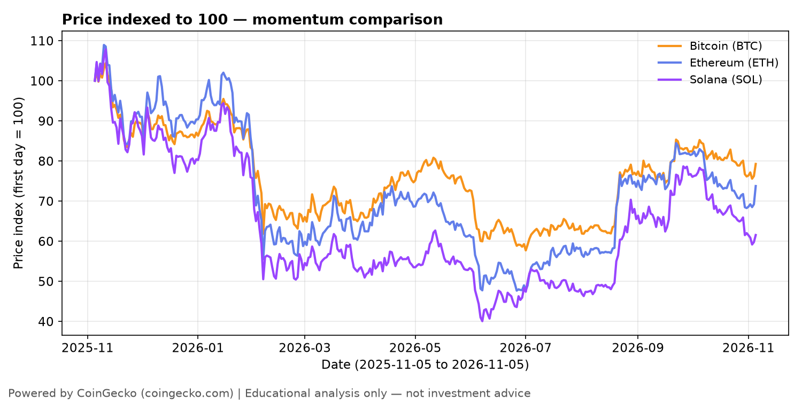
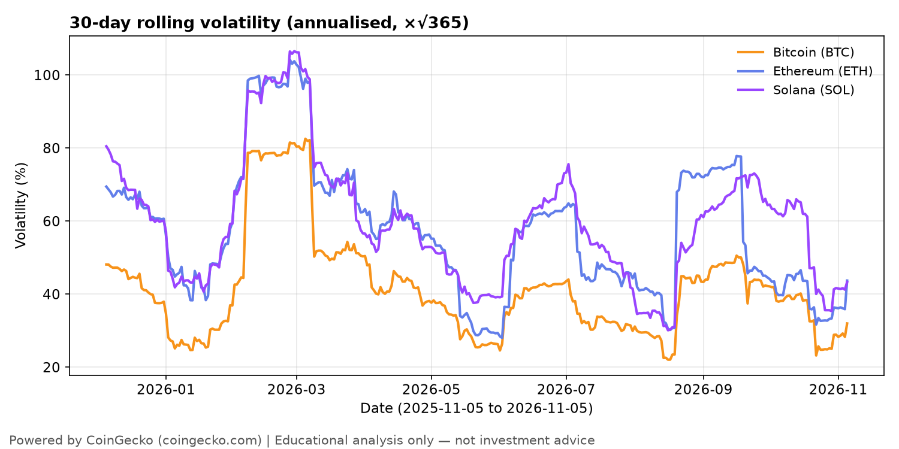
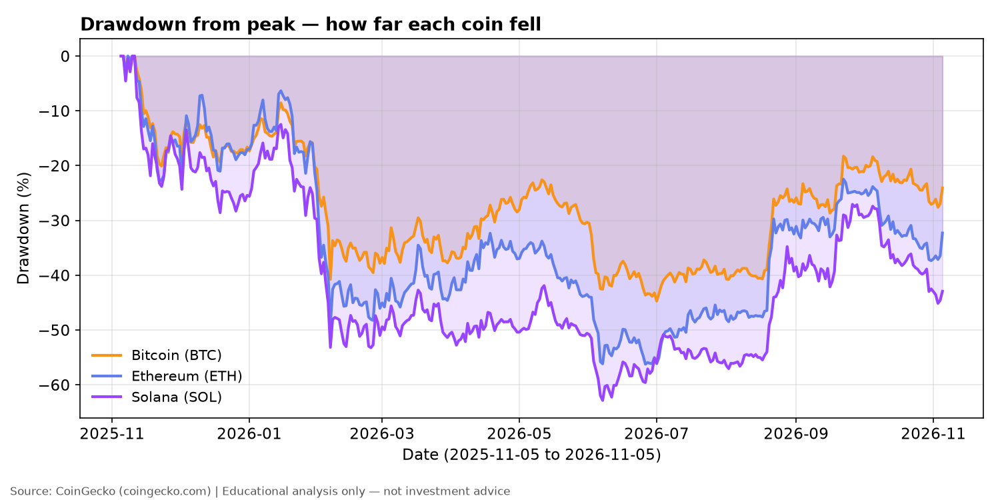
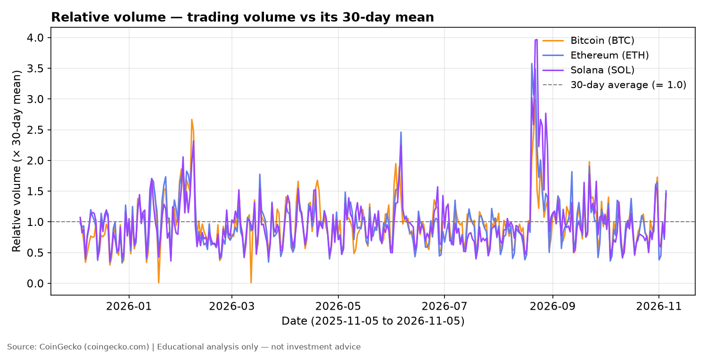
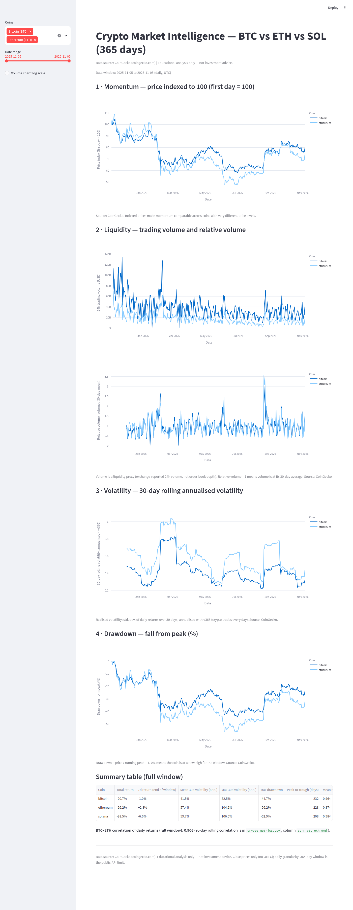

# Day 1 — Crypto Market Intelligence Dashboard

> **60-Day Data Analytics + AI Portfolio, Day 1.** A descriptive, end-to-end
> analysis of how Bitcoin, Ethereum, and Solana behaved over the past year —
> momentum, realised volatility, liquidity, and drawdown — built from a live
> public API, with documented provenance, a validated metric, and honest
> limitations.

## Problem

Retail crypto observers (and hiring managers reviewing this portfolio) can
see today's price, but not how the major coins actually behaved over the
past year: which one had stronger momentum, which was more volatile, where
liquidity dried up, and how deep and long the worst falls were.

**Business question:** *How did Bitcoin and Ethereum differ in price
momentum, realized volatility, liquidity proxies, and drawdown over the
past 366 daily observations?* Solana is included as a third comparator where it adds
contrast, not as a co-lead.

**Audience:** retail crypto observers who want a plain-English answer to
"which coin was steadier, which moved harder, and when did it hurt most?";
hiring managers / portfolio reviewers looking for end-to-end craft
(provenance, reproducible pipeline, labelled charts, a validated metric);
and future self (Days 2–60) reusing this fetch → clean → metrics →
charts → app template.

**Scope — hard limits:** descriptive analytics only. **No buy/sell
recommendation, no price prediction, no investment advice.**
*Educational analysis only — not investment advice.*

## Dataset

- **Source:** CoinGecko public API — https://api.coingecko.com/api/v3
  (Powered by [CoinGecko](https://www.coingecko.com))
- **Endpoint:** `GET /coins/{bitcoin,ethereum,solana}/market_chart/range?vs_currency=usd&from=1762300800&to=1793836800`
- **Date accessed:** 2026-11-05. **Keyless (no API key) — HTTP 200 for all
  three coins.** No Demo key was needed or used.
- **Time range:** 2025-11-05 → 2026-11-05, daily granularity (00:00 UTC),
  366 rows per coin, no gaps or duplicates.
- **Fields:** `prices`, `market_caps`, `total_volumes` (each
  `[timestamp_ms, value]`; price/market cap/volume in USD) → cleaned to
  `date, coin, price, market_cap, volume`.
- **Terms:** CoinGecko data is free via the public API with attribution;
  the raw JSONs ARE committed to this public repo as provenance — whether
  that counts as redistribution under CoinGecko's terms is unresolved, and
  no legal certainty is claimed. The Demo plan has no commercial rights;
  attribution alone does not grant them. Full statement, including the
  manual metric validation, is in [`data/README.md`](data/README.md).
- **Data type: REAL CoinGecko data (not synthetic).** If the API had been
  unreachable, a deterministic synthetic fallback (seed 42) would have been
  used and labelled SYNTHETIC everywhere — that was not needed.

## Tools

Python 3.12 · pandas · numpy · matplotlib · plotly · Streamlit · requests ·
pytest · Jupyter. See [`requirements.txt`](requirements.txt) — exact versions
pinned (`==`) to the versions verified in the build venv (Python 3.12.3).
Code is formatted with `black` and linted with `ruff`; both must pass
(`black --check src tests`, `ruff check src tests`). Dev tools are pinned
in the portfolio-root `requirements-dev.txt` (ruff 0.17.4, black 26.10.1);
lint/format settings live in `pyproject.toml`. CI runs the same checks
on every push / pull request (see `.github/workflows/ci.yml` — the single
consolidated workflow — at the portfolio root).

## Method

1. **Fetch** (`src/data_pipeline.py`): 3 API calls, ≥5 s apart, one retry
   after 60 s on HTTP 429; `range` endpoint preferred, `days=365` fallback.
2. **Clean** (`clean_chart`): merge the three series on timestamp, one row
   per calendar day, drop duplicate timestamps, assert no NaN prices.
3. **Metrics** (`compute_metrics`, per coin): daily return, 7-day rolling
   return, 30-day rolling volatility annualised with √365 (crypto trades
   every day), drawdown from running peak, relative volume (volume / 30-day
   mean), turnover (volume / market cap), BTC–ETH correlation (full window
   and 90-day rolling).
4. **Charts + app + notebook:** all read only the processed CSVs
   (`data/processed/crypto_daily.csv`, `crypto_metrics.csv`).
5. **Validation:** BTC max drawdown recomputed by hand in the notebook —
   peak $105,951.50 (2025-11-11) → trough $58,566.09 (2026-07-01) =
   −44.7237%, matching the pipeline exactly.

## Key insights

1. **Momentum — a down year, Bitcoin losing least.** Indexed to 100 on
   2025-11-05: BTC ended at 79.3 (−20.7%), ETH at 73.8 (−26.2%), SOL at
   61.5 (−38.5%). All three peaked within a week of the window start and
   never regained it.
2. **Volatility & drawdown — Bitcoin was steadier.** Mean 30-day annualised
   volatility: BTC 41.5% vs ETH 57.4% vs SOL 59.7%. Max drawdown: BTC
   −44.7% (232 days peak-to-trough), ETH −56.2%, SOL −62.9%; none had
   recovered to its peak by 2026-11-05.
3. **Liquidity — an August 2026 volume surge, and faster ETH/SOL turnover.**
   Relative volume spiked to 3.0× (BTC), 3.6× (ETH) and 4.0× (SOL) in the
   same week (20–23 Aug 2026). Mean turnover: ETH and SOL 0.061 vs BTC
   0.025 — ~2.5× faster. BTC–ETH daily-return correlation: 0.906.

**Recommendation (analytical next step, not investment advice):** add a
non-crypto comparator (e.g. a broad equity index) to test whether the
Feb 2026 volatility spike and Aug 2026 volume surge were crypto-specific
or market-wide, and track turnover weekly as a standing liquidity monitor.
Full findings: [`outputs/insights_summary.md`](outputs/insights_summary.md).

## Visuals











*Dashboard overview: a full-page screenshot of the running Streamlit app
(`streamlit run src/app.py`), captured 2026-11-05. At capture time the
sidebar had Bitcoin and Ethereum selected, so the four in-app charts show
those two coins; the summary table at the bottom covers all three coins.*

## How to run

```bash
python3 -m venv .venv
source .venv/bin/activate        # Windows: .venv\Scripts\activate
pip install -r requirements.txt
python3 src/data_pipeline.py    # fetch CoinGecko -> data/processed/*.csv
python3 src/make_charts.py      # regenerate outputs/charts/*.png
streamlit run src/app.py        # dashboard at http://localhost:8501
pytest tests/ -q                # 14 offline tests
```

Offline quick-start: `python3 src/data_pipeline.py --offline  # no network; uses the committed data/raw/*.json cache`. A clean checkout runs fully offline from the committed processed CSVs (charts/app/tests), and a live fetch is 3 calls ≥5 s apart with a possible 60 s retry on 429.

The notebook runs top-to-bottom with Jupyter:
`jupyter nbconvert --to notebook --execute notebooks/analysis.ipynb`.

## Project structure

```
├── README.md  requirements.txt  .gitignore  LICENSE (MIT)
├── research_brief.md  plan.md
├── data/
│   ├── README.md            # provenance + manual validation
│   ├── raw/                 # verbatim API JSON (committed — small, part of the deliverable)
│   └── processed/           # crypto_daily.csv, crypto_metrics.csv
├── notebooks/analysis.ipynb
├── src/
│   ├── data_pipeline.py     # fetch -> clean -> metrics -> save
│   ├── make_charts.py       # static charts from processed CSVs
│   └── app.py               # Streamlit dashboard (processed CSVs only)
├── outputs/
│   ├── insights_summary.md
│   └── charts/01_price_indexed.png  02_rolling_volatility.png
│             03_drawdown.png  04_relative_volume.png
├── screenshots/dashboard.png
└── tests/test_pipeline.py
```

## Limitations

- Close prices only (no OHLC/ATR); daily granularity; 366 daily
  observations (365-day span) is the public-API cap, and the November 2025
  peaks sit at the very start of the window.
- Volume is a liquidity *proxy* (exchange-reported 24h volume, not
  order-book depth).
- Correlation (0.906 BTC–ETH) describes co-movement, not causation.
- One window, one market regime — all three coins fell over this year;
  nothing here generalises to other periods.

## License

Code: MIT — see [LICENSE](LICENSE) and the portfolio-root [LICENSE](../../LICENSE). Copyright (c) 2026 Victor. Third-party CoinGecko data is **not** covered by the MIT licence; it is under separate CoinGecko terms — see `data/README.md` for the full data-licensing note (including the unresolved redistribution question; no legal certainty is claimed).
