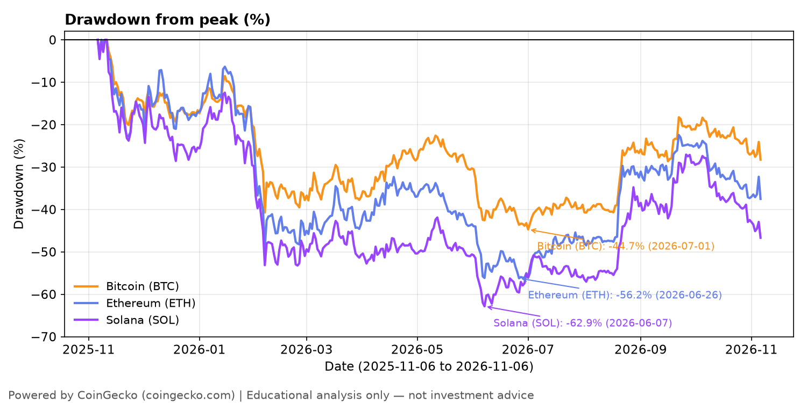
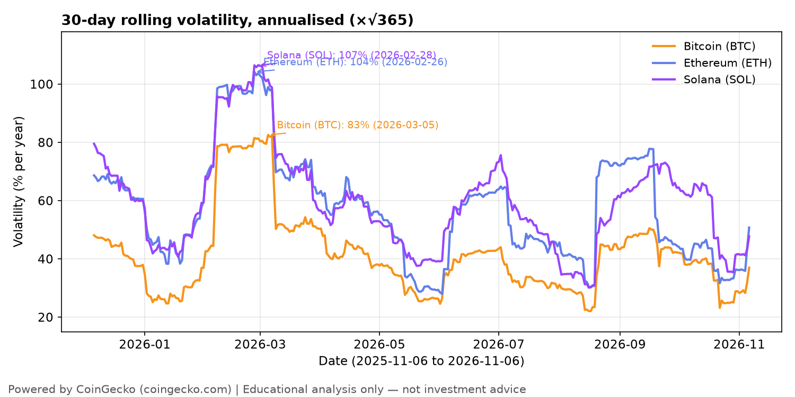
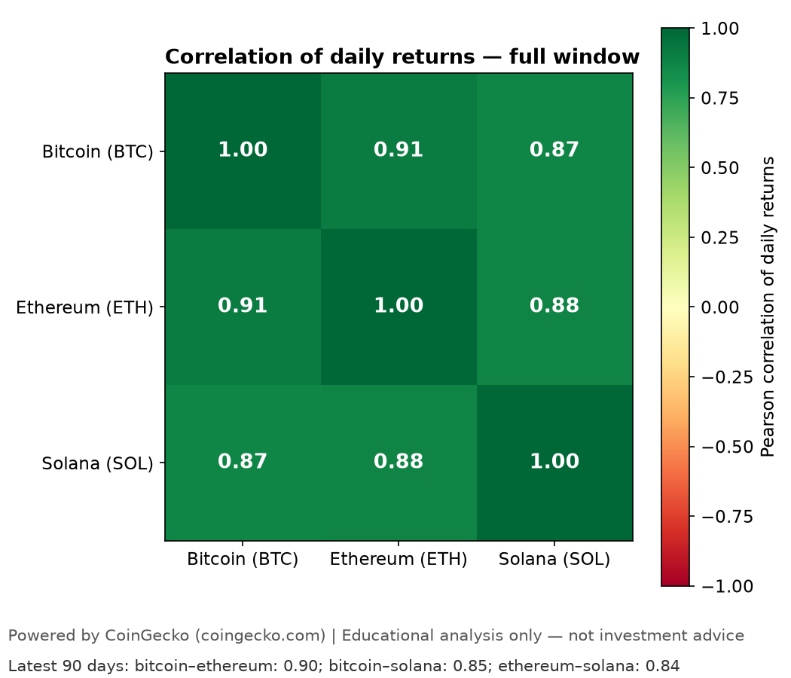
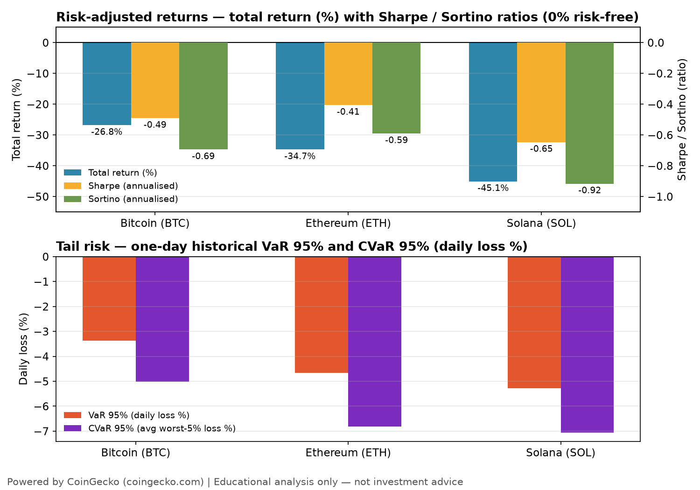

# Day 02 — Crypto Risk & Volatility Analyzer

> **60-Day Data Analytics + AI Portfolio, Day 02.**
> Descriptive, historical risk analysis only. *Educational analysis only — not investment advice.*

## Problem

A holder of Bitcoin, Ethereum and Solana knows the prices went up and down over the past year, but not how much risk each coin actually carried: how far each one fell from its peak and how long it took to climb back, how jumpy its day-to-day moves were, whether the three coins tended to fall together (so holding all three gave little protection), and how much return each delivered for each unit of risk taken. Day 1 described *what happened* to prices; Day 2 measures *how risky it was to hold them*.

**Audience:** a non-expert investor (or prospective holder) assessing portfolio exposure — someone who owns, or is considering owning, one or more of BTC / ETH / SOL and wants a plain-language answer to "how bad could a bad stretch get, and did the return justify the ride?"

## Dataset

- **Source:** CoinGecko public API (`https://api.coingecko.com/api/v3`), no key required.
- **Endpoint:** `GET /coins/{bitcoin,ethereum,solana}/market_chart/range?vs_currency=usd&from=1762387200&to=1793923200` (no `interval` parameter — granularity is automatic).
- **Window:** 2025-11-06 → 2026-11-06 (365-day span, 366 daily observations per coin).
- **Access date:** 2026-11-06. Live fetch, no key (HTTP 200 for all three coins). No synthetic data was used.
- **Rows:** 1,098 total (366 per coin) in `data/processed/crypto_daily.csv`.
- **Licence:** code is MIT (see `LICENSE`); CoinGecko data is under separate CoinGecko terms, not MIT. **Powered by CoinGecko** (https://www.coingecko.com) — attribution is required by CoinGecko's API terms. See `data/README.md` for the full provenance note, including the unresolved question of whether committing verbatim raw API JSON to a public repo counts as redistribution (no legal certainty is claimed either way).

## Tools

Python 3.12.3, pandas, numpy, matplotlib, plotly, Streamlit, requests, pytest, jupyter/nbformat. See `requirements.txt` for pinned versions. Lint/format: ruff + black (line-length 88), pinned in the portfolio-root `requirements-dev.txt`.

## Method

All metrics are computed on the daily, date-aligned frame, per coin, using **simple (arithmetic) daily returns** (`r_t = price_t / price_{t-1} − 1`), never log returns.

| Metric | Definition |
|---|---|
| Max / current drawdown | `price / running_max(price) − 1`; max is the minimum over the window, with peak/trough dates; current is the value on 2026-11-06 |
| Drawdown duration & recovery | Peak-to-trough calendar days; recovery days = days from trough until price first closes at or above the peak price again |
| Rolling 30-day volatility (annualised) | `std(r_{t-29} … r_t) × √365` (sample std, ddof=1; **365**, not 252, because crypto trades every day) |
| Return correlations | Pearson correlation of daily returns, full window and latest 90 days |
| Sharpe ratio (annualised) | `mean(r) / std(r) × √365`, **risk-free rate 0%** |
| Sortino ratio (annualised) | `mean(r) / downside_deviation × √365`, downside deviation = `sqrt(mean(min(r, 0)²))`, risk-free rate 0% |
| Historical VaR 95% (daily) | 5th percentile of daily returns (one-day, 95% historical VaR) |
| Historical CVaR 95% (daily) | Mean of daily returns at or below VaR 95% ("average loss on the worst 5% of days") |

## Key insights

All three coins lost money over the window and none recovered to its peak by 2026-11-06.

| Coin | Total return | Max drawdown | Current drawdown | Mean 30d vol (ann.) | Max 30d vol (ann.) | Sharpe | Sortino | VaR 95% | CVaR 95% |
|---|---|---|---|---|---|---|---|---|---|
| Bitcoin (BTC) | −26.8% | −44.7% | −28.3% | 41.5% | 82.5% (2026-03-05) | −0.49 | −0.69 | −3.4% | −5.0% |
| Ethereum (ETH) | −34.7% | −56.2% | −37.5% | 57.4% | 104.2% (2026-02-26) | −0.41 | −0.59 | −4.7% | −6.8% |
| Solana (SOL) | −45.1% | −62.9% | −46.7% | 59.6% | 106.5% (2026-02-28) | −0.65 | −0.92 | −5.3% | −7.1% |

- **Drawdown:** Solana fell furthest (−62.9%, peak $167.38 on 2025-11-11 → trough $62.18 on 2026-06-07, 208 days peak-to-trough, not recovered by 2026-11-06). Bitcoin fell least (−44.7%) but was still 28.3% below its peak at the end of the window; all three coins spent ~360 of 366 days underwater.
- **Volatility:** Solana was the jumpiest (mean 30-day volatility 59.6% annualised), Ethereum close behind (57.4%), Bitcoin clearly calmer (41.5%). All three hit their jumpiest stretch in late February / early March 2026 (max 82–107% annualised).
- **Correlation:** the coins moved together — full-window BTC–ETH 0.91, BTC–SOL 0.87, ETH–SOL 0.88; latest 90 days 0.90 / 0.85 / 0.84. Holding all three gave little protection.
- **Risk-adjusted return:** every Sharpe and Sortino is negative (all three lost money), so the ranking is about who lost least per unit of risk: Ethereum was least bad (Sharpe −0.41), then Bitcoin (−0.49), then Solana (−0.65). The coin with the worst total return (Solana, −45.1%) also had the worst return per unit of risk.
- **Tail risk:** on a typical bad day a holder could expect to lose about 3.4% (BTC), 4.7% (ETH) or 5.3% (SOL); on the worst 5% of days the average loss was 5.0% / 6.8% / 7.1%.

Full numbers: `data/processed/crypto_risk_summary.csv` and `data/processed/crypto_correlations.csv`. Plain-language notes: `outputs/insights_summary.md`.

## Visuals






## How to run

```bash
python -m venv .venv
source .venv/bin/activate
pip install -r requirements.txt
python -m src.data_pipeline            # live fetch (3 calls, >=5 s apart)
python -m src.data_pipeline --offline  # reuse cached data/raw/*.json, no network
python -m src.make_charts              # regenerate the 4 charts, offline
pytest tests/ -q                        # offline tests
streamlit run src/app.py                # risk dashboard
```

## Limitations

- Descriptive, historical analysis only — no buy/sell recommendation, no price prediction, no investment advice. Past volatility and drawdowns do not predict future risk.
- Close prices only (no open/high/low); daily granularity; one 365-day window.
- Sharpe/Sortino use a 0% risk-free rate, so they are pure return-per-unit-of-volatility measures, not excess returns over cash.
- VaR/CVaR are historical, one-day figures on past daily returns; they say nothing about how bad a future bad day could be.
- All three coins fell over this window, so every Sharpe/Sortino is negative; the ranking compares losses per unit of risk, not gains.

## License

MIT — see [LICENSE](LICENSE). Copyright (c) 2026 Victor. CoinGecko data is under separate CoinGecko terms.
