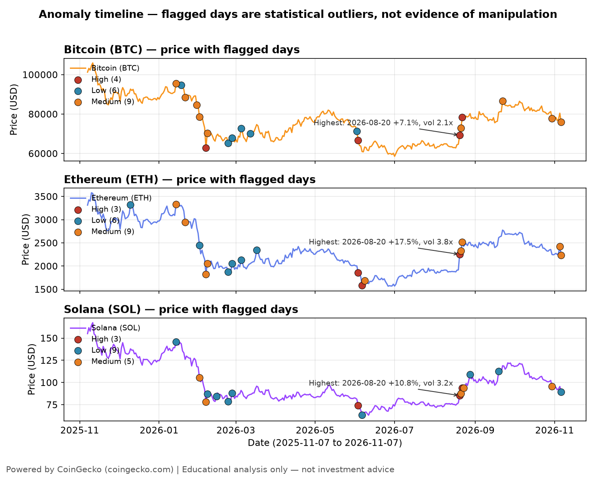
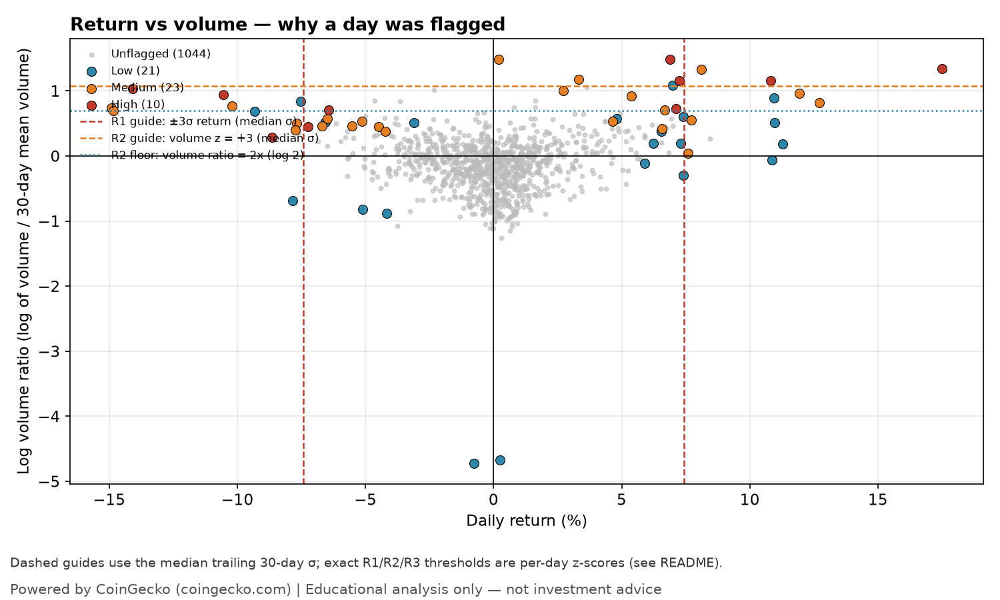
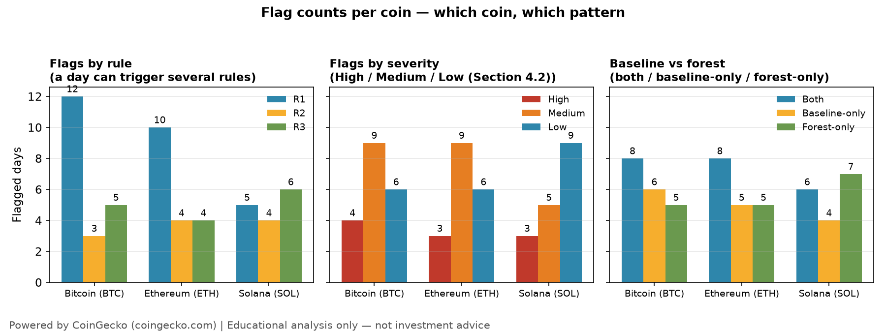
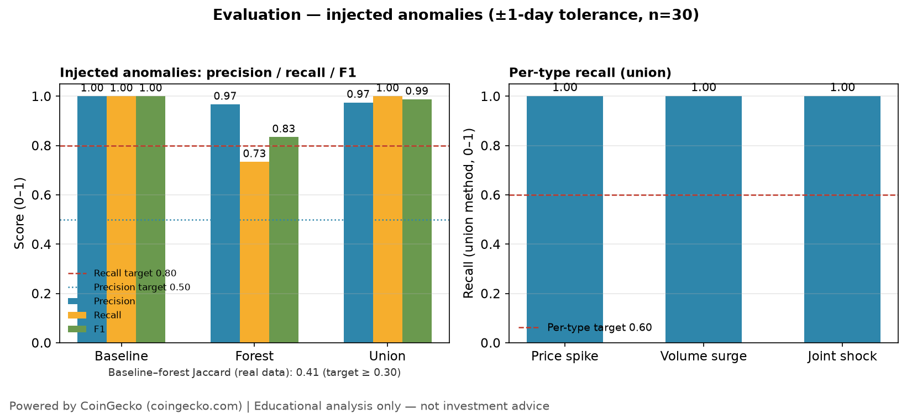

# Day 03 — Crypto Market Anomaly Detector

> **60-Day Data Analytics + AI Portfolio, Day 03.**
> Descriptive, historical anomaly analysis only. *Educational analysis only — not investment advice.*

## Problem

A holder of Bitcoin, Ethereum and Solana can see that prices and volumes moved sharply on some days over the past year, but cannot tell which days were genuinely unusual and which were just normal crypto noise: a −8% day in a calm month means something different from a −8% day in a month when every day moved ±6%, and a price jump with no volume behind it means something different from the same jump on four times the usual volume. Day 1 described *what happened* to prices and Day 2 measured *how risky it was to hold them*; Day 3 flags the specific days whose price–volume pattern stood out from each coin's own recent behaviour, explains each flag in plain language from the numbers on that day, and checks honestly how well the detector works.

**Audience:** a non-expert holder (or prospective holder) of BTC / ETH / SOL who wants a plain-language answer to "which days were actually unusual, why, and how much should I trust the flag?"

*Anomalies flagged here are statistical outliers in price and volume. They are not evidence of manipulation, and no flagged pattern should be presented as such.*

## Dataset

- **Source:** CoinGecko public API (`https://api.coingecko.com/api/v3`), no key required.
- **Endpoint:** `GET /coins/{bitcoin,ethereum,solana}/market_chart/range?vs_currency=usd&from=1762473600&to=1794009600` (no `interval` parameter — granularity is automatic).
- **Window:** 2025-11-07 → 2026-11-07 (365-day span, 366 daily observations per coin — both endpoint dates are included).
- **Access date:** 2026-11-07. Live fetch, no key (HTTP 200 for all three coins). No synthetic data was used.
- **Rows:** 1,098 total (366 per coin) in `data/processed/crypto_daily.csv`; 1,005 flaggable rows after the 30-day warm-up (return_z is first valid on day 31 per coin; volume_z on day 60, because it needs 30 prior log-volume ratios).
- **Licence:** code is MIT (see `LICENSE`); CoinGecko data is under separate CoinGecko terms, not MIT. **Powered by CoinGecko** (https://www.coingecko.com) — attribution is required by CoinGecko's API terms. See `data/README.md` for the full provenance note, including the unresolved question of whether committing verbatim raw API JSON to a public repo counts as redistribution (no legal certainty is claimed either way).

## Tools

Python 3.12.3, pandas, numpy, matplotlib, plotly, Streamlit, requests, pytest, scikit-learn, jupyter/nbformat. See `requirements.txt` for pinned versions. Lint/format: ruff + black (line-length 88), pinned in the portfolio-root `requirements-dev.txt`.

## Method

All features are computed on the daily, date-aligned frame, per coin, using **simple (arithmetic) daily returns** (`r_t = price_t / price_{t-1} − 1`), never log returns. All z-scores use **trailing 30-day windows excluding today** — a centred or full-window z-score would leak future information into "today's" score.

| Feature | Definition |
|---|---|
| `daily_return` / `abs_return` | `price[t] / price[t-1] − 1` (first day per coin: NaN) and its absolute value |
| `volume_ratio` | `volume[t] / mean(volume[t-30 … t-1])` — today's volume vs its own trailing 30-day mean (excludes today) |
| `log_volume_ratio` | `log(volume_ratio)` — used for z-scoring, because volume is right-skewed |
| `vol_30d_ann` | 30-day rolling annualised volatility, `std(returns[t-29 … t]) × √365` (Day 2 definition, reused) |
| `drawdown` | `price[t] / max(price[≤ t]) − 1` (≤ 0; Day 2 definition, reused) |
| `return_z` | `(daily_return − mean(daily_return[t-30 … t-1])) / std(daily_return[t-30 … t-1])` |
| `volume_z` | Same trailing window on `log_volume_ratio` |
| `vol_regime` | `vol_30d_ann / median(vol_30d_ann)` — whether today sits in a high-volatility regime relative to the coin's own year |

**Baseline rules** (a day is baseline-flagged if any fires):

| Rule | Definition |
|---|---|
| R1 — return shock | `|return_z| ≥ 3` |
| R2 — volume surge | `volume_z ≥ 3` **and** `volume_ratio ≥ 2` (the ratio floor stops tiny absolute volumes from tripping the z-rule on quiet days) |
| R3 — joint shock | `|return_z| ≥ 2` **and** `volume_z ≥ 2` on the same day |

**Severity:** **High** = R1 or R2 with `|z| ≥ 4`, or R1+R2 together; **Medium** = any single rule at threshold; **Low** = R3 only (forest-only flags are also Low — severity describes the rule outcome).

**Unsupervised model:** `sklearn.ensemble.IsolationForest`, `contamination` set from the observed baseline flag rate (**0.0368** — the baseline flagged 37 of 1,005 flaggable days), `random_state=42`, `n_estimators=200`. Five input features, standardised per coin (no cross-coin scaling): `daily_return`, `abs_return`, `volume_ratio` (log-transformed), `vol_30d_ann`, `drawdown`. Output: `isolation_forest_score` (decision function, lower = more anomalous) and binary `is_anomaly`.

**Evaluation design:** there is no ground-truth manipulation label for real crypto data, so evaluation is on **30 injected anomalies** of known type, each built from the coin's trailing 30-day window ending the day before the injection (10 price spikes: return +4.0 × trailing return std; 10 volume surges: volume 5.0 × trailing mean volume; 10 joint shocks: return +3.0 × trailing std and volume 5.0 × trailing mean volume), spread across the three coins with at most one per calendar month per coin, recorded in `data/processed/injected_anomalies.csv` with a `construction` column. The identical pipeline runs on the injected copy (`data/processed/crypto_daily_injected.csv`); a flag within **±1 day** of an injection counts as detecting it. A mandatory harness self-check asserts every plant clears its target rule's bar on the injected frame. Precision counts a flag as a true positive if it matches an injection or a flag the detector also raises on the clean (uninjected) data, because the injected copy still contains all 54 genuine unusual real days. Thresholds were fixed in the plan before evaluation ran and were not tuned afterwards. Full report card: `outputs/anomaly_evaluation.md`.

## Key insights

**54 flagged days** out of 1,005 flaggable rows (baseline 37, forest 39, both 22, baseline-only 15, forest-only 17; Jaccard overlap 0.41, target ≥ 0.30).

| Coin | Flags | Baseline | Forest | Both | High / Medium / Low |
|---|---|---|---|---|---|
| Bitcoin (BTC) | 19 | 14 (4.2% of flaggable) | 13 | 8 | 4 / 9 / 6 |
| Ethereum (ETH) | 18 | 13 (3.9%) | 13 | 8 | 3 / 9 / 6 |
| Solana (SOL) | 17 | 10 (3.0%) | 13 | 6 | 3 / 5 / 9 |

- **Flags clustered in February 2026 (16 of 54) and August 2026 (11 of 54)** — the two sharpest stretches of the year. The single most extreme day for all three coins was **2026-08-20**: ETH +17.5% (return z = 10.8, volume 3.8× its 30-day average), SOL +10.8% (z = 6.6, 3.2×), BTC +7.1% (z = 5.8, 2.1×) — all High severity, flagged by both methods. The worst sell-off flag was BTC −14.1% on 2026-02-06 (z = −5.7).
- **The methods substantially agree** (Jaccard 0.41): 22 days flagged by both, 15 baseline-only, 17 forest-only. A day flagged by both deserves more confidence than a day flagged by only one. Forest-only flags are the joint patterns no single rule catches — e.g. ETH +6.2% on 2025-12-10 (return z = 1.8, volume 1.2×, 30-day volatility 68% annualised).
- **On injected anomalies the union finds 30 of 30 (recall 1.00, target ≥ 0.80)** — per-type recall 1.00 for price spikes, volume surges and joint shocks. Precision is 0.974 (76 of 78 flags are injected anomalies or genuine unusual days also flagged on clean data; target ≥ 0.50). The baseline rules alone also find all 30; the Isolation Forest alone finds 22 of 30 and misses only volume surges, so **volume-only surges are the forest's blind spot in isolation**. All five §4.4 targets pass. Thresholds were not tuned to hide anything.

Full numbers: `data/processed/anomaly_timeline.csv` (one row per flagged day, with a plain-language explanation). Plain-language notes: `outputs/insights_summary.md`. Evaluation report: `outputs/anomaly_evaluation.md`.

## Visuals






## How to run

```bash
python -m venv .venv
source .venv/bin/activate
pip install -r requirements.txt
python -m src.data_pipeline            # live fetch (3 calls, >=5 s apart)
python -m src.data_pipeline --offline  # reuse cached data/raw/*.json, no network
python -m src.make_charts              # regenerate the 4 charts, offline
pytest tests/ -q                        # offline tests (from the day folder or the repo root)
streamlit run src/app.py                # anomaly-timeline dashboard
```

## Limitations

- Descriptive, historical analysis only — no buy/sell recommendation, no price prediction, no investment advice. Past unusual days do not predict future ones.
- Close prices only (no open/high/low); daily granularity; one 365-day window.
- Crypto returns are heavy-tailed and volatility clusters, so a fixed ±3σ rule over-flags in volatile regimes and under-flags in calm ones; the trailing window and the `vol_regime` feature mitigate this but do not remove it.
- Isolation Forest scores are relative rankings, not probabilities — "anomaly score −0.12" has no absolute meaning outside this dataset.
- The model cannot distinguish a genuine market event (e.g. an ETF headline, a network upgrade) from a data error or from manipulation. It flags *statistical unusualness only*.
- 365 days per coin is a small sample for unsupervised learning; results are descriptive, not a production detector.
- The Isolation Forest alone misses volume-only surges: it found 22 of 30 injected anomalies, all 8 misses being volume surges, because a single high-volume day with an ordinary return is not among the most anomalous days on the forest's five features. The baseline rules catch all 8, so the union misses none.
- GBM synthetic data (the fallback, not used here) has no real anomalies, so on synthetic data the injected-anomaly evaluation is the only meaningful evaluation.

## License

MIT — see [LICENSE](LICENSE). Copyright (c) 2026 Victor. CoinGecko data is under separate CoinGecko terms.
