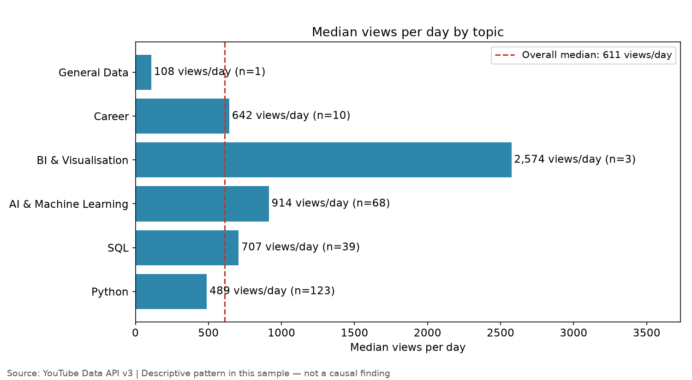
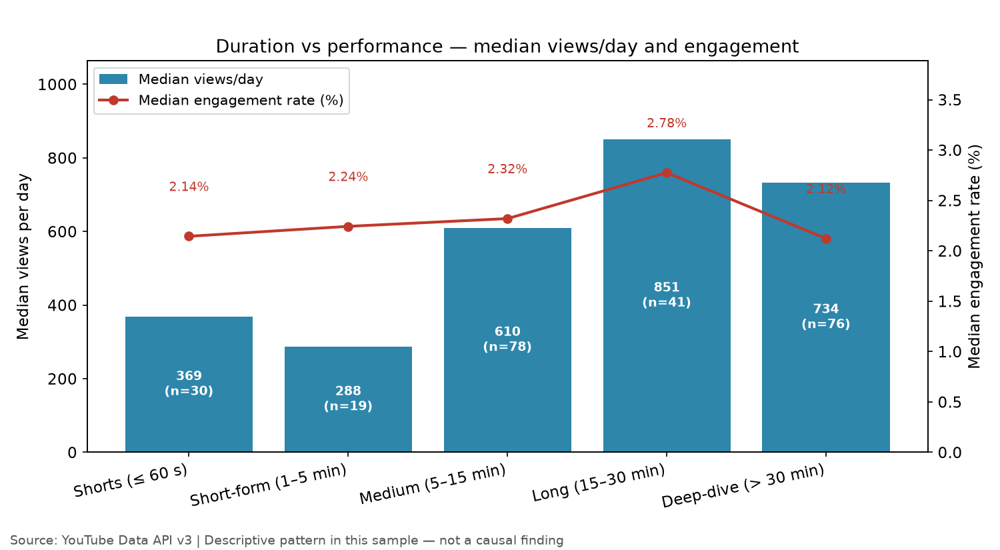
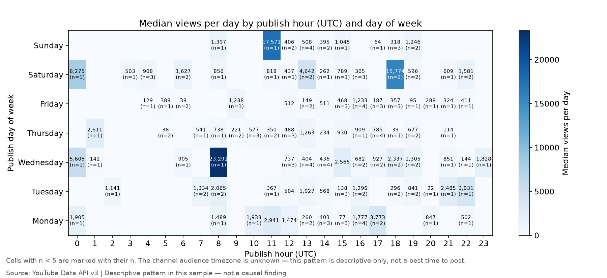
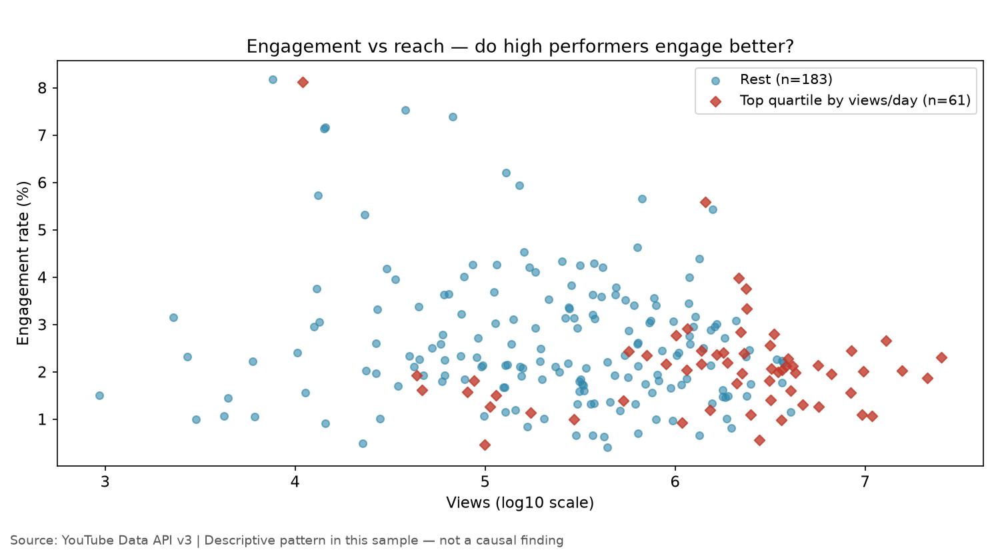

# Day 04 — YouTube Video Performance Analyzer

> **60-Day Data Analytics + AI Portfolio, Day 04.**
> A creator deciding what to publish next can see views, likes and comments on
> individual videos, but cannot tell which topics, formats, lengths and
> publishing times are actually linked with stronger performance. This project
> fetches a bounded, reproducible sample of public data/AI-adjacent YouTube
> videos, normalises performance by video age (views per day), compares topics,
> durations, formats and publish times on medians — never means — and turns
> only the differences visible in those medians into concrete, evidence-cited
> content recommendations.

Performance patterns here describe this sampled set of public videos. They are descriptive, not causal, and are not a guarantee of future performance.

## Problem

A data/AI creator deciding what to publish next needs to know which topic to
cover, how long to make the video, what format to use, and roughly when to
publish. Raw lifetime views do not answer that: a 2021 video with 2M views is
not comparable to a 2026 video with 200K views, a viral outlier distorts any
average, and a high-view video with almost no likes is a different kind of
success from a smaller video whose audience engages heavily. Day 4 answers it
with age-normalised medians on a fixed, reproducible sample.

## Dataset

- **Source:** YouTube Data API v3 (`youtube.googleapis.com/youtube/v3`), via the
  `custom.youtube` connector. Data from the YouTube Data API v3 —
  [YouTube's Terms of Service](https://www.youtube.com/t/terms).
- **Access date:** 2026-11-08 (relevance-ranked snapshot as of this date — not a
  date-bounded cohort; the helper sends no `publishedAfter`/`publishedBefore`).
- **Sample:** 5 fixed queries × 50 results, `order=relevance`:
  `data analytics`, `machine learning tutorial`, `Python data analysis`,
  `artificial intelligence explained`, `SQL tutorial`. Deduplicated by video ID.
- **Row counts:** 250 candidates → 244 unique videos (6 duplicates dropped) →
  **244 final videos** from **143 channels**. 0 live/upcoming streams dropped,
  0 rows dropped for missing view counts.
- **Quota used:** 508 units for this build's fetch (5 searches × 100 + 5 videos
  calls × 1 + 3 channels calls × 1), ~5% of the 10,000/day free-tier quota.
  The day's total YouTube usage was ~1,624 units including the researcher's
  100-unit probe and two earlier fetch runs of the same design (see
  `data/README.md`).
- **Coverage:** like counts present for 97.5% of videos (238 of 244);
  subscriber counts present for 100% (143 of 143 channels). Largest single
  channel (Simplilearn) is 4.1% of the sample — no channel dominates it.
- **Licence:** code is MIT (see `LICENSE`); YouTube data is under separate
  YouTube terms, not MIT. Only public video metadata is used — no user data,
  no comment text, no private data. Raw API JSONs are a dated one-time
  snapshot (2026-11-08) committed as the provenance record; see
  `data/README.md` for the honestly stated tensions on derived metrics and
  30-day storage rules.

## Tools

Python 3.12.3 — pandas, NumPy, Matplotlib, Plotly, Streamlit, requests,
pytest, Jupyter/nbformat (see `requirements.txt` for pinned versions).
Duration parsing is stdlib `re` — no extra dependency. No new runtime
dependency was added for Day 4.

## Method

- **Primary KPI — views per day:** `view_count / days_since_publish`
  (minimum 1 day). Age-normalised performance; the primary "how strong is
  this video" measure.
- **Engagement rate:** `(like_count + comment_count) / view_count`.
  Also `like_rate`, `comment_rate`, `views_per_subscriber`.
  Missing like/comment/subscriber counts stay NaN, never 0.
- **Duration buckets (fixed before seeing the data):** Shorts ≤ 60 s ·
  Short-form 61–300 s · Medium 301–900 s · Long 901–1800 s · Deep-dive
  > 1800 s.
- **Topic (deterministic keyword grouping — the Day 4 text-classification
  step):** first match wins in the order python → sql → ai_ml → bi_viz →
  career → general → other, on lower-cased title + tags + description.
- **Format:** tutorial before explainer, else other.
- **High performers:** top quartile of views per day (n=61 of 244).
- **Medians, never means,** for every views/engagement comparison.
  Log10(view count) is used only on chart 04's axis — never in a KPI or
  recommendation.
- **Recommendations:** generated from the group medians by one function
  (`build_recommendations` in `src/youtube_kpi.py`); every recommendation
  cites its numbers and carries the descriptive-not-causal caveat. Groups
  with n < 10 are labelled thin-sample or omitted. No causal verbs.

## Key insights

Sample: 244 videos, 143 channels. Median 611 views/day; median engagement
rate 2.20% (within the 0.5–8% sanity range).

| Finding | Number |
|---|---|
| Best topic by median views/day (solid groups, n ≥ 10) | AI & Machine Learning: 914 views/day (n=68) vs 611 overall; Python 489 (n=123), SQL 707 (n=39), Career 642 (n=10) |
| Best length by median views/day | Long (15–30 min): 851 views/day (n=41); Deep-dive 734 (n=76), Medium 610 (n=78), Shorts 369 (n=30), Short-form 288 (n=19) |
| Best topic by median engagement | Career: 2.95% (n=10); Python 2.31% (n=120), SQL 2.24% (n=37), AI & ML 1.92% (n=66) |
| Tutorials vs explainers | Tutorials 596 views/day (n=192) vs explainers 504 (n=14) |
| Top quartile vs the rest | 3,124 vs 380 views/day; engagement 2.01% vs 2.32% — reach and engagement did not move together |
| Best weekday | Wednesday: 878 views/day (n=34); Friday lowest at 373 (n=41) |
| Publish hour | No interpretable pattern — every hour cell with n ≥ 5 sits between 357 and 1,397 median views/day, and most hour/day cells hold 1–4 videos |
| Channel size | Large channels 887 views/day (n=78) vs mid-size 680 (n=83) vs small 367 (n=83) |

Thin-sample notes: BI & Visualisation's 2,574 median views/day rests on n=3
and General Data on n=1 — neither supports a recommendation. The "Other"
topic group is empty (0 videos).

## Visuals









## How to run

```bash
python -m venv .venv
source .venv/bin/activate
pip install -r requirements.txt
python -m src.data_pipeline            # live fetch (YouTube Data API v3)
python -m src.data_pipeline --offline  # or: rebuild from the committed cache, no network
python -m src.make_charts              # regenerate exactly the 4 charts
pytest tests/ -q                        # offline tests
streamlit run src/app.py                # creator KPI dashboard
```

## Limitations

- Relevance-ranked snapshot, not a date-bounded cohort: the sample mixes
  2017 and 2026 videos (published 2017-05-19 to 2026-11-07); `views_per_day`
  only partly corrects for age.
- Search relevance ranking is undocumented; findings describe the returned
  set, not all of YouTube.
- No causal claims: a pattern in this cross-sectional sample cannot show
  that a topic or length drives stronger performance.
- Publish-time patterns are descriptive only — the channel audience timezone
  is unknown, so no best time to post can be concluded.
- Comment sentiment is out of scope: no comments endpoint exists in the
  helper.
- Derived-metrics and 30-day storage tensions are stated honestly in
  `data/README.md`; no legal certainty is claimed.

## License

MIT — see [LICENSE](LICENSE). Copyright (c) 2026 Victor. YouTube data is
under separate YouTube terms, not MIT.
