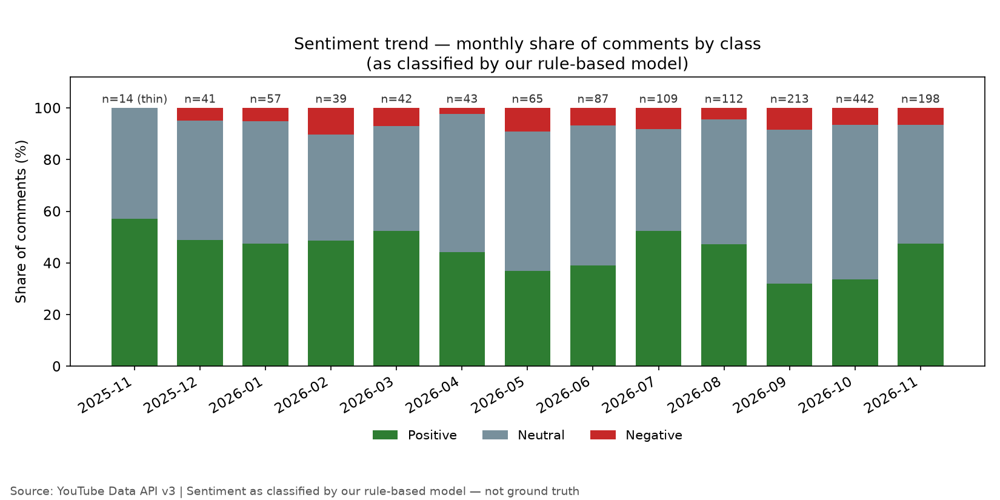
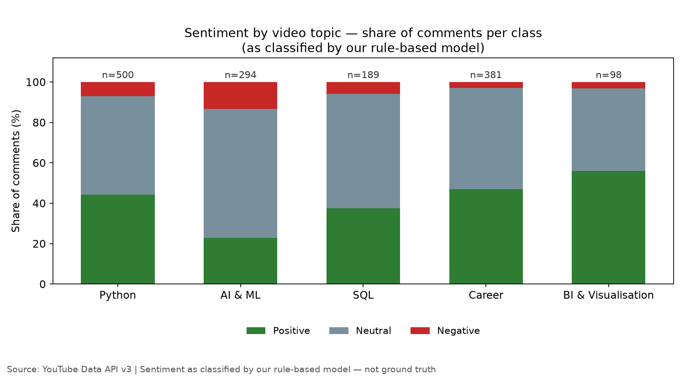
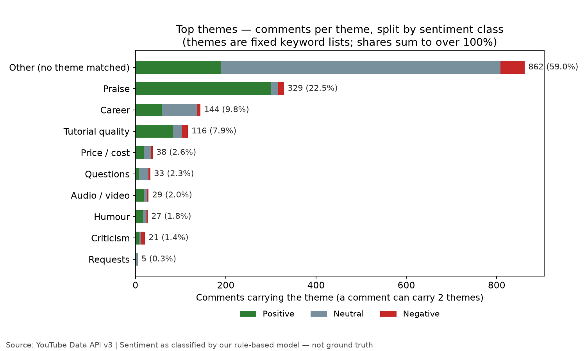
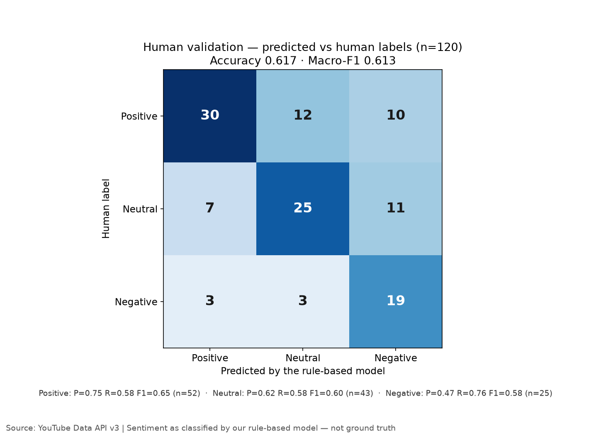

# Day 05 — Social Media Sentiment Analyzer

> **60-Day Data Analytics + AI Portfolio, Day 05.**
> Classify public YouTube comments by sentiment with a transparent rule-based
> lexicon model, extract recurring themes, and document the model's limits.
> Sentiment here is a **model estimate, not ground truth** — every share below
> is "as classified by our rule-based model" and is reported next to its
> human-validation numbers.

## What it does

- Fetches top-level public comments on **12 data/AI YouTube videos**
  (12 distinct channels, chosen from Day 4's video frame) via the
  YouTube Data API v3 — **1,600 threads fetched, 1,462 analysed**,
  window 2025-11-09 → 2026-11-09, **16 quota units**.
- Scores every comment with our own lexicon/rule-based model
  (`src/sentiment.py`): 289-word lexicon (133 positive / 156 negative),
  negation flips the next 3 scored words, intensifiers ×1.5, an emoji map,
  and a `!` bonus. Compound = `s / sqrt(s² + 15)`; thresholds ±0.05.
  The lexicon was written **before any comment was seen** and is never tuned
  after validation — a baseline, not a trained model.
- Assigns each comment up to 2 themes from fixed keyword lists
  (praise, tutorial quality, requests, career, criticism, questions,
  audio/video, price/cost, humour, other).
- Validates the model against **120 human-labelled comments**
  (40 per predicted class, labelled blind from text only):
  **accuracy 0.617, macro-F1 0.613** — a modest baseline.
  The model over-predicts negative (precision 0.47) and misses praise
  (12 of 52 truly positive comments classified neutral, 10 negative).
- Dashboard (`src/app.py`, Streamlit): topic/video/sentiment filters,
  KPI summary, 4 charts, theme table with sentiment split and short
  excerpts, and the full validation panel.

## Key findings (as classified by our rule-based model)

- **1,462 analysed comments: 40.6% positive, 52.6% neutral, 6.8% negative.**
  But **55.3% of comments matched no lexicon word** (808 of 1,462) and are
  neutral by default, not by meaning — so the neutral share is inflated
  and the positive/negative shares are under-counts.
- **AI & ML is the most negative and least positive topic**: 13.3% negative
  / 22.8% positive (n=294); within the topic, the 60 Minutes AI episode is
  the most negative-classified video (20.2% negative, n=99). BI & Visualisation is the most positive (56.1%, n=98),
  career 47.0% (n=381), Python 44.4% (n=500), SQL 37.6% (n=189).
- **Monthly trend is a video-mix confound, not a pure time trend**: positive
  share ranges 31.9% (2026-09) to 57.1% (2025-11, n=14, thin). Two videos
  contribute ~40% of the corpus, so which videos were active each month
  moves the shares.
- **Themes: 59.0% of comments matched no theme** (`other`, 862) — the fixed
  lists missed the large Google Data Analytics course-cohort check-in
  pattern ("here from the Google Data Analytics course", "good luck",
  "starting today"). Reported, not re-tuned. Next largest: praise 329
  (22.5%, 91.2% positive), career 144 (9.8%), tutorial quality 116 (7.9%).
- **Validation (n=120)**: accuracy **0.617**, macro-F1 **0.613**.
  Per class — positive P 0.75 / R 0.58 / F1 0.65 (support 52);
  neutral P 0.62 / R 0.58 / F1 0.60 (support 43);
  negative P 0.47 / R 0.76 / F1 0.58 (support 25).
  Labelling boundary note: an independent spot-check of 30 labels agreed
  on 27/30; all 3 disagreements were positive-vs-neutral calls on
  enthusiastic course check-ins, which the original labeller counted as
  neutral — so the positive recall of 0.58 partly reflects that boundary,
  not just model error.
- **Per video**: 3Blue1Brown's neural-network video contributed the most
  comments (293, 20.0%); the Simplilearn machine-learning course only 9
  (11 of 12 videos ≥ 20 comments). The 60 Minutes AI episode is the most
  negative-classified video (20.2% negative).

## Limitations

- The sentiment model is a **lexicon baseline**: it cannot detect sarcasm,
  irony, or domain meaning ("hidden layer" is content, not a complaint);
  it scores words, not intent. Spanish written in Latin script slips
  through the language filter ("que" is a top neutral word); curly
  apostrophes split contractions ("don't" → "don" + "t").
- 55.3% of comments carry no scored word and default to neutral.
  59.0% of comments match no theme. Both gaps are reported, not fixed by
  re-tuning — the lexicon and theme lists were frozen before the data
  was seen.
- The corpus is 12 videos chosen from Day 4's frame, not a random sample
  of YouTube; comments are top-level only (replies excluded); the monthly
  trend partly reflects which videos were active. Findings describe these
  12 videos only and are **descriptive, not causal**.
- Validation is one labeller, 120 comments, labelled blind from text only.
  Borderline calls are recorded in `data/processed/validation_labels.csv`.

## Charts


*Monthly sentiment shares (as classified by the model). November 2025 n=14.*


*Sentiment share per topic (as classified by the model).*


*Comments per theme, split by sentiment class. 59.0% matched no theme.*


*Predicted vs human labels, n=120. Accuracy 0.617, macro-F1 0.613.*

## How to run

```bash
python3 -m venv .venv
.venv/bin/pip install -r requirements.txt
.venv/bin/python src/data_pipeline.py --use-cache   # rebuild from committed cache, no API
.venv/bin/python src/data_pipeline.py --offline     # same, explicit
.venv/bin/python src/make_charts.py
.venv/bin/python -m pytest tests/ -q
.venv/bin/streamlit run src/app.py
```

Live fetch (needs the YouTube connector key; 16 quota units for this corpus):

```bash
.venv/bin/python src/data_pipeline.py
```

## Data

- `data/raw/comments_<video_id>.json` — one raw API response file per video
  (12 files, 2.7 MB total).
- `data/processed/comments.csv` — 1,462 analysed comments with scores,
  themes and language flags.
- `data/processed/validation_sample.csv` — 120-comment stratified sample
  (40 per predicted class, seed 42).
- `data/processed/validation_labels.csv` — human labels for the sample.
- `data/processed/data_source.json` — provenance (source, window, quota,
  filter counts). See `data/README.md` for the full provenance note,
  including a hand-validated metric.
- Data from the YouTube Data API v3. YouTube data is under separate
  YouTube terms — see [YouTube's Terms of Service](https://www.youtube.com/t/terms).

## Tests

```bash
.venv/bin/python -m black --check src tests
.venv/bin/python -m ruff check src tests
.venv/bin/python -m pytest tests/ -q   # 14 tests
```

Tests cover hand-computed scoring (thresholds, negation, intensifiers,
emoji, punctuation), themes, non-Latin detection, top words/bigrams,
evaluation metrics, the stratified validation sample, deterministic
synthetic data, offline mode, filter behaviour, CSV↔README consistency,
and attribution/limitations wording.

## License

MIT — see [LICENSE](LICENSE). Copyright (c) 2026 Victor.
