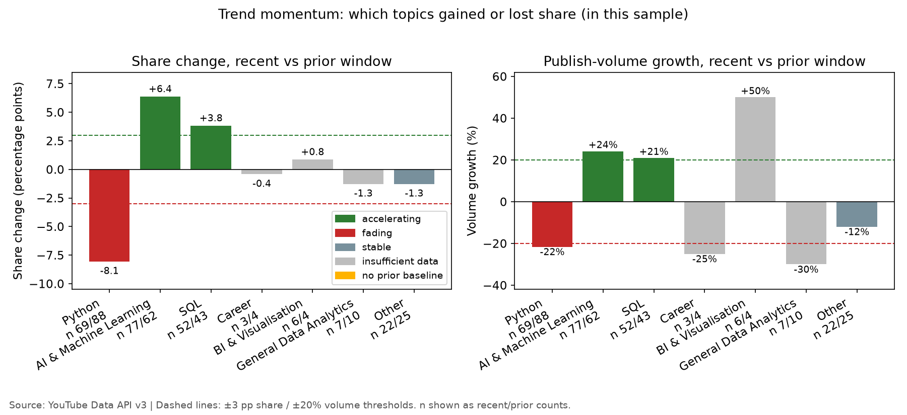
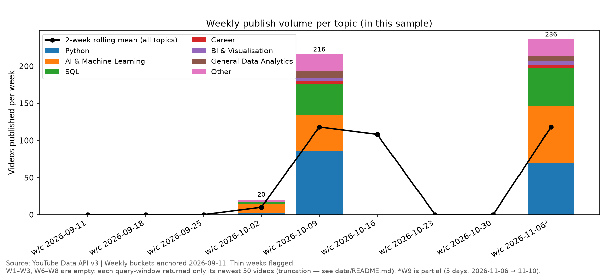
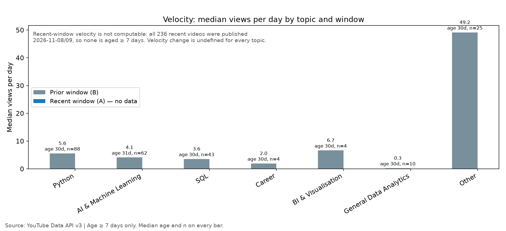
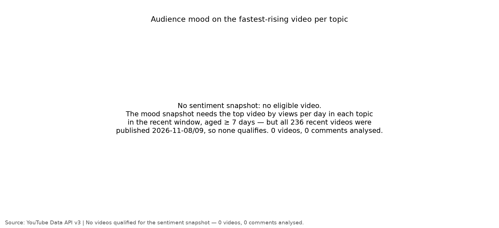

# Day 06 — Viral Content Trend Explorer

> **60-Day Data Analytics + AI Portfolio, Day 06.**
> Trends here compare two 30-day cohorts of recently published videos. The API gives a current
> snapshot of each video's statistics, not daily history — so these are cohort comparisons, not a
> record of views rising or falling over time.

## Problem

A data/AI creator deciding what to make next can see what is popular today, but cannot tell what
is *accelerating* and what is *fading*: are Python tutorials being published faster than a month
ago while SQL tutorials slow down, or is it just one viral video distorting the picture? This
project fetches two consecutive 30-day cohorts of recently published data/AI videos from YouTube,
compares publish volume and view velocity per topic between the two windows with fixed,
pre-registered thresholds, and reports which topics are accelerating, fading, or stable — with the
velocity cross-check, the age bias, and the snapshot limitation stated on the front page. The
audience is a data/AI creator deciding what topic to cover next. Every finding is stated about
*this sample* ("in this sample, videos on topic X published in the last 30 days outnumbered those
in the prior 30 days by …"), never as "topic X is going viral".

## Dataset

- **Source:** YouTube Data API v3, via the `custom.youtube` connector helper. Access date
  **2026-11-10**. Endpoints: `search.list` (10 calls), `videos.list` (10 batched calls),
  `channels.list` (9 batched calls), `commentThreads.list` (0 calls — no video qualified for the
  sentiment snapshot).
- **Sample — Layer B (the trend sample):** 5 queries (`data analytics`, `machine learning
  tutorial`, `Python data analysis`, `artificial intelligence explained`, `SQL tutorial`) × 2
  windows (prior 2026-09-11 → 2026-10-11, recent 2026-10-11 → 2026-11-10), `order=date`,
  50/page, one page per query-window. **500 candidates → 474 unique → 472 final videos**
  (236 per window; 2 dropped for missing `viewCount`). 406 distinct channels.
- **Layer A (context only):** Day 4 frame, 244 videos fetched 2026-11-08, relevance-ranked.
  Never mixed into the momentum math. Overlap with Layer B: 0 videos.
- **Quota used:** 1,019 units for this run (day total 2,238 including the researcher's probe and
  a first attempt that crashed before saving — see `data/README.md`).
- **Truncation (read first):** all 10 query-windows returned exactly 50 videos, so each window
  holds only its newest videos — the recent window effectively covers 2026-11-08 → 11-09 and the
  prior window 2026-10-08 → 10-10. Weekly buckets W1–W3 and W6–W8 are empty; volume numbers are
  lower bounds. No second page was fetched (the plan forbids it).
- **Licence:** data is public YouTube metadata under the YouTube API Services Terms of Service
  and Developer Policies. Data from the YouTube Data API v3 — see
  [YouTube's Terms of Service](https://www.youtube.com/t/terms). Code is MIT; YouTube data is
  under separate YouTube terms. Full provenance and the licence tensions, stated honestly, are in
  [`data/README.md`](data/README.md).

## Tools

Python 3.12.3; pandas 3.1.1, numpy 2.5.4, matplotlib 3.11.2, plotly 7.1.0, streamlit 1.66.1,
requests 2.34.2, pytest 9.2.0, jupyter 1.1.1, nbformat 5.11.1 (see `requirements.txt`). Dev tools:
ruff 0.17.4, black 26.10.1 (portfolio-root `requirements-dev.txt`). No new runtime dependency.

## Method

- **Topic taxonomy (Day 4 rule, unchanged):** deterministic keyword match on lower-cased
  `title + tags + description`, first match wins in priority order: python, sql, ai_ml, bi_viz,
  career, general, other.
- **Buckets:** momentum windows B (prior) vs A (recent), each 30 days; weekly buckets W1–W9
  anchored 2026-09-11 (W9 partial, 5 days, flagged everywhere); 2-week rolling mean as a display
  aid only.
- **Metrics:** `views_per_day` = views / days since publish (age ≥ 7 days only — younger videos
  get NaN); `engagement_rate` = (likes + comments) / views; `topic_share`, `volume_growth`,
  `share_change` in percentage points. Medians, not means, for every views/engagement comparison.
- **Classification (fixed thresholds):** accelerating = share change ≥ +3 pp **and** volume growth
  ≥ +20% with n ≥ 10 in both windows; fading is the mirror; otherwise stable; n < 10 in either
  window → insufficient data; n_B = 0 → no prior baseline. Velocity cross-check: accelerating
  with velocity change < −30%, or fading with velocity change > +30%, is flagged "mixed signal".
- **Age bias:** views per day is systematically higher for young videos. Mitigations: the 7-day
  minimum-age guard, median age reported alongside every velocity number, and a 14-day-guard
  sensitivity check.
- **Sentiment:** Day 5's lexicon scorer copied verbatim (`src/sentiment.py` — scoring functions
  only, no themes), applied to the top video by views per day per topic in the recent window.
  Sentiment never enters a trend classification. In this build the snapshot is empty (0 videos,
  0 comments) because no recent video is aged ≥ 7 days.
- **Validation:** holdout backtest (train W1–W7, predict top share-growth topic, check top-2 in
  W8) — **not computable in this sample** (W1–W3 and W8 are empty); age-guard sensitivity check
  (no flips); one topic's momentum numbers recomputed by hand from `videos.csv` (Python — see
  `data/README.md`).

## Key insights

| Topic | n recent / prior | Share change | Volume growth | Classification |
|---|---|---|---|---|
| AI & Machine Learning | 77 / 62 | +6.36 pp | +24.2% | **Accelerating** |
| SQL | 52 / 43 | +3.81 pp | +20.9% | **Accelerating** |
| Python | 69 / 88 | −8.05 pp | −21.6% | **Fading** |
| Other | 22 / 25 | −1.27 pp | −12.0% | Stable |
| Career / BI & Visualisation / General | 3–7 / 4–10 | — | — | Insufficient data |

- **Velocity: not computable.** No recent video is aged ≥ 7 days, so every recent-window velocity
  median is undefined and no mixed-signal flag can be raised. Prior-window medians (reference
  only): Python 5.6/day (median age 30 days, n=88), AI & Machine Learning 4.1/day (31 days,
  n=62), SQL 3.6/day (30 days, n=43).
- **Sentiment snapshot: empty** (0 videos, 0 comments analysed).
- **Backtest: not computable** (W1–W3 and W8 empty). No hit/miss is claimed.
- Full findings: [`outputs/insights_summary.md`](outputs/insights_summary.md); weekly briefing
  (generated from `trend_table.csv`):
  [`outputs/weekly_briefing.md`](outputs/weekly_briefing.md).

## Visuals


*Share change and volume growth against the fixed ±3 pp / ±20% threshold lines.*


*Weekly publish volume per topic with the 2-week rolling mean. W1–W3 and W6–W8 are empty
(truncation); W9 is partial.*


*Median views per day by topic and window. Recent-window velocity is not computable in this
sample.*


*Audience mood snapshot — empty in this sample: no eligible video.*

## How to run

```bash
python -m venv .venv
source .venv/bin/activate
pip install -r requirements.txt
python -m src.data_pipeline --offline   # from the committed cache, no network
python -m src.make_charts               # regenerates exactly the 4 PNGs
pytest tests/ -q                         # from the repo root AND from inside this folder
streamlit run src/app.py                # dashboard (smoke test on port 8502)
```

To re-fetch live data: `python -m src.data_pipeline` (uses the `custom.youtube` connector
helper; ~1,019 quota units). The Streamlit dashboard reads only the committed processed CSVs.

## Limitations

- **Snapshot, not history.** The API gives a current snapshot of each video's statistics, not
  daily history. Every "trend" here is a comparison of two publish-date cohorts.
- **Truncation.** All 10 query-windows hit the 50-result one-page cap. The recent window is
  effectively Nov 8–9 and the prior window Oct 8–10; weekly buckets W1–W3 and W6–W8 are empty;
  volume numbers are lower bounds.
- **Velocity undefined for the recent window**, so the velocity cross-check, mixed-signal flags
  and age-guard sensitivity check all come back empty. **Backtest not computable. Sentiment
  snapshot empty.**
- **Sentiment is a model output**, not ground truth, and describes five videos at most.
- **No causal claims.** A classification is a statement about this sample only.
- **Known size exception:** `data/raw/videos_details.json` is ~2.0 MB, over the 1 MB/file
  guideline (474 detail records); total `data/` is 3.9 MB, inside the 5 MB/day limit. See
  `data/README.md`.

## License

MIT — see [LICENSE](LICENSE). Copyright (c) 2026 Victor.
