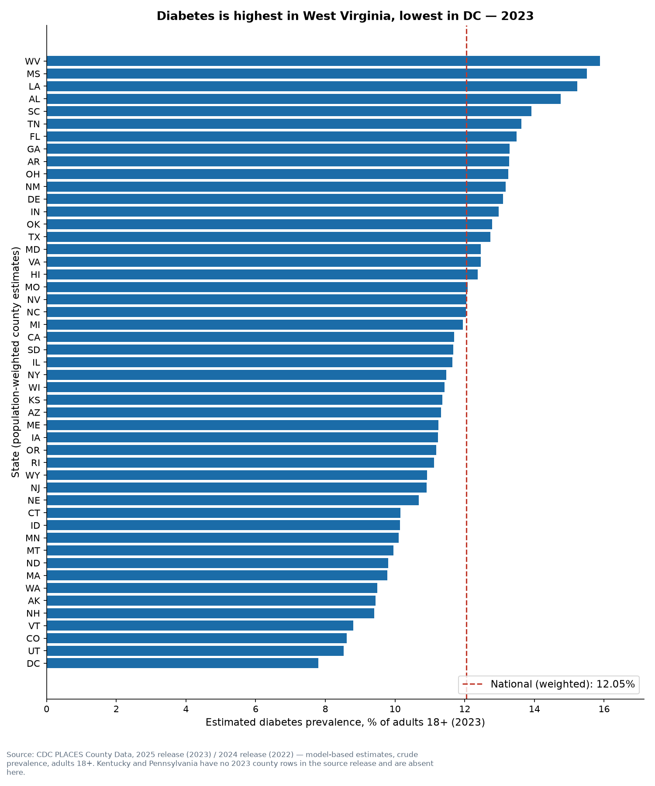
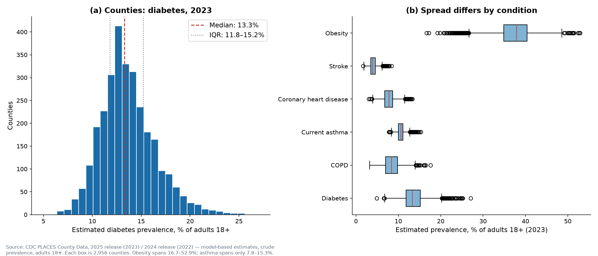
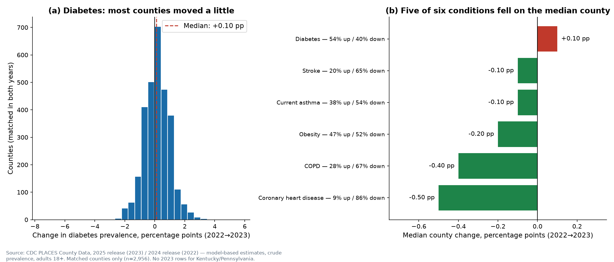
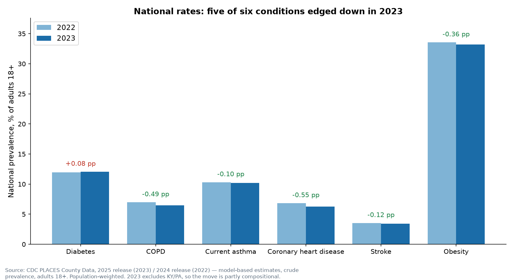

# Day 07 — Disease Prevalence Dashboard

> **60-Day Data Analytics + AI Portfolio, Day 07.**
> CDC PLACES county estimates for six chronic conditions, 2022–2023.

## Problem

Disease numbers for US counties are easy to misread: rates quoted without
denominators, county percentages averaged as if all counties were the same
size, and year-over-year changes quoted without saying which definition or
which counties are in both years. This dashboard compares **reported
disease rates across places and time, accounting for population
denominators and data definitions**: CDC PLACES county estimates for six
chronic conditions, converted to estimated adult cases with each county's
own adult population, rolled up to states **population-weighted** (never a
simple mean), and compared 2022→2023 only on counties present in both
years — with the missing counties, the confidence intervals, and the
cross-release caveat on the front page.

## Dataset

- **Source:** CDC PLACES: Local Data for Better Health, County Data —
  **2025 release** (2023 estimates, dataset `swc5-untb`) and **2024
  release** (2022 estimates, dataset `fu4u-a9bh`), via CDC Open Data
  (Socrata, `https://data.cdc.gov/resource/<id>.json`). No key, no account.
- **Fetched:** 2026-11-11. Six measures, crude prevalence only
  (`CrdPrv`, % of adults 18+): diabetes, COPD, current asthma, coronary
  heart disease, stroke, obesity.
- **Rows:** 2,958 counties per measure in 2023 (2,956 with a published
  value), 3,145 per measure in 2022 (3,144 analysed). Matched counties
  for year-over-year change: 2,956 per measure. See `data/README.md` for
  the full provenance, including the two coverage gaps below.
- **Licence:** US federal government work — public domain. Attribution:
  "Source: CDC PLACES: Local Data for Better Health, County Data, 2025
  release (2023 estimates) and 2024 release (2022 estimates), via CDC
  Open Data (data.cdc.gov). Estimates are model-based, derived from the
  Behavioral Risk Factor Surveillance System (BRFSS)."

## Tools

Python 3.12.3; pandas, numpy, matplotlib, plotly, streamlit, requests
(all pinned in `requirements.txt`); pytest, black, ruff.

## Method

1. **Fetch** — Socrata SoQL, count-check first per measure/release, then
   paginated fetch with a rows-fetched == count assertion (no silent
   truncation). 12 measure-releases, ~24 requests total.
2. **Clean** — drop the `US` national aggregate row from county tables;
   drop the 1 suppressed row per measure in 2023 (Loving County, TX — no
   published value); `est_cases = round(prevalence / 100 × adult pop)`.
3. **Roll up** — state and national rates are population-weighted
   (Σ est. cases / Σ adults 18+). A test asserts the weighted rate differs
   from the naive county mean.
4. **Compare** — year-over-year change on the 2,956 counties present in
   both years only; headline in percentage points.
5. **Visualise** — interactive state choropleth + county bubble map in the
   Streamlit app, plus 4 static charts in `outputs/charts/`.

## Key insights

National (population-weighted) estimated prevalence, 2023 — and the
2022→2023 move:

| Condition | 2022 | 2023 | Change |
|---|---|---|---|
| Diabetes | 11.97% | 12.05% | +0.08 pp |
| COPD | 6.98% | 6.49% | −0.49 pp |
| Current asthma | 10.31% | 10.21% | −0.10 pp |
| Coronary heart disease | 6.83% | 6.28% | −0.55 pp |
| Stroke | 3.53% | 3.41% | −0.12 pp |
| Obesity | 33.56% | 33.20% | −0.36 pp |

- **Geography dominates.** Diabetes runs 4.9% (Madison County, ID) to
  27.1% (Greene County, AL) across counties; West Virginia is the highest
  state for diabetes (15.88%), COPD (10.63%), heart disease (8.73%) and
  obesity (40.63%), while DC is lowest for diabetes (7.80%). The top
  state runs about 2× the bottom state for diabetes, 2.66× for COPD.
- **Five of six conditions edged down** on the median matched county
  (heart disease −0.50 pp, COPD −0.40 pp, obesity −0.20 pp, asthma and
  stroke −0.10 pp; diabetes +0.10 pp). But the national moves are partly
  compositional — see Limitations.
- **The biggest county moves are noise, not signal.** The largest rises
  and falls (e.g. Kenedy County, TX, diabetes −7.50 pp; Kalawao County,
  HI, +5.70 pp) are all in counties with a few hundred adults, where the
  median confidence-interval width (3.9 pp for diabetes) swallows the
  move. Small-county swings should not be read as real change.
- **Definitions move numbers as much as disease does.** Tangipahoa
  parish, LA: crude diabetes 14.6% vs age-adjusted 13.5% — a 1.1 pp gap
  in one county, same year, from the definition alone.

Full findings: `outputs/insights_summary.md`. Analysis:
`notebooks/analysis.ipynb`.

## Visuals






The Streamlit dashboard adds the state map and county dot map
(see `screenshots/dashboard.png`).

## How to run

```bash
python -m venv .venv
source .venv/bin/activate
pip install -r requirements.txt
python -m src.data_pipeline --live      # fetch from CDC Open Data
python -m src.data_pipeline --offline   # regenerate from committed CSVs
python -m src.make_charts               # rebuild the 4 charts
pytest tests/ -q                        # 21 tests
streamlit run src/app.py                # dashboard
```

## Limitations

- **Model-based estimates, not counted cases.** Every value is a modelled
  estimate from survey data with a confidence interval (median width
  0.8–15.3 pp by condition). Say "estimated prevalence", never bare
  "cases".
- **Two states vanish in 2023.** The 2025 release has no rows at all for
  Kentucky (120 counties) or Pennsylvania (67 counties), and Loving
  County, TX is suppressed — so 2023 covers 2,956 counties vs 3,144 in
  2022. National 2022→2023 moves are partly compositional; the
  matched-county median is the cleaner signal.
- **Crude rates only.** Comparisons with age-adjusted figures will differ
  (Tangipahoa: 14.6% crude vs 13.5% age-adjusted).
- **County rankings are not a health league table.** Small counties have
  wide intervals; a ranking is a starting point for questions.
- Our computed national rates sit 0.01–0.41 pp from CDC's published US
  figures because the US figure covers suppressed counties too — a
  coverage note, not an error.

## Validation

- pytest 21/21 (from the day folder and from the portfolio root).
- Hand-validated: Claiborne parish, LA, diabetes 2023 — 22.8% of 11,034
  adults = 2,516 estimated cases (matches the pipeline exactly); Louisiana
  diabetes state rate 15.23% recomputed from the county CSV to the last
  digit. See `data/README.md`.
- Streamlit smoke test: HTTP 200 on `/` and `/_stcore/health` (fresh port),
  real dashboard screenshot in `screenshots/dashboard.png`.

## License

MIT — see [LICENSE](LICENSE). Copyright (c) 2026 Victor.
