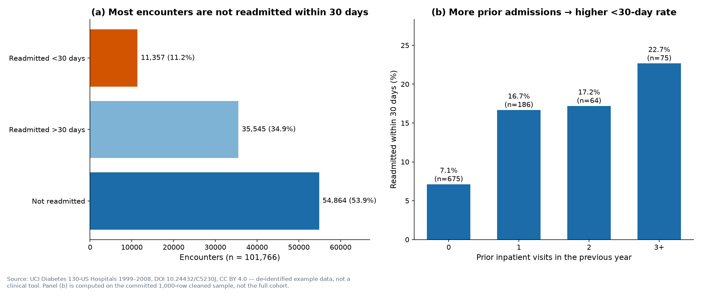
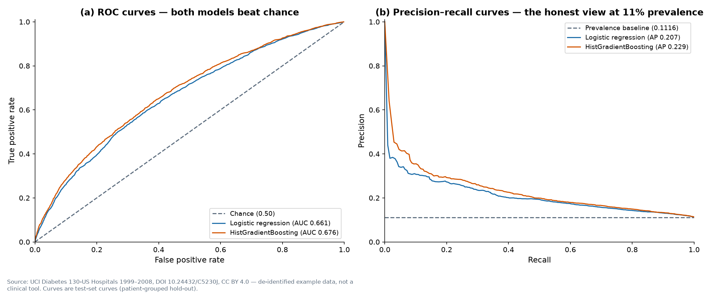
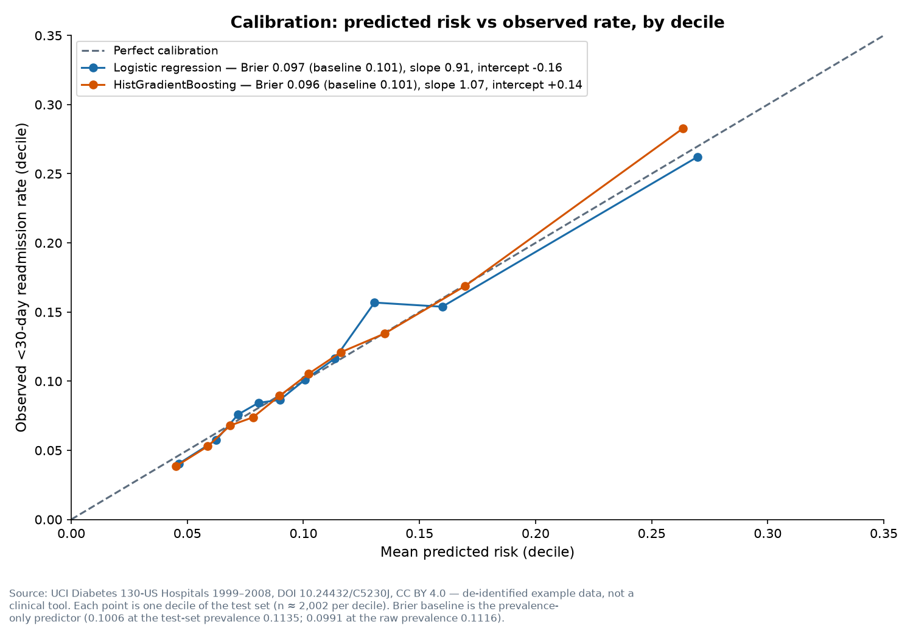
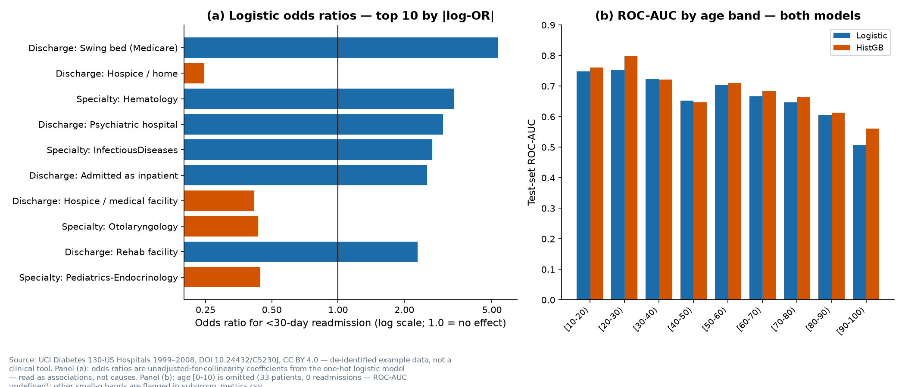

# Day 08 — Hospital Readmission Risk Model

> **60-Day Data Analytics + AI Portfolio, Day 08.** Reproducible classification
> notebook with model card.

## Problem

A hospital stay ends, and within 30 days some patients are back. Day 8 asks two
linked questions about that return: *which features of the stay and the patient
are associated with being readmitted within 30 days*, and *how well can a model
tell the two groups apart — and how much can its predicted risks be trusted?*
The second half matters as much as the first: a model that ranks patients well
but whose "20% risk" actually means 5% (or 40%) would mislead any decision made
from it, so discrimination (ROC-AUC, PR-AUC) and calibration (Brier score,
slope/intercept, decile table) are reported side by side, for both models, on
the same held-out patients. The analysis is honest about its limits up front:
the data is 1999–2008, covers diabetes patients only, has no external
validation set, and the same patient can appear many times — so the train/test
split is grouped by patient, the patients who died or went to hospice (and
therefore *cannot* be readmitted) are excluded before modelling, and
performance is reported by age, sex and race as a fairness check.

**Audience:** a data analyst or hiring reviewer who wants to see a
classification done properly on messy real health data — leakage handled,
imbalance handled without distorting the probabilities, calibration reported
instead of assumed, and the model card stating plainly what the model must
never be used for.

## Dataset

- **Source:** Diabetes 130-US Hospitals for Years 1999–2008, UCI Machine
  Learning Repository (id 296) — de-identified inpatient encounters of
  patients diagnosed with diabetes at 130 US hospitals, 1999–2008.
- **Download:** https://archive.ics.uci.edu/static/public/296/diabetes+130-us+hospitals+for+years+1999-2008.zip
  (3,170,254 bytes; `diabetic_data.csv` 19,159,383 bytes + `IDS_mapping.csv`
  2,547 bytes). No sign-in, no key, no payment. Fetched 2026-11-12.
- **Rows:** 101,766 encounters, 50 columns. Target: binary — 1 if
  `readmitted == "<30"` (11,357; 11.16%), else 0. The 3-class split is
  `<30` 11,357 (11.16%), `>30` 35,545 (34.93%), `NO` 54,864 (53.91%).
- **Licence:** CC BY 4.0. Attribution: Clore, J., Cios, K., DeShazo, J., &
  Strack, B. (2014). Diabetes 130-US Hospitals for Years 1999-2008
  [Dataset]. UCI Machine Learning Repository. https://doi.org/10.24432/C5230J
- **Data-size exception:** the raw CSV (~19 MB) is git-ignored and downloaded
  at build time; only a 500-row provenance sample, `IDS_mapping.csv` and
  compact processed CSVs are committed. See [data/README.md](data/README.md).

## Tools

Python 3.12.3; pandas, numpy, matplotlib, plotly, streamlit, requests,
scikit-learn (HistGradientBoosting, calibration, permutation importance),
scipy, pytest, jupyter, nbformat — all pinned in
[requirements.txt](requirements.txt). Lint/format: ruff 0.17.4 + black 26.10.1
(portfolio-root `requirements-dev.txt`).

## Method

1. **Download + verify** (`python -m src.data_pipeline --live`): row count
   101,766 and target distribution 11,357 / 35,545 / 54,864 asserted.
2. **Clean** (plan §3.3): `?` is the missing symbol (the metadata API says
   "NaN" — wrong for this file); `weight` dropped at 96.86% missing;
   high-missing categoricals kept as an explicit "Missing" category;
   `max_glu_serum` / `A1Cresult` value "None" kept as "not measured";
   ICD-9 codes in `diag_1/2/3` grouped into 10 chapters; ID labels joined
   from `IDS_mapping.csv` (never hard-coded).
3. **Exclude** 1,652 encounters discharged expired or to hospice
   (ids 11: 1,642; 19: 8; 20: 2; 21: 0) — labels verified from
   `IDS_mapping.csv` at build time; the label rule governs if IDs and
   labels ever disagree. 100,114 encounters remain.
4. **Split** patient-grouped 80/20, seed 42 (`StratifiedGroupKFold`,
   5 folds, fold 0 = test): train 80,090 rows (56,417 patients, 11.34%
   positive), test 20,024 rows (14,022 patients, 11.35% positive), zero
   patient overlap.
5. **Models** (same preprocessing, no tuning, no class weighting, no
   resampling, threshold 0.5): logistic regression (`C=1.0`,
   `max_iter=1000`) and HistGradientBoosting (`max_iter=300`,
   `learning_rate=0.05`). 5-fold grouped CV on the train set.
6. **Evaluate** on the test set: ROC-AUC, PR-AUC, Brier, calibration
   slope/intercept, calibration-in-the-large, decile table, confusion
   matrix at 0.5, subgroup metrics by age/gender/race. No recalibration
   (out of scope; future work).

## Key insights

| Model | ROC-AUC | PR-AUC | Brier | Cal. slope | Cal. intercept |
|---|---|---|---|---|---|
| Logistic regression | 0.6612 | 0.2071 | 0.0971 | 0.9131 | −0.1609 |
| HistGradientBoosting | 0.6761 | 0.2293 | 0.0956 | 1.0698 | +0.1434 |
| Prevalence-only baseline | 0.5000 | 0.1116 | 0.1006 | — | — |

- **Prior inpatient visits dominate.** On the 1,000-row sample the <30-day
  rate rises from 7.1% (0 prior visits, n=675) to 16.7% (1, n=186), 17.2%
  (2, n=64) and 22.7% (3+, n=75). Permutation importance agrees:
  `number_inpatient` is the top HistGB feature (Δ ROC-AUC 0.0753), followed
  by discharge disposition (0.0532); everything else is ≤ 0.0071.
- **Discrimination is modest but real.** Both models beat chance and the
  prevalence baseline (CV ROC-AUC 0.6633 ± 0.0032 logistic, 0.6736 ± 0.0033
  HistGB). At threshold 0.5 sensitivity is very low (0.013 / 0.009) — the
  models rarely predict "readmitted" at 11% prevalence — with precision
  0.42 / 0.67 on the few they flag.
- **Calibration is reasonable, as-is.** Brier 0.0971 / 0.0956 vs 0.1006
  baseline; slopes 0.91 / 1.07 (ideal 1); mean predicted risk 0.1125 /
  0.1126 vs observed 0.1135. The top decile's observed rate is 26–28%
  against a predicted ~26–27%.
- **The oldest patients are the weak spot.** ROC-AUC falls to 0.51
  (logistic) / 0.56 (HistGB) at age [90-100); [0-10) has 33 test patients
  and 0 readmissions, so its ROC-AUC is undefined. By gender and race the
  models are broadly consistent (Female 0.668 / Male 0.654 logistic;
  Caucasian 0.661 / African American 0.663), with small-n flags on Asian,
  Hispanic, Other and Missing-race subgroups.
- **Discharge destination carries the largest odds ratios** — discharge to
  a Medicare swing bed OR 5.32, to a psychiatric hospital OR 3.00, while
  discharge to hospice at home is protective (OR 0.25). These are
  associations from a one-hot model, not causes, and the rare categories
  are noisy.

Full findings: [outputs/insights_summary.md](outputs/insights_summary.md).
Model card: [outputs/model_card.md](outputs/model_card.md).
Notebook: [notebooks/analysis.ipynb](notebooks/analysis.ipynb).

## Visuals






## How to run

```bash
python -m venv .venv
source .venv/bin/activate
pip install -r requirements.txt
python -m src.data_pipeline --live      # download from UCI, clean, train, write processed CSVs
python -m src.data_pipeline --offline   # verify committed files; no network, never rewrites data_source.json
python -m src.make_charts               # regenerate the 4 charts from processed CSVs
pytest tests/ -q                         # 42 tests
streamlit run src/app.py                # dashboard (processed CSVs only, offline)
```

## Validation

- Pipeline verified live 2026-11-12: 101,766 rows, target 11,357 / 35,545 /
  54,864, `weight` 96.86% missing, exclusions 1,652 with labels verified.
- Notebook runs top-to-bottom via nbconvert, 0 error cells; the guarded
  training section re-trained both models and matched the committed metrics
  exactly (ROC-AUC 0.6612 / 0.6761).
- pytest: 42 passed, from the day folder and from the portfolio root.
- `black --check` + `ruff check` clean.
- Manual validation (one metric, by hand): the prevalence-only Brier on the
  test set is 0.1135 × (1 − 0.1135) = 0.1006, matching `brier_baseline`
  0.1006 in `model_metrics.csv`; at the raw prevalence 0.1116 × 0.8884 =
  0.0991. See [data/README.md](data/README.md).
- Streamlit smoke gate: fresh port, HTTP 200 on `/` and `/_stcore/health`,
  real `screenshots/dashboard.png` (see `coder_handoff.md`).

## Limitations

- Diabetes patients only; 1999–2008 US practice (patterns have changed);
  130 hospitals; no external validation set.
- Encounters after a patient's first readmission are not independent
  observations (no encounter ordering to filter on).
- Discharge dispositions 13/14 ("Hospice / home", "Hospice / medical
  facility") are retained per the frozen exclusion list {11, 19, 20, 21};
  only the expired/hospice-labelled ids in that list are excluded.
- No recalibration was applied; Platt/isotonic scaling is future work.
- **Not a clinical tool.** Never use the model to make care decisions.

## License

MIT — see [LICENSE](LICENSE). Copyright (c) 2026 Victor.
