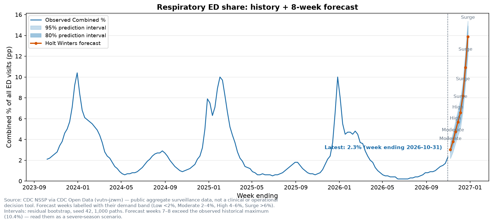
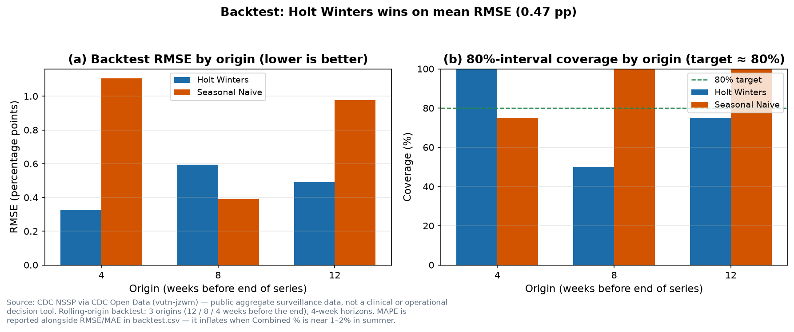
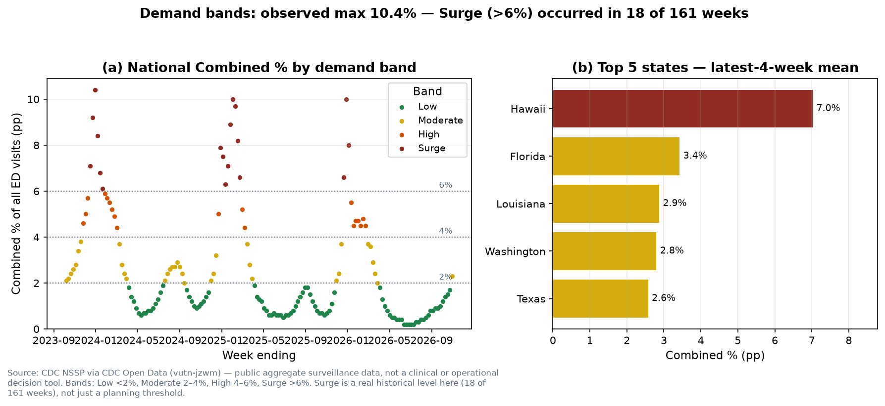
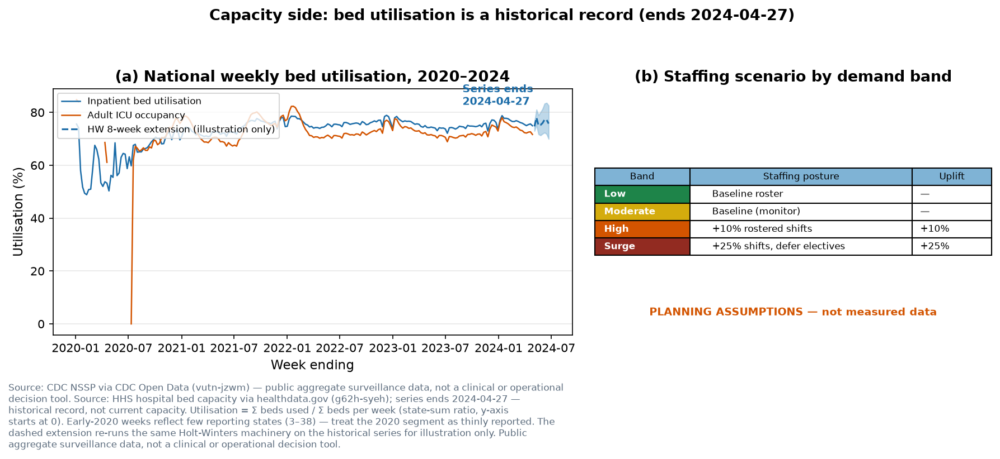

# Day 09 — Healthcare Resource Demand Forecast

> **60-Day Data Analytics + AI Portfolio, Day 09.**
> Forecast visits or bed demand from historical operational trends and quantify forecast uncertainty.

## Problem

Respiratory illness drives a hospital's busiest weeks, and it arrives in waves — but a capacity plan needs more than a single number. This project answers three linked questions about the next 8 weeks: *how many respiratory ED visits should a hospital system expect*, *how uncertain is that number*, and *what staffing posture does each forecast level imply?* The 8-week forecast is published with 80% and 95% prediction intervals, backtested honestly against a seasonal-naïve baseline, and translated into demand bands (Low / Moderate / High / Surge) with a staffing scenario for each band. A second, longer series — national inpatient bed utilisation, 2020–2024 — exercises the same forecasting machinery on the capacity side.

**Audience:** a data analyst or hiring reviewer who wants to see a forecast done properly on real public-health data: a baseline the model must beat, rolling-origin backtesting with interval coverage (not just point error), uncertainty quantified and reported, and a forecast translated into an operational decision without pretending the translation is measured data.

## Dataset

- **Primary — CDC NSSP Emergency Department Visits (COVID-19, Flu, RSV):** dataset `vutn-jzwm` on CDC Open Data (Socrata, no key). Fetched 2026-11-13 via `GET https://data.cdc.gov/resource/vutn-jzwm.json?$limit=50000` — **25,116 rows**, 161 weeks (2023-10-07 → 2026-10-31), 52 geographies (50 states + DC + "United States"), 3 pathogens. Fields: `week_end`, `pathogen`, `geography`, `percent_visits` (% of **all** ED visits in that geography/week). There is **no** `Combined` value in the data — Combined is the sum of the three pathogen percentages (same denominator). 72 rows (0.29%) have NULL `percent_visits`, treated as missing, never 0; no national week is affected.
- **Secondary — HHS hospital bed capacity:** dataset `g62h-syeh` on healthdata.gov (Socrata, no key), two paged calls (`$limit=50000`, `$offset=0/50000`) — **81,713 rows**, 2020-01-01 → **2024-04-27** (reporting ended; a historical record, not current capacity). National weekly inpatient bed utilisation = Σ beds used / Σ beds per week (state-sum ratio, not the mean of per-state ratios), 226 weeks.
- **Licence:** both sources are US federal public-domain data. Attribution: "CDC National Syndromic Surveillance Program (NSSP), Emergency Department Visits — COVID-19, Flu, RSV, via CDC Open Data (data.cdc.gov/resource/vutn-jzwm)" and "U.S. Department of Health and Human Services, COVID-19 Reported Patient Impact and Hospital Capacity by State Timeseries, via healthdata.gov (resource g62h-syeh)".

## Tools

Python 3.12.3; pandas 3.1.1, numpy 2.5.4, matplotlib 3.11.2, plotly 7.1.0, streamlit 1.66.1, requests 2.34.2, pytest 9.2.0, jupyter 1.1.1, nbformat 5.11.1, scikit-learn 1.9.1, scipy 1.18.1, **statsmodels 0.15.0** (new runtime dep this day — Holt-Winters). All pinned in `requirements.txt`. Lint/format: ruff 0.17.4, black 26.10.1 (portfolio-root `requirements-dev.txt`).

## Method

- **Target:** national weekly Combined respiratory ED share, 161 weeks. **Horizon:** 8 weeks ahead (weeks ending 2026-11-07 → 2026-12-26).
- **Methods (exactly two, no tuning grid):** seasonal naïve (same week last year) as the baseline, and Holt-Winters exponential smoothing (additive trend + additive seasonality, period 52). SARIMA was kept out of scope.
- **Intervals:** residual bootstrap (seed 42, 1,000 paths); 80% = 10th/90th percentiles, 95% = 2.5th/97.5th.
- **Backtest:** 3 rolling origins (train ends 12 / 8 / 4 weeks before the end), 4-week horizons; RMSE, MAE, MAPE and 80%-interval coverage per origin × method. The published forecast is the method with the lowest mean backtest RMSE.
- **Demand bands:** Low <2%, Moderate 2–4%, High 4–6%, Surge >6%. **Staffing uplifts are PLANNING ASSUMPTIONS, not measured data:** High +10% rostered shifts, Surge +25% + elective-deferral trigger.
- **SQL check:** the notebook answers mean Combined % by season and the 4-week lagged Combined % twice — pandas and in-memory SQLite — asserted equal.

## Key insights

- **Forecast (Q1):** Holt-Winters publishes Combined % rising **3.03% → 13.87%** over the 8 weeks (bands Moderate, Moderate, High, High, Surge, Surge, Surge, Surge). Final week 80% interval 12.76–14.91%, 95% interval 12.08–15.38%. Latest observed week (2026-10-31): **2.3%** (COVID-19 0.5% + Influenza 1.7% + RSV 0.1%), with influenza already at 1.7% vs 0.3% the same week last year.
- **Backtest (Q2):** Holt-Winters mean RMSE **0.47 pp** vs seasonal naïve **0.82 pp** (MAE 0.42 vs 0.78; MAPE 42.19% vs 80.63%). Mean 80%-interval coverage 75% (Holt-Winters) vs 92% (naïve) against the ≈80% target — Holt-Winters is sharper but slightly under-covers at one origin.
- **Bands & staffing (Q3):** historically Low 89, Moderate 35, High 19, Surge 18 of 161 weeks — Surge is a real level (observed max **10.4%**, 2023-12-30), not a decorative threshold. Top states by latest-4-week mean: Hawaii 7.0% (already Surge), Florida 3.4%, Louisiana 2.9%, Washington 2.8%, Texas 2.6%. Bed utilisation averaged 72.5% (max 78.9%, 2022-12-10) and was 74.95% in its final week (2024-04-27).
- **Honest caveat:** the forecast's final two weeks exceed the observed historical maximum (10.4%) — read them as a severe-season scenario, not a roster plan on their own. See `outputs/insights_summary.md` for the full findings and the one recommendation.

## Visuals

| Chart | What it shows |
|---|---|
| `outputs/charts/01_forecast.png` | National Combined % history + 8-week forecast with 80%/95% intervals, bands labelled |
| `outputs/charts/02_backtest.png` | Backtest RMSE and 80%-interval coverage by origin, both methods |
| `outputs/charts/03_demand_bands.png` | History coloured by demand band + top-5-state panel |
| `outputs/charts/04_bed_capacity.png` | Bed utilisation 2020–2024 (series ends 2024-04-27) + staffing-scenario table |






The Streamlit dashboard (`src/app.py`) embeds the same four charts and adds a state comparison and a volume converter (forecast % → expected visits → expected admissions, defaults 1,000 visits/week and 15% admission rate, both labelled planning assumptions).

## How to run

```bash
python -m venv .venv
source .venv/bin/activate
pip install -r requirements.txt
python -m src.data_pipeline --live      # fetch live, verify counts, build series + forecast
python -m src.data_pipeline --offline   # recompute derived tables from committed CSVs (no network)
python -m src.make_charts               # 4 charts, offline from processed CSVs
python -m pytest tests/ -q              # 39 tests
streamlit run src/app.py                # dashboard (smoke-tested on port 8502)
```

Raw full JSONs are git-ignored (data-size exception, plan §3.4: NSSP ~2 MB, bed ~585 MB on disk) and re-downloaded at build time; committed provenance is `data/raw/sample_rows.json` (1,000 NSSP + 100 bed rows, 799 KB) plus the compact processed CSVs (`data/` total < 5 MB, no file > 1 MB). `--offline` never clobbers `data_source.json`.

## Limitations

- The ED series is a **share** of visits, not a count — visit numbers come only from the user-entered volume assumption.
- The forecast's outer weeks exceed the observed historical maximum (10.4%); the additive-trend model has no ceiling.
- MAPE inflates when Combined % sits near 1–2% in summer; judge methods on RMSE.
- The bed series ends 2024-04-27 and early-2020 weeks cover as few as 3 reporting states; its dashed 8-week extension is a method illustration, not a capacity prediction.
- Iowa has reported nothing since 2026-07-04; Delaware and Georgia nothing since 2026-10-17 (national series unaffected).
- statsmodels' Holt-Winters optimiser emits a ConvergenceWarning on some windows (stops on tolerance, not a failed fit); suppressed in `src/forecast.py`, recorded in `data/README.md`.

## License

MIT — see [LICENSE](LICENSE). Copyright (c) 2026 Victor.
