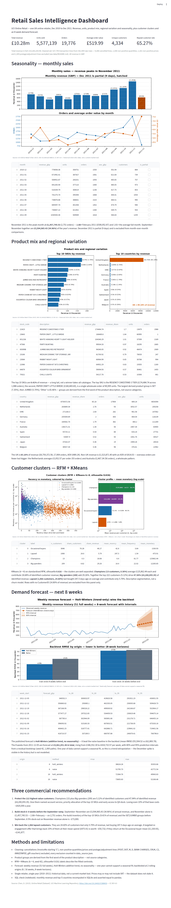
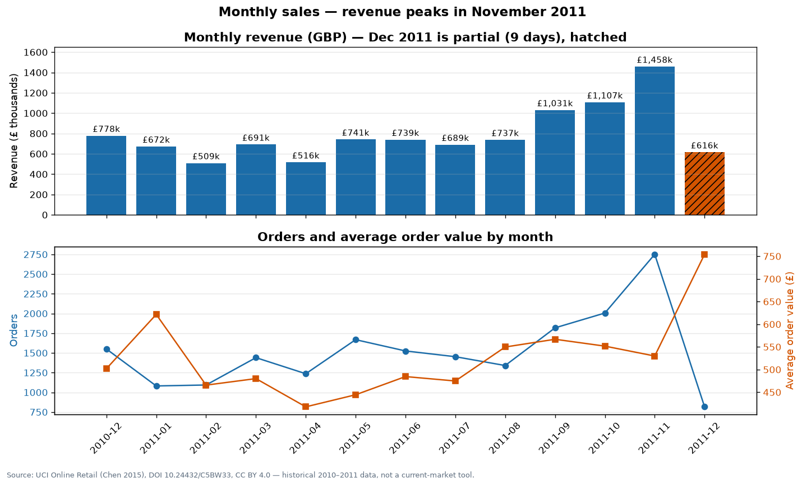
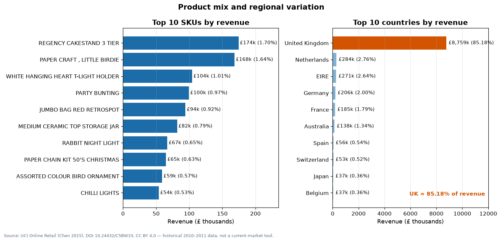
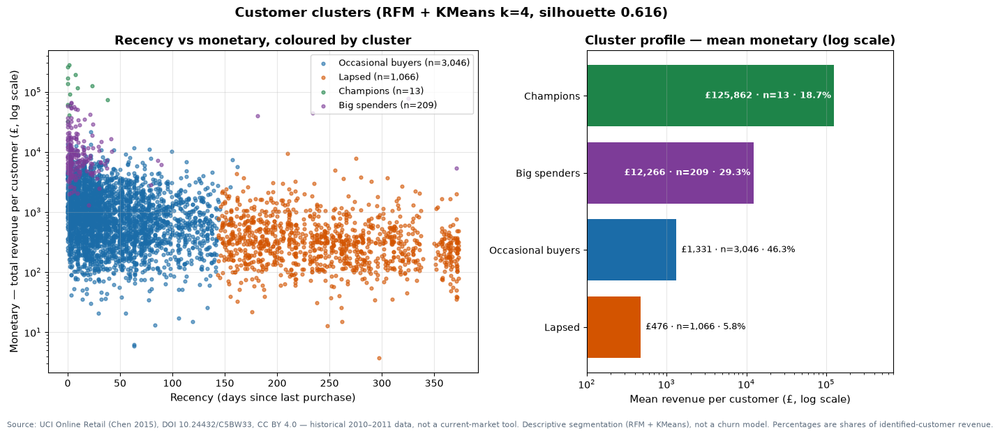
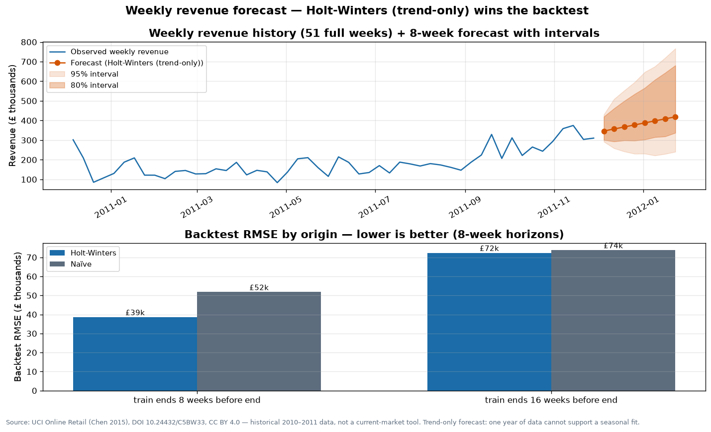

# Day 10 — Retail Sales Intelligence Dashboard

> **60-Day Data Analytics + AI Portfolio, Day 10.**
> A UK online retailer's year of transactions (Dec 2010 – Dec 2011), turned into a
> sales KPI dashboard: where the money comes from, who the customers are, and what
> the next 8 weeks look like — plus three commercial recommendations, each tied to a
> measured number.



## Problem

A UK online retailer has a year of transaction data and three linked questions:
*where does the money actually come from* (revenue, units, product mix, countries,
seasons), *who are the customers* (recency / frequency / monetary value, and which
groups behave alike), and *what should the next quarter look like* (a near-term
demand forecast with honest uncertainty, plus three commercial actions worth
taking)? The dataset is famous and messy in exactly the ways real retail data is
messy — cancelled orders, negative quantities, missing customer IDs, postage and
adjustment lines mixed in with real products, no category column — so the cleaning
rules are part of the deliverable: every exclusion is counted, and every number in
the dashboard traces to the cleaned transaction set documented in
[`data/README.md`](data/README.md).

**Audience:** a data analyst or hiring reviewer who wants to see retail analytics
done properly on real transactional data — a documented cleaning pipeline with
counted exclusions, KPIs with stated definitions and denominators, product mix and
regional variation shown with shares (not just ranks), customer clustering from RFM
with a silhouette check, a forecast with a baseline it must beat and a backtest,
and three recommendations that each name their evidence, their action, and their
expected effect in measured terms.

## Dataset

| Item | Value |
|---|---|
| Source | UCI Machine Learning Repository, dataset **"Online Retail"** (dataset 352), Chen (2015) |
| Dataset page | https://archive.ics.uci.edu/dataset/352/online+retail |
| Download | https://archive.ics.uci.edu/static/public/352/online+retail.zip (ZIP with `Online Retail.xlsx`, 22.6 MB) |
| DOI | https://doi.org/10.24432/C5BW33 |
| Licence | **CC BY 4.0** — Chen, D. (2015). Online Retail [Dataset]. UCI Machine Learning Repository. https://doi.org/10.24432/C5BW33 |
| Fetch date | 2026-11-14 |
| Raw rows | **541,909** rows, 8 columns (InvoiceNo, StockCode, Description, Quantity, InvoiceDate, UnitPrice, CustomerID, Country) |
| Confirmed date range | 2010-12-01 08:26 → 2011-12-09 12:50 |
| Cleaned rows | **527,795** transaction lines → 19,776 orders, 4,334 identified customers |
| Total revenue | **£10,283,243.98** (GBP; the dataset does not state whether prices include VAT) |

Cleaning exclusions, in order: 9,288 cancelled rows (3,836 cancelled invoices) →
1,336 non-positive quantities → 1,181 non-positive prices → 2,309
postage/adjustment lines → 0 missing descriptions. Full counts and the
adjustment-code list are in [`data/processed/data_source.json`](data/processed/data_source.json)
and [`data/README.md`](data/README.md).

**Data-size exception (Day 8 precedent):** the raw XLSX (22.6 MB) is over the
portfolio rule (files < 1 MB, < 5 MB per day folder), so it is git-ignored and
re-downloaded at build time (`python -m src.data_pipeline --live`). The committed
provenance record is `data/raw/sample_rows.json` (1,000 cleaned rows) plus the
processed CSVs in `data/processed/` (164,522 bytes total). No committed file is
over 1 MB.

## KPIs

Computed on the cleaned set; all revenue in GBP.

| KPI | Value |
|---|---|
| Total revenue | £10,283,243.98 |
| Total units sold | 5,577,139 |
| Orders | 19,776 |
| Average order value (AOV) | £519.99 |
| Unique customers (identified) | 4,334 |
| Repeat-customer rate | 65.27% (2,829 of 4,334 customers ordered ≥ 2 times) |
| Top-10 SKU revenue share | 9.41% |
| UK revenue share | 85.18% (£8,759,372.58) |

Definitions: revenue = Σ Quantity × UnitPrice; orders = distinct non-cancelled
InvoiceNo; AOV = revenue / orders; repeat rate = customers with ≥ 2 orders /
all identified customers. Rows with no CustomerID (131,455 rows, 14.80% of
revenue) stay in the revenue/product/country analysis but are excluded from RFM
and clustering.

## Headline findings

**Q1 — Where does the revenue come from?** November 2011 is the peak month at
**£1,457,745.53** (2,751 orders) — **2.86×** February 2011 (£508,952.87, the low
month) and 1.81× the average full month. September–November together are
**£3,594,965.43 (34.96% of annual revenue)**: a Q4 ramp, not a flat year.
December 2011 (£615,501.60) is partial — 9 days only — and is excluded from
month-over-month comparisons. The top SKU is REGENCY CAKESTAND 3 TIER
(£174,484.74, 1.70%, 1,988 orders); the second, PAPER CRAFT LITTLE BIRDIE
(£168,469.60, 1.64%), is a single wholesale order of 80,995 units. The top 10
SKUs are only 9.41% of revenue — a long tail, not a winner-takes-all catalogue.
The largest derived product group is SET (7.35%), then JUMBO (5.70%);
"Other" is 65.46% (groups are the first word of the product description, not
source categories). The UK is 85.18% of revenue (17,904 orders, AOV £489.24);
non-UK revenue is £1,523,871.40 with an AOV of £814.03 — overseas orders are
fewer but bigger: the Netherlands averages £3,052.57 per order (93 orders) and
Australia £2,467.34 (56 orders), a wholesale pattern.

**Q2 — Who are the customers?** RFM + KMeans (k = 4, seed 42) on the 4,334
identified customers; silhouette **0.616** — the clusters are well separated.
**Champions: 13 customers (0.30%)** average £125,862.44 each and contribute
18.68% of identified-customer revenue. **Big spenders: 209 (4.82%)** add 29.26%.
Together the top 222 customers (5.12%) drive **47.94% of identified revenue
(£4,200,055.35)**. Occasional buyers are the bulk — 3,046 customers (70.28%,
46.27% of revenue). **Lapsed: 1,066 customers (24.60%)** last bought 247.5 days
ago on average and contribute only 5.79% of revenue. Descriptive segmentation,
not a churn model.

**Q3 — What demand is coming next?** Weekly revenue (51 full ISO weeks) is
forecast 8 weeks ahead (2011-12-05 → 2012-01-23). Holt-Winters (additive trend,
no seasonality) beat the naïve baseline in the backtest at both rolling origins
(8 and 16 weeks, 8-week horizons): mean RMSE **£55,504.52 vs £62,800.78**, so
Holt-Winters is the published forecast. The 8 weeks total **£3,061,051.48**,
rising from £346,552.30 to £418,710.57 per week, with 80% and 95% prediction
intervals from a residual bootstrap (seed 42, 1,000 paths). No seasonality is
modelled — one year of data cannot support a seasonal fit — so this is a trend
extrapolation, and the December spike visible in the history is discussed but
not modelled.

## The three commercial recommendations

1. **Protect the 222 highest-value customers.** Champions (13) plus Big spenders
   (209) are 5.12% of identified customers and 47.94% of identified revenue
   (£4,200,055.35). Give them named-account service, priority allocation of the
   top-10 SKUs and early access to Q4 stock. Losing even 10% of that base costs
   ~£420,000 a year.
2. **Build stock 6–8 weeks before the September ramp.** September–November are
   £3,594,965.43 (34.96%) of annual revenue, and November alone is £1,457,745.53
   — 2.86× February — on 2,751 orders. Pre-build inventory of the top-10 SKUs
   (9.41% of revenue) and the SET/JUMBO groups before September. A 5% stock-out
   on November revenue alone is ~£73,000.
3. **Win back the 1,066 lapsed customers.** They are 24.60% of customers but
   only 5.79% of revenue, last buying 247.5 days ago on average. A targeted
   re-engagement offer that brings back 10% of them at their mean spend
   (£475.91) is worth ~£50,732; if they return at the Occasional-buyer mean
   (£1,330.93), ~£141,877.

## Visuals









The Streamlit dashboard renders the same four charts plus KPI, table and
recommendation panels — see [`screenshots/dashboard.png`](screenshots/dashboard.png)
(1200×6321, real capture of the running app on port 8502).

## How to run

```bash
python -m venv .venv
source .venv/bin/activate
pip install -r requirements.txt          # pinned versions, Python 3.12.3
python -m src.data_pipeline --live       # download + clean + build all tables
python -m src.make_charts                # regenerate the 4 charts (offline)
streamlit run src/app.py                 # dashboard (loads processed CSVs only)
pytest tests/ -q                         # 31 tests
```

Offline mode (no network, no raw file needed — regenerates the derived tables
and charts from the committed processed CSVs):

```bash
python -m src.data_pipeline --offline
```

`--use-cache` re-uses a previously downloaded raw file under `data/raw/`.
`--synthetic` builds a clearly-labelled synthetic fallback (seed 42) only if the
live download fails; it never overwrites real data.

## Method

1. **Download + verify:** one GET of the UCI ZIP; XLSX opens, row count 541,909,
   8 columns with the exact expected names.
2. **Clean (in order, every exclusion counted):** cancellations (InvoiceNo
   starting `C`) → Quantity ≤ 0 → UnitPrice ≤ 0 → postage/adjustment lines
   (StockCodes POST, DOT, M, D, BANK CHARGES, CRUK, C2, AMAZONFEE; gift-voucher
   codes `gift_0001_*`; Descriptions POSTAGE/DISCOUNT/MANUAL/BANK CHARGES/AMAZON
   FEE/CRUK) → missing Description. Revenue = Quantity × UnitPrice (GBP).
3. **Aggregate:** monthly (Dec 2010–Nov 2011 full months; Dec 2011 partial, 9
   days, flagged and excluded from MoM), weekly (ISO weeks, full weeks only —
   51 weeks), country, top-20 SKUs, derived product groups (first alphabetic
   word of Description, top 10 + Other).
4. **Cluster:** RFM per identified customer (recency to the dataset end,
   frequency = orders, monetary = revenue), standardised, KMeans k = 4,
   seed 42, n_init 10; silhouette 0.616; labels assigned from the fitted
   centroids.
5. **Forecast:** weekly revenue, 8 weeks ahead; exactly two methods — naïve
   baseline and Holt-Winters additive trend (no seasonality: one year cannot
   support a seasonal fit); residual bootstrap intervals (seed 42, 1,000
   paths); backtest at 2 rolling origins (8/16 weeks, 8-week horizons);
   the lower mean backtest RMSE is published.
6. **SQL check:** the notebook recomputes monthly revenue and the top-5
   countries in SQLite (in-memory) and asserts them equal to the pandas
   result.
7. **Charts + dashboard:** 4 matplotlib charts (to scale, legible, footnoted
   with source + CC BY 4.0); Streamlit dashboard loads the processed CSVs
   only.

## Validation

| Gate | Result |
|---|---|
| pytest (`tests/test_pipeline.py`) | **31/31 passed** — from the day folder and from the repo root |
| black + ruff | clean (`black --check src tests`, `ruff check src tests`) |
| Notebook (`notebooks/analysis.ipynb`) | 16 cells, **0 error cells** via nbconvert (executed 2026-11-14; forecast section re-ran from the raw XLSX and asserted the backtest/forecast match) |
| Streamlit smoke | port **8502**: HTTP 200 on `/` and on `/_stcore/health`; real full-page screenshot `screenshots/dashboard.png` (1200×6321, 461,265 bytes — palette-quantised from the RGB capture to meet the < 1 MB rule); server killed, port verified free |
| Hand validation (coder) | Sum of `monthly_sales.csv` revenue_gbp = **£10,283,243.98**, exactly equal to the total in `data_source.json` (difference £0.00). Country-revenue sum also equals £10,283,243.98; top-10 SKU share recomputed as 9.41%; repeat rate recomputed from `rfm_clusters.csv` as 65.27%; AOV recomputed as £519.99. See [`data/README.md`](data/README.md). |
| Orchestrator validate | `python agents/orchestrator.py --day 10 validate` — **10/11 passed**. The one FAIL is a false positive in the validator's credential heuristic: it matches the case-insensitive pattern `AKIA` + 16 characters inside the base64-encoded chart PNG embedded in `notebooks/analysis.ipynb` (line 328, output of the chart-01 display cell). That string is random base64 image data, not a credential — there is no key, token, password or secret anywhere in the tree. See `coder_handoff.md`. |
| File sizes | No committed file > 1 MB; `data/` committed total 467 KB (< 5 MB); notebook 904,309 bytes (< 1 MB) |

## Limitations

- **Single retailer, single year (2010–2011):** historical data, not a
  current-market tool. Seasonality is observed, not estimated from multiple
  years; the forecast is a trend extrapolation, not a seasonal prediction.
- **Product groups are derived** (first word of the product description), not
  source categories.
- **Prices may or may not include VAT** — the dataset does not state it.
- **14.80% of revenue (£1,522,177.33) has no CustomerID** and is excluded from
  RFM/clustering only; the cluster shares are shares of *identified*-customer
  revenue.
- **No Saturday transactions at all** in the data (the retailer apparently did
  not trade on Saturdays) — a data quirk, not a finding about demand.
- **Recommendations are commercial judgements grounded in measured numbers**,
  not measured effects: the £-values are what is at stake if the stated
  assumption holds, not a measured uplift.
- No `.pbix` is built (a Power BI file cannot be built or verified in this
  environment); the Streamlit dashboard + 4 static charts are the deliverables.

## License

MIT — see [LICENSE](LICENSE). Copyright (c) 2026 Victor.

Dataset attribution (CC BY 4.0): Chen, D. (2015). Online Retail [Dataset]. UCI
Machine Learning Repository. https://doi.org/10.24432/C5BW33
