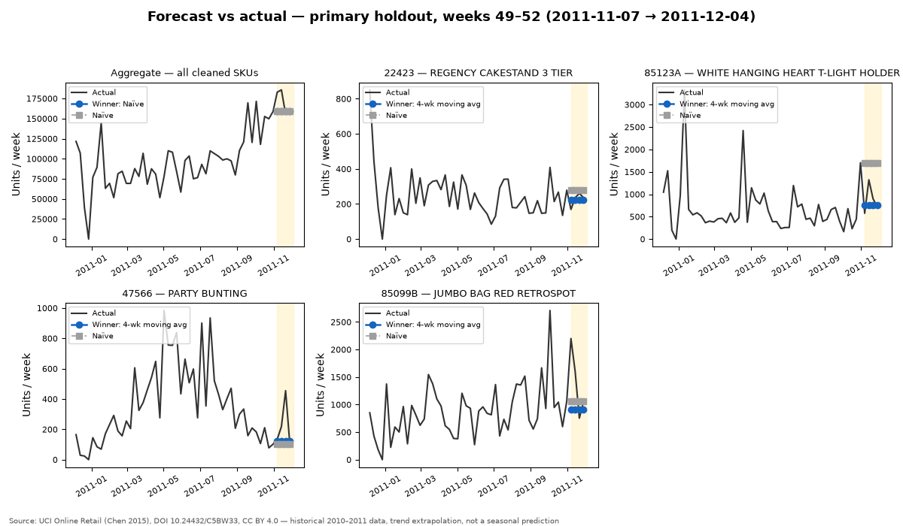
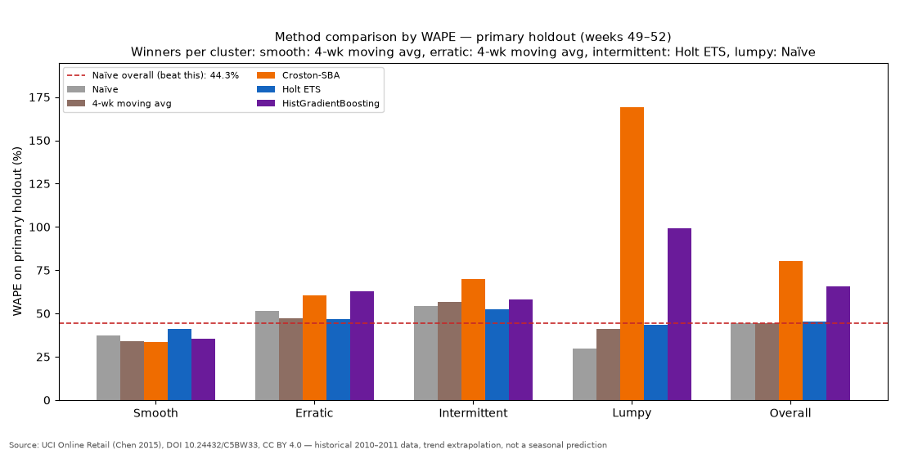
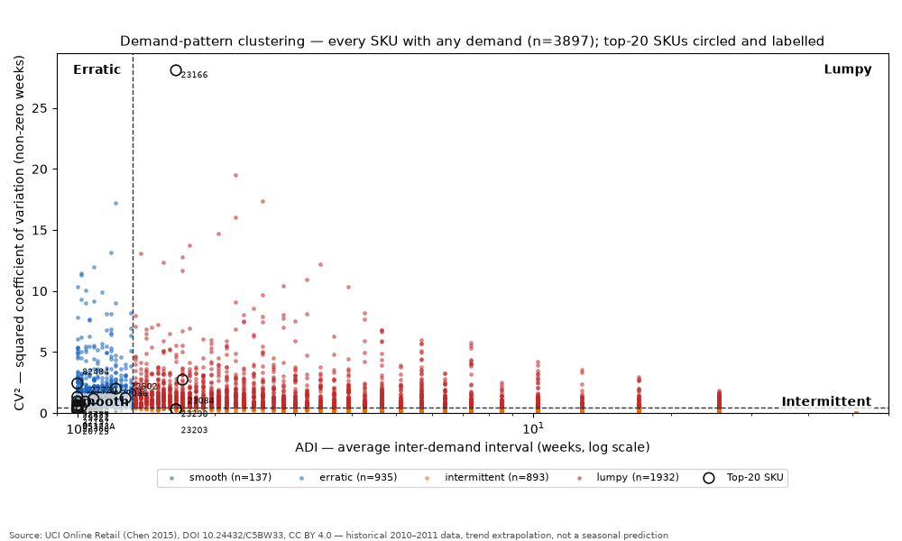
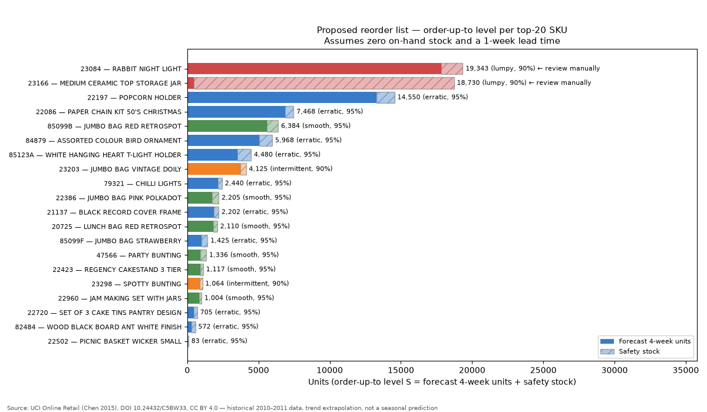

# Day 11 — Inventory Demand Forecast

> **60-Day Data Analytics + AI Portfolio, Day 11.** SKU-level demand forecast
> plus a proposed reorder list for a UK online retailer (UCI Online Retail,
> 2010–2011).

> **Two assumptions, labelled on every surface:**
> 1. The forecast is a **4-week trend extrapolation from one retailer over one
>    year — NOT a seasonal prediction** (52 weeks is a single cycle; no seasonal
>    component is fitted).
> 2. The reorder list assumes **zero on-hand stock and a 1-week lead time**
>    (the dataset has no inventory or lead-time columns).

## Problem

A UK online retailer needs to know, for each of its key products, how much will
sell over the next 4 weeks — and what to reorder now to avoid stockouts without
over-stocking slow lines. The catalogue has ~4,000 StockCodes, but demand is
heavily concentrated and most of the long tail is intermittent (many zero
weeks). This project forecasts the top 20 SKUs by revenue individually plus one
aggregate series, compares simple baselines against an intermittent-demand
method, exponential smoothing and gradient boosting on the same 4-week holdout,
picks the winner **per demand-pattern cluster** (not one global winner), and
turns the winning forecasts into a labelled, assumption-based reorder list.

**Audience:** a retail inventory / buying manager who needs to know what to
order now, which lines to review manually, and how much to trust each number —
and a data reviewer checking the forecast method.

## Dataset

- **Source:** UCI Machine Learning Repository, dataset "Online Retail" (ID 352),
  DOI [10.24432/C5BW33](https://doi.org/10.24432/C5BW33).
  Download: `https://archive.ics.uci.edu/static/public/352/online+retail.zip`
  (one plain full download; the server ignores Range headers). Fetched live
  2026-11-15, no key, no account.
- **Raw file:** 541,909 rows, 8 columns, confirmed date range
  2010-12-01 08:26 → 2011-12-09 12:50. **Licence: CC BY 4.0.**
  Attribution: Chen, D. (2015). Online Retail [Dataset]. UCI Machine Learning
  Repository. https://doi.org/10.24432/C5BW33
- **Cleaning (in order):** cancelled invoices 9,288 rows (3,836 invoices) →
  non-positive quantity 1,336 → non-positive price 1,181 → non-product
  adjustment lines 2,309 → missing description 0. Cleaned: **527,795 rows,
  £10,283,243.98 revenue, 5,577,139 units, 19,776 orders.** Partial first/last
  weeks (27,349 rows) excluded from the weekly series; 52 full weeks kept
  (2010-12-06 → 2011-12-04). No Saturday transactions (6-day trading week).
  Full provenance in [data/README.md](data/README.md).
- **Data-size exception:** the raw XLSX (22.6 MB) is git-ignored and
  re-downloaded at build time; committed data is the processed CSVs plus a
  1,000-row cleaned sample (`data/raw/sample_rows.json`), total under 5 MB.

## Tools

Python 3.12.3; pandas, numpy, matplotlib, scikit-learn, scipy, statsmodels,
openpyxl, Streamlit, requests, pytest, jupyter/nbformat. Pinned versions in
[requirements.txt](requirements.txt). Lint/format: ruff 0.17.4, black 26.10.1.

## Method

- **Weekly demand (units)** per SKU over the 52 full weeks. **Top-20 selection:**
  revenue-ranked over the 52 full weeks, each SKU with demand in ≥ 30/52 weeks.
  One top-20-by-revenue SKU failed the rule — 23284 DOORMAT KEEP CALM AND COME
  IN (£37,111.60, only 27 weeks with demand) — and was replaced by the
  next-ranked passer. The final top 20 are 12.36% of cleaned full-week revenue.
- **Clustering:** Syntetos–Boylan ADI/CV² quadrants (cut-offs 1.32 / 0.49) for
  all 3,897 SKUs with any demand; KMeans k = 4 cross-check on the top 200 SKUs
  (agreement 64.0% — partial agreement, SBC decides).
- **Forecast (exactly 6 methods, 4-week horizon):** naïve, seasonal naïve
  (unavailable on a 52-week series — WAPE n/a, never contends), 4-week moving
  average, Croston-SBA (α = 0.1), Holt ETS (additive trend, **no seasonality**),
  HistGradientBoosting (lags 1/2/4, rolling-4 mean, week-of-year/month,
  December indicator). Two backtest origins: primary train weeks 1–48 /
  forecast weeks 49–52 (the Christmas ramp, headline); supplementary train
  weeks 1–29 / forecast weeks 30–33.
- **Winner rule:** per cluster, lowest volume-weighted primary-holdout WAPE,
  with a 0.5 pp simplicity tie-break (naïve → moving average → Croston-SBA →
  Holt → gradient boosting).
- **Reorder logic (assumptions):** 1-week lead time; 95% service level
  (z = 1.65) for smooth/erratic, 90% (z = 1.28) for intermittent/lumpy; safety
  stock SS = z·σ·√LT with σ over training weeks 1–48 (non-zero weeks only for
  intermittent/lumpy); order-up-to S = forecast 4-week demand + SS; implied
  order assumes zero on-hand. A 2-week-lead-time ROP is shown as a sensitivity
  column. Lumpy SKUs and Croston-SBA winners are flagged `review-manually`.
- **SQL check:** weekly demand per SKU and the top-20 ranking answered in
  pandas and in in-memory SQLite, asserted equal (notebook + test).

## Key insights

| KPI | Value |
|---|---|
| Total units, 52 full weeks (all SKUs) | 5,241,272 |
| Top-20 revenue share | 12.36% |
| Headline WAPE, primary holdout (best overall method) | 44.2% (4-week moving average) |
| SKUs flagged review-manually | 2 of 20 |
| Published 4-week forecast, top 20 | 69,194 units |
| Aggregate 4-week forecast (naïve) | 627,508 units |
| Total order-up-to, top 20 | 97,314 units (69,194 forecast + 28,120 safety stock) |

1. **Demand is concentrated and mostly lumpy.** Of 3,897 SKUs with any demand,
   1,932 (49.6%) are lumpy and only 137 (3.5%) are smooth; lumpy lines are
   25.7% of units, erratic lines 48.5%.
2. **Simple wins on the hard test.** On the Christmas-ramp holdout the 4-week
   moving average is best overall (44.2% WAPE) and wins the smooth (34.0%) and
   erratic (47.3%) clusters on the tie-break; Holt wins intermittent (52.4%),
   naïve wins lumpy (29.7%). Gradient boosting is second-worst (65.5%) and
   Croston-SBA worst overall (80.3%) — 44 usable training rows per SKU is too
   little for ML, and a flat Croston rate cannot track bulk spikes. The
   aggregate series is the exception: naïve wins at 8.3% WAPE.
3. **Order now, but review the lumpy lines by hand.** The two lumpy SKUs hold
   38,073 of the 97,314-unit order-up-to total. 23166 (MEDIUM CERAMIC TOP
   STORAGE JAR) is the warning case: a 476-unit forecast but 18,254 units of
   safety stock, because one training week sold 74,215 units.

## Visuals






## How to run

```bash
python -m venv .venv
source .venv/bin/activate
pip install -r requirements.txt
python -m src.data_pipeline --live        # download + build (raw re-downloaded)
python -m src.data_pipeline --offline     # regenerate from committed CSVs (no network, never clobbers data_source.json)
python -m src.make_charts                 # rebuild the 4 charts
pytest tests/ -q                          # 28 tests
streamlit run src/app.py                  # dashboard (use a fresh port, e.g. --server.port 8502)
```

## Validation

- `black --check` + `ruff check` clean; `pytest` 28/28 (from the repo root and
  from inside the day folder); notebook runs via nbconvert with exit 0 and
  0 error cells (15 cells, 657,984 bytes).
- Hand validation (exact, diff 0.0): 23166 safety stock recomputed by hand
  from the committed CSVs — 1.28 × σ(non-zero training weeks) = 18,253.99
  units, matching `reorder_list.csv` exactly. 22423's 4-week forecast (901.0)
  and the aggregate naïve WAPE (8.25%) also recomputed exactly. See
  [data/README.md](data/README.md).
- Offline pipeline run reproduces the processed files and leaves
  `data_source.json` byte-identical (tested).
- Streamlit smoke: port 8502, HTTP 200 on `/` and `/_stcore/health`, real
  `screenshots/dashboard.png`, server killed and port verified free.

## Recommendations

Exactly three, each evidence → action → expected effect — see
[outputs/insights_summary.md](outputs/insights_summary.md).

## Limitations

- Single retailer, single year (2010–2011); the forecast is a trend
  extrapolation, not a seasonal prediction — no seasonal component is fitted
  and nothing is claimed beyond the 4-week horizon.
- The 4-week holdout falls on the Christmas ramp, so errors look worse than a
  mid-year holdout (the supplementary mid-year holdout is reported alongside).
- Prices may or may not include VAT (the dataset does not state it); no
  currency conversion or tax adjustment.
- No inventory or lead-time data exists: the reorder list is assumption-based
  (zero on-hand, 1-week lead time, 95%/90% service levels). Never treat the
  order-up-to level as a measured stock position.
- One week (2010-12-27) has zero transactions — the retailer was closed over
  Christmas; December 2011 is a partial month (data end 2011-12-09).
- No Power BI file is produced (a `.pbix` cannot be built or verified in this
  environment); the forecast is delivered as the Streamlit app + static charts.

## License

MIT — see [LICENSE](LICENSE). Copyright (c) 2026 Victor.
