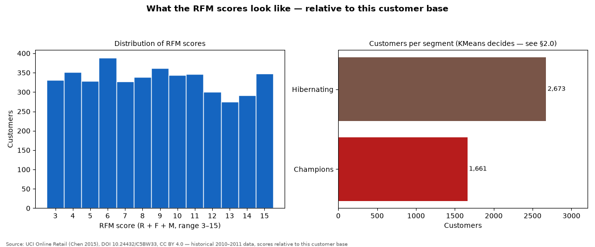
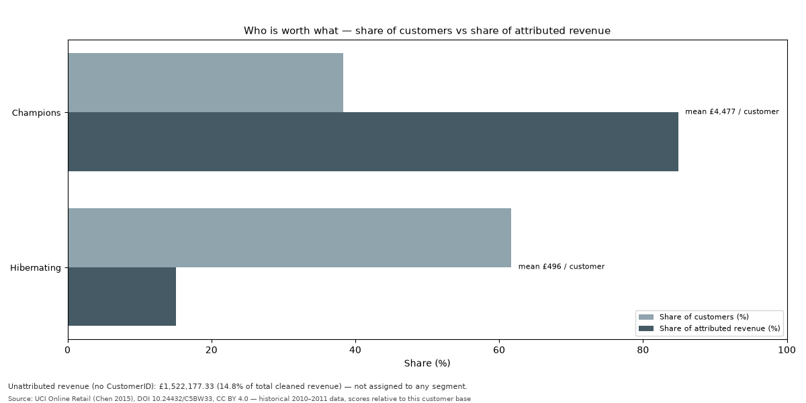
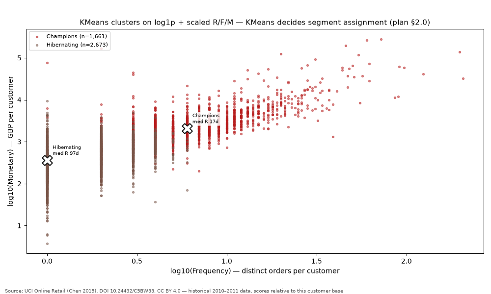
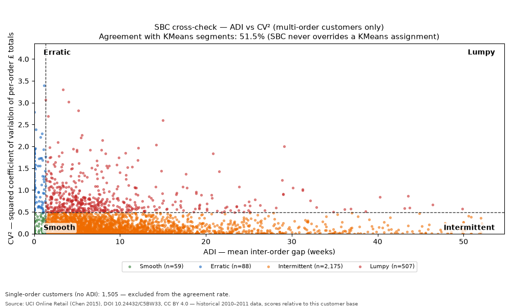

# Day 12 — Customer Segmentation Engine

> **60-Day Data Analytics + AI Portfolio, Day 12.**
> Which customer groups does this UK online retailer actually have — who is
> worth protecting, who is slipping away, and who is already gone — and what
> should the retailer do differently for each group?

## Problem

A UK online retailer has 4,334 identified customers but no picture of who
they are. This project computes Recency, Frequency and Monetary value per
customer, scores them, clusters them with KMeans, and turns each resulting
segment into exactly one tailored action with the £ at stake. The dataset is
the same messy real retail data as Days 10–11 — cancelled orders, negative
quantities, missing customer IDs, postage and adjustment lines — so the
cleaning rules are part of the deliverable: every exclusion is counted, and
every number traces to the cleaned RFM table.

**Three hard limits, labelled on every surface:**

1. **RFM scores are relative to this customer base, not absolute.** A score
   of 5 means "top fifth of these customers", not "good" in any absolute
   sense. Recompute if the base changes.
2. **The data is 2010–2011 — the segments describe that year, not today.**
   No claim is made about current customers; the actions are the *kind* of
   action each segment warrants, illustrated with this year's £.
3. **14.80% of cleaned revenue has no CustomerID (£1,522,177.33 of
   £10,283,243.98) and cannot be attributed to any segment.** Segment
   revenue shares are reported against attributed revenue AND against total
   cleaned revenue, so the unattributed gap is visible, never hidden.

## Dataset

- **Source:** UCI Machine Learning Repository, dataset 352, "Online Retail".
- **Download:** `https://archive.ics.uci.edu/static/public/352/data.csv`
  (primary, HTTP 200, 45,038,760 bytes); fallback legacy XLSX
  `https://archive.ics.uci.edu/ml/machine-learning-databases/00352/Online%20Retail.xlsx`.
- **Fetched:** 2026-11-16 (live, no key, no account).
- **Rows:** 541,909 raw, 8 columns; 527,795 cleaned rows, £10,283,243.98
  revenue, 5,577,139 units, 19,776 orders.
- **Window:** 2010-12-01 08:26 → 2011-12-09 12:50 (confirmed from the
  file); snapshot date 2011-12-10 = max(InvoiceDate) + 1 day.
- **Licence:** CC BY 4.0. Attribution: Chen, D. (2015). Online Retail
  [Dataset]. UCI Machine Learning Repository. https://doi.org/10.24432/C5BW33.
  Also cite Chen, Sain & Guo (2012) as the RFM-segmentation source paper
  for this exact dataset.

## Tools

Python 3.12.3; pandas 3.1.1, numpy 2.5.4, matplotlib 3.11.2, plotly 7.1.0,
streamlit 1.66.1, requests 2.34.2, scikit-learn 1.9.1, scipy 1.18.1,
openpyxl 3.1.5 (fallback XLSX reading), pytest 9.2.0, jupyter 1.1.1.
See `requirements.txt` (pinned).

## Method

1. **Clean** (in order, every exclusion counted): parse dates; drop
   cancellations (InvoiceNo starting `C`); drop Quantity ≤ 0; drop
   UnitPrice ≤ 0; drop non-product adjustment lines (StockCodes POST, DOT,
   M, D, BANK CHARGES, CRUK, C2, AMAZONFEE and descriptions POSTAGE,
   DISCOUNT, MANUAL, BANK CHARGES, AMAZON FEE, CRUK); drop missing
   descriptions; `line_revenue = Quantity × UnitPrice`. Rows with no
   CustomerID are excluded from RFM only and counted as unattributed
   revenue.
2. **RFM** per customer: Recency = snapshot − most recent InvoiceDate, in
   calendar days (range 1–374); Frequency = distinct InvoiceNo;
   Monetary = Σ(Quantity × UnitPrice) in GBP.
3. **Score** by percentile rank, 1–5 (ties share a score), R inverted;
   `rfm_code = R·100 + F·10 + M`, `rfm_score = R + F + M` (3–15).
4. **Decider rule (plan §2.0): KMeans on log1p-transformed,
   StandardScaler-scaled R/F/M is the SOLE decider of segment
   assignment.** RFM scores name and explain the segments; SBC quadrants
   are a cross-check with the agreement rate reported. No customer is
   ever moved between segments because their RFM code "looks like"
   another segment — on this data the score rule would disagree with
   KMeans for 2,830 of 4,334 customers.
5. **k re-derived:** k = 2..8 by silhouette (primary) + elbow SSE.
   **Chosen k = 2, silhouette 0.4330** (k = 3: 0.3374, k = 4: 0.3339) —
   not copied from Day 10's k = 4. Clusters are named from their median
   RFM-score profile by the fixed prototype rule (plan §4.2).
6. **SBC cross-check:** ADI in weeks (mean inter-order gap ÷ 7) and CV²
   from per-order £ totals, cut-offs 1.32 / 0.49; single-order customers
   get quadrant `Single-order` and are excluded from the agreement rate.
7. **Actions:** exactly one tailored action per segment, each with the £
   at stake (= the segment's revenue).
8. **SQL check:** the notebook answers count + revenue per segment and
   the top segment by revenue twice — pandas and in-memory SQLite —
   and asserts they agree.

## Key insights

| Segment | Customers | Share | Revenue £ | Share of attributed | Median R / F / M |
|---|---:|---:|---:|---:|---:|
| Champions | 1,661 | 38.3% | £7,436,335.44 | 84.9% | 17 days / 6 orders / £2,044.87 |
| Hibernating | 2,673 | 61.7% | £1,324,731.21 | 15.1% | 97 days / 1 order / £358.38 |
| Unattributed (no CustomerID) | — | — | £1,522,177.33 | — (14.8% of total) | — |

- **Q1 — Which groups exist?** Two, and they are starkly unequal: 1,661
  Champions (38.3% of customers) drive 84.9% of attributed revenue
  (£7,436,335.44 of £8,761,066.65), while 2,673 Hibernating customers
  (61.7%) account for only 15.1% (£1,324,731.21). The median customer
  bought 51 days ago, twice, for £668.13. The top customer (14646) spent
  £279,138.02 across 72 orders.
- **Q2 — Who is worth protecting, who is slipping away, who is gone?**
  Champions are worth protecting (median 17 days since last order, 6
  orders). Hibernating customers are already mostly gone — median 97 days
  since last order, a single order each, £358.38 median spend — and 1,505
  customers (34.7%) bought exactly once. The SBC cross-check agrees with
  KMeans for only **51.5%** of multi-order customers (1,458 of 2,829):
  most customers are Intermittent (2,175, 50.2%), not Smooth (59) — this
  retailer’s customers order irregularly, so demand-pattern quadrants do
  not line up with value segments, and the disagreement is reported, not
  hidden.
- **Q3 — What to do differently per group?** One action per segment (see
  table below).

### Per-segment actions (£ at stake)

| Segment | Action | £ at stake |
|---|---|---|
| Champions | Protect them first: VIP retention — early access, a personal thank-you and priority service. | £7,436,335.44 to protect |
| Hibernating | Reactivate cheaply or let go: one low-cost reactivation email featuring what's new since they last bought. | £1,324,731.21 already lapsed |

## Visuals






## How to run

```bash
python -m venv .venv
source .venv/bin/activate
pip install -r requirements.txt
python -m src.data_pipeline --live        # download + clean + segment
python -m src.data_pipeline --offline     # regenerate from committed CSVs
python -m src.make_charts                 # rebuild the 4 charts
pytest tests/ -q                          # 28 tests
streamlit run src/app.py                  # dashboard
```

`--live` downloads the 43 MB CSV once and caches it under `data/raw/`
(git-ignored); `--use-cache` reuses the cached file; `--offline` runs
from the committed processed CSVs only and never overwrites a live
`data_source.json`.

## Validation

- **Hand validation (exact):** customers 14646 (R=2, F=72, M=£279,138.02),
  14911 (R=2, F=198, M=£136,275.72) and 17850 (R=373, F=34, M=£5,391.21)
  recomputed independently from the raw CSV — diffs 0, 0, £0.00. Champions
  revenue: rfm_table sum £7,436,335.44 vs segment_profile £7,436,335.44
  (diff £0.00); Hibernating £1,324,731.21 vs £1,324,731.21 (diff £0.00).
  Recency range 1–374 matches plan §4.1. Full arithmetic in
  `data/README.md`.
- **Tests:** 28/28 pass (`pytest tests/ -q`, from the day folder and from
  the portfolio root). `black --check` + `ruff check` clean.
- **Decider verified:** the `segment` column reproduces exactly from the
  KMeans labels + prototype naming for every customer (test
  `test_decider_segment_equals_kmeans_label_mapping`).
- **Notebook:** `notebooks/analysis.ipynb` executes top-to-bottom via
  nbconvert with 0 error cells; the SQL check asserts in the notebook.
- **Streamlit smoke:** fresh port 8502, HTTP 200 on `/` and
  `/_stcore/health`, real `screenshots/dashboard.png`, server killed,
  port verified free. See `coder_handoff.md`.
- **Offline run:** regenerates the derived tables; `data_source.json`
  byte-identical after the offline run (sha256 verified).

## Limitations

- Historical 2010–2011 data — the segments describe that year, not today.
- RFM scores are relative to this customer base, not absolute.
- 14.80% of cleaned revenue (£1,522,177.33) has no CustomerID and cannot
  be attributed to any segment.
- Prices may or may not include VAT — the dataset does not state it.
- SBC and KMeans disagree about 48.5% of multi-order customers
  (agreement 51.5%); SBC is a cross-check only and never overrides a
  KMeans assignment.
- k = 2 is a coarse split: with only two segments, "Hibernating" mixes
  one-time buyers with lapsed repeat buyers; a finer k would separate
  them, but the silhouette rule (plan §4.3) selects k = 2 on this data.
- No Power BI file is produced (a `.pbix` cannot be built or verified in
  this environment); the segmentation is delivered as the Streamlit app +
  static charts.

## License

MIT — see [LICENSE](LICENSE). Copyright (c) 2026 Victor.
