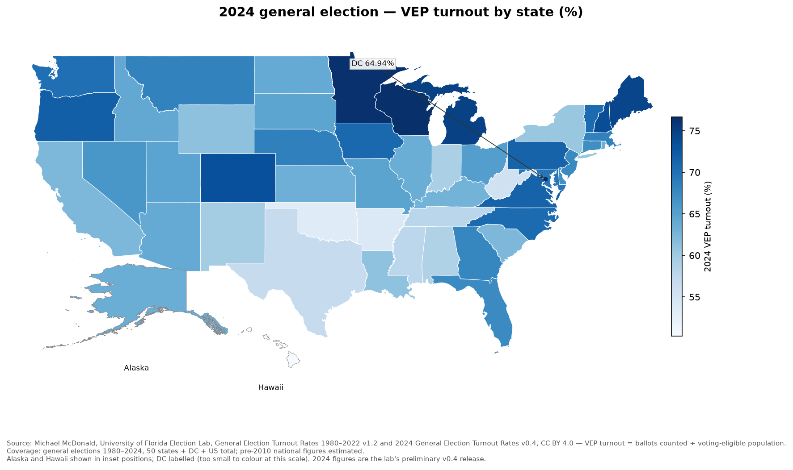
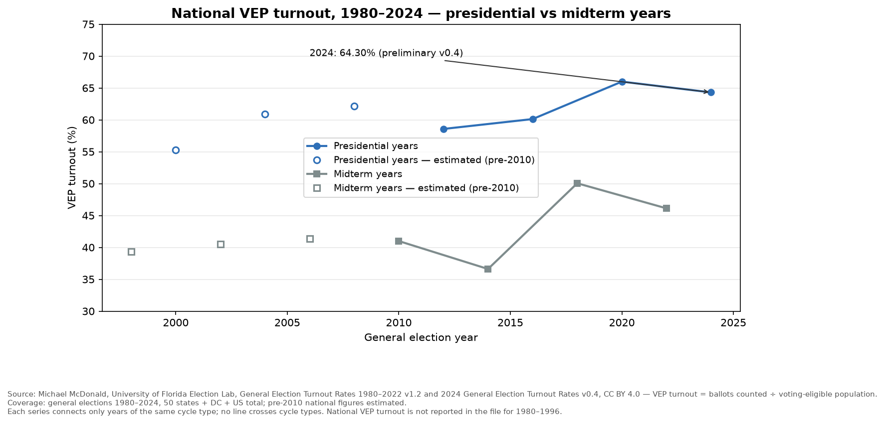
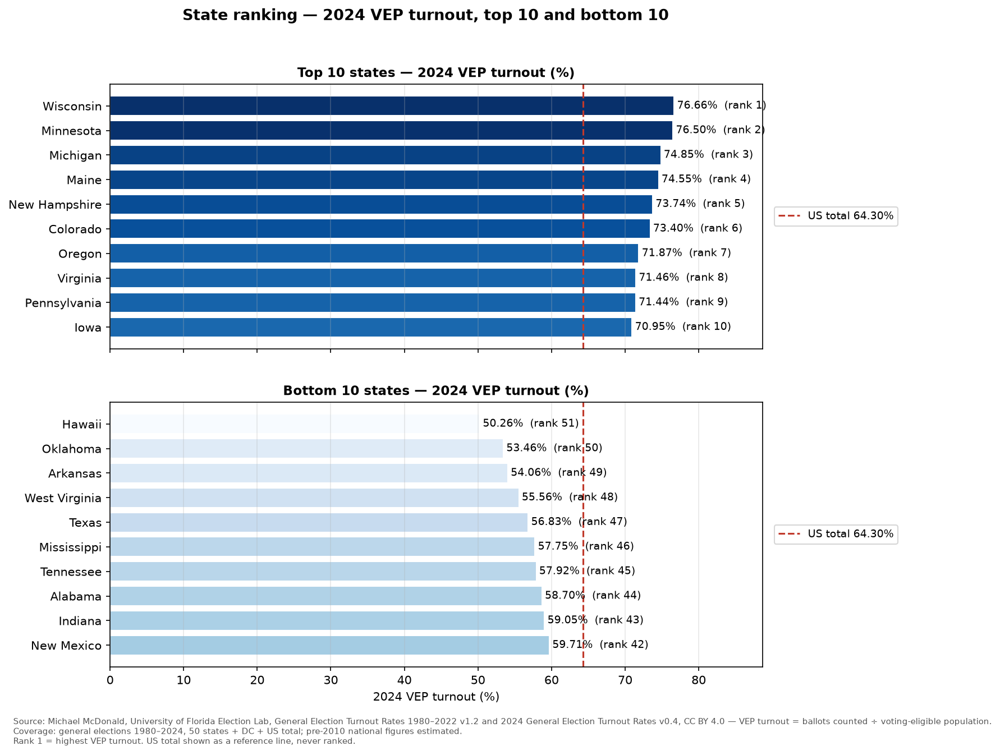
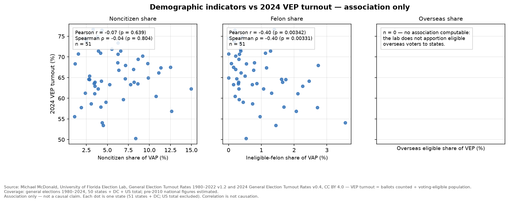

# Day 14 — Voter Turnout Analytics

**How does voter turnout differ across US states and over time, and which
demographic indicators move with it — described only, with every number
traceable to its source and no claim about what caused any difference?**

## Problem and audience

US voter turnout differs sharply by state and by election type — in 2024 the
national voting-eligible-population (VEP) turnout was **64.30%**, while in the
2022 midterm it was **46.12%** — but the figures a reader finds online mix
three different denominators (voting-eligible, voting-age, and registered
voters), compare presidential years against midterms as if they were one trend,
and sometimes present a state's rate without saying what it is a rate *of*.
This project does the comparison once, in the open: one authoritative
denominator (VEP, from the UF Election Lab), like-with-like comparisons within
cycle type only, a state choropleth for 2024, a 1980–2024 time series split by
cycle type, a ranked state table, and the demographic indicators the files
themselves carry shown next to turnout as associations — with the source, the
denominator, and the coverage limits stated on every surface.

**Audience:** a nonpartisan reader (citizen, student, journalist) who wants to
know where turnout is higher or lower, how it has moved over time, and which
demographic indicators move with it — and a data reviewer checking the method.

## Headline findings

| Figure | Value |
|---|---|
| 2024 national VEP turnout | **64.30%** (156,766,239 ballots ÷ 243,803,423 VEP) |
| 2022 midterm VEP turnout | **46.12%** (112,030,874 ballots ÷ 242,907,672 VEP) |
| 2024 vs 2020 (same cycle) | **−1.69 pp** (65.99% → 64.30%) |
| 2022 vs 2018 (same cycle) | **−3.93 pp** (50.05% → 46.12%) |
| Highest 2024 state | **Wisconsin 76.66%** (rank 1, +1.62 pp vs 2020) |
| Lowest 2024 state | **Hawaii 50.26%** (rank 51, −5.09 pp vs 2020) |
| States up vs 2020 / down | 7 up, 44 down (median change −1.68 pp) |
| Presidential-year range (national) | 55.28% (2000) – 65.99% (2020) |
| Midterm-year range (national) | 36.61% (2014) – 50.05% (2018) |
| Noncitizen share vs turnout (2024) | Pearson r = −0.07, p = 0.639, n = 51 — no clear association |
| Ineligible-felon share vs turnout (2024) | Pearson r = −0.40, p = 0.003, n = 51 — moves with turnout; association only |
| Overseas eligible share vs turnout (2024) | n = 0 — not computable (see Limitations) |

## The decider rules (plan §2.0 — non-negotiable)

1. **UF VEP is authoritative; EAVS is a cross-check only.** The primary metric
   is VEP turnout recomputed from the UF files. If the EAVS cross-check
   disagrees with a UF numerator, the UF figure stands and the disagreement is
   recorded — the pipeline never overwrites a UF figure with an EAVS figure,
   never averages the two, and never plots an EAVS-derived rate on the same
   axis as a VEP rate.
2. **Demographic associations are descriptive only.** Every association is a
   Pearson **and** Spearman correlation with **n, r, and p**, on 2024
   state-level data. Allowed language: "moves with", "associated with".
   Forbidden: "causes", "drives", "explains", "because of". No regression
   model is fitted.
3. **Outliers are reported as found, never dropped.** States outside the
   1.5×IQR fence or with |z| > 3 within their cycle type are listed in the
   memo with their values. Flagged rows stay in every chart and table.
4. **Like-with-like cycle comparisons only.** Presidential vs previous
   presidential, midterm vs previous midterm. A presidential-to-midterm
   change is labelled a "cycle-type change", not a trend.

## Top 10 and bottom 10 states, 2024 VEP turnout

| Rank | State | VEP turnout | pp change vs 2020 |
|---|---|---|---|
| 1 | Wisconsin | 76.66% | +1.62 pp |
| 2 | Minnesota | 76.50% | −2.71 pp |
| 3 | Michigan | 74.85% | +1.58 pp |
| 4 | Maine | 74.55% | −0.32 pp |
| 5 | New Hampshire | 73.74% | −0.22 pp |
| 6 | Colorado | 73.40% | −3.29 pp |
| 7 | Oregon | 71.87% | −3.46 pp |
| 8 | Virginia | 71.46% | −0.33 pp |
| 9 | Pennsylvania | 71.44% | +1.51 pp |
| 10 | Iowa | 70.95% | −1.09 pp |

| Rank | State | VEP turnout | pp change vs 2020 |
|---|---|---|---|
| 42 | New Mexico | 59.71% | −0.78 pp |
| 43 | Indiana | 59.05% | −2.01 pp |
| 44 | Alabama | 58.70% | −2.76 pp |
| 45 | Tennessee | 57.92% | −1.32 pp |
| 46 | Mississippi | 57.75% | −2.88 pp |
| 47 | Texas | 56.83% | −2.96 pp |
| 48 | West Virginia | 55.56% | −1.63 pp |
| 49 | Arkansas | 54.06% | −2.11 pp |
| 50 | Oklahoma | 53.46% | −0.97 pp |
| 51 | Hawaii | 50.26% | −5.09 pp |

District of Columbia: 64.94%, rank 25, −3.93 pp vs 2020. US total 2024:
64.30% (shown as a reference line, never ranked).

## Charts









## Setup and how to run

```bash
python3 -m venv .venv
.venv/bin/pip install -r requirements.txt
.venv/bin/pip install -r ../requirements-dev.txt   # black, ruff, mypy, pytest-cov

# Full build: download the UF CSVs + docs, shapefile and EAVS zip, build
# processed tables, cross-checks and charts.
.venv/bin/python -m src.data_pipeline --live

# Rebuild from the committed CSVs only (no network; never clobbers a live
# data_source.json). Chart 01 is skipped if the shapefile is absent.
.venv/bin/python -m src.data_pipeline --offline

# Charts only:
.venv/bin/python -m src.make_charts

# Dashboard:
.venv/bin/streamlit run src/app.py --server.port 8502

# Tests (31 tests, coverage ≥ 30):
.venv/bin/python -m pytest tests/ -q --cov=src --cov-fail-under=30

# Notebook (16 cells, 0 errors):
.venv/bin/python -m jupyter nbconvert --to notebook --execute --inplace notebooks/analysis.ipynb
```

## Validation

- **Recompute check:** VEP turnout recomputed from ballots ÷ VEP for all 987
  rows that carry both figures matches the file's `VEP_TURNOUT_RATE` within
  0.05 pp — max difference **0.0226 pp**, 0 rows over tolerance. Spot-checks:
  2024 US 64.30%, 2022 US 46.12%, 2024 Colorado 73.40%, California 62.26%,
  Arkansas 54.06%.
- **VEP reconciliation:** recomputing VEP from its components (VAP −
  noncitizen VAP − ineligible felons + eligible overseas) flags 0 rows over
  the 0.5% tolerance; max relative difference 0.058%.
- **EAVS cross-check (2024 numerator, F1a ballots cast summed by state):**
  sampled states Colorado −0.011% and California +0.15% (both within 0.5%).
  Additional states Arkansas −5.71% and Texas +0.78% differ by more than 0.5%
  and are disclosed in `outputs/insights_summary.md` — UF figures stand.
- **Shapefile join:** all 51 jurisdictions (50 states + DC) joined the Census
  geometry; 0 unmatched.
- **Manual validation:** 2024 US VEP turnout recomputed by hand from the
  committed CSV — 156,766,239 ÷ 243,803,423 × 100 = 64.30% — diff **0.0 pp**
  against the file rate.
- **Tests:** 31 passed, coverage 65.20% (threshold 30). `black --check` +
  `ruff check` clean; `mypy src tests` clean (strict-by-default).
- **Notebook:** 16 cells, executes via nbconvert with 0 error cells.
- **Streamlit smoke:** fresh port, HTTP 200 on `/` and `/_stcore/health`,
  real screenshot at `screenshots/dashboard.png` (see `coder_handoff.md`).

## Limitations

- **Descriptive only — no predictive model.** Nothing here forecasts a future
  election. Correlations are associations, never causes.
- **State level only — no county map.** No verified no-key source gives a
  county-level denominator; a county "turnout rate" built on total county
  population would be a different, misleading metric.
- **2024 figures are the lab's preliminary v0.4 release** (dated 3/2/2026).
- **Pre-2010 national figures are estimated** (the lab estimates the national
  total from reporting states); national VEP turnout is **not reported in the
  file for 1980–1996** at all. Pre-2010 state ballots are null for 200
  state-year rows and stay null.
- **State-level overseas eligible voters are not apportioned by the lab**, so
  no state-level overseas association is computable (n = 0).
- **VAP vs VEP vs registered voters are different denominators** and are never
  mixed, averaged, or plotted on the same axis.

## Data and attribution

- Source: Michael McDonald, University of Florida Election Lab, General
  Election Turnout Rates 1980–2022 v1.2 and 2024 General Election Turnout
  Rates v0.4 (https://election.lab.ufl.edu/voter-turnout/), CC BY 4.0.
  Retrieved 2026-11-21.
- Cross-check: U.S. Election Assistance Commission, 2024 Election
  Administration and Voting Survey
  (https://www.eac.gov/research-and-data/studies-and-reports).
- Map geometry: U.S. Census Bureau, cartographic boundary file
  `cb_2024_us_state_500k` (public domain).
- Full provenance, row counts, and cross-check results:
  [`data/README.md`](data/README.md) and
  [`data/processed/data_source.json`](data/processed/data_source.json).
- Insights memo: [`outputs/insights_summary.md`](outputs/insights_summary.md).
