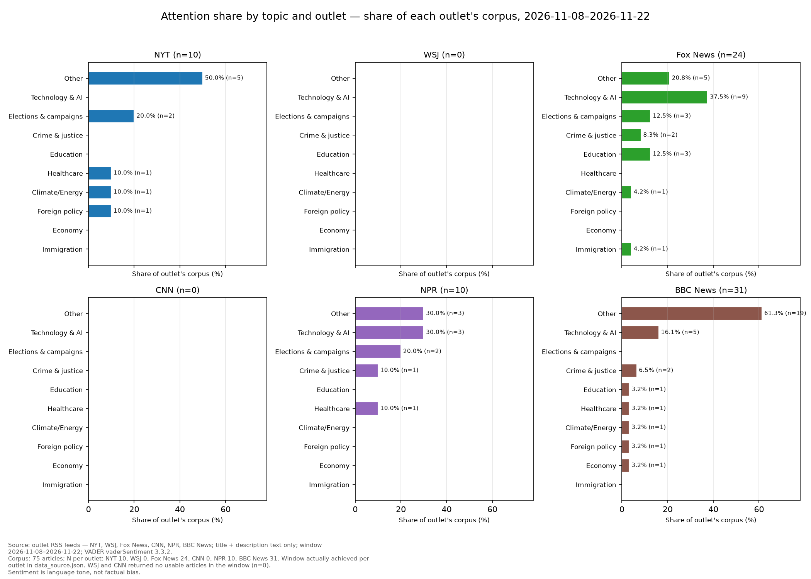
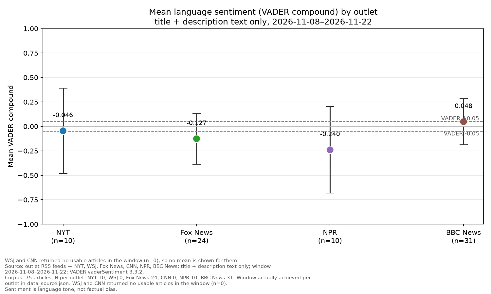
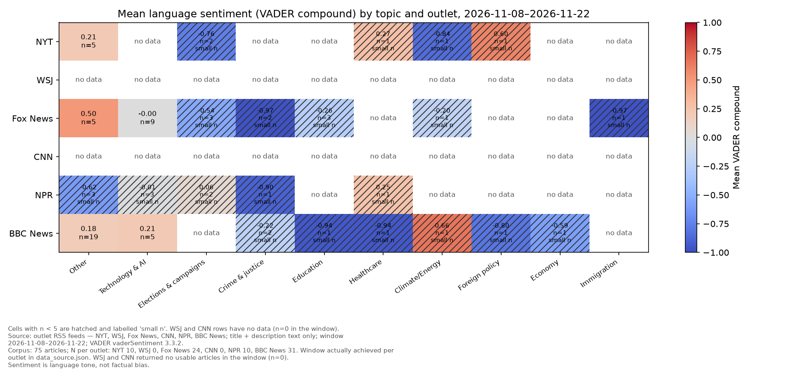
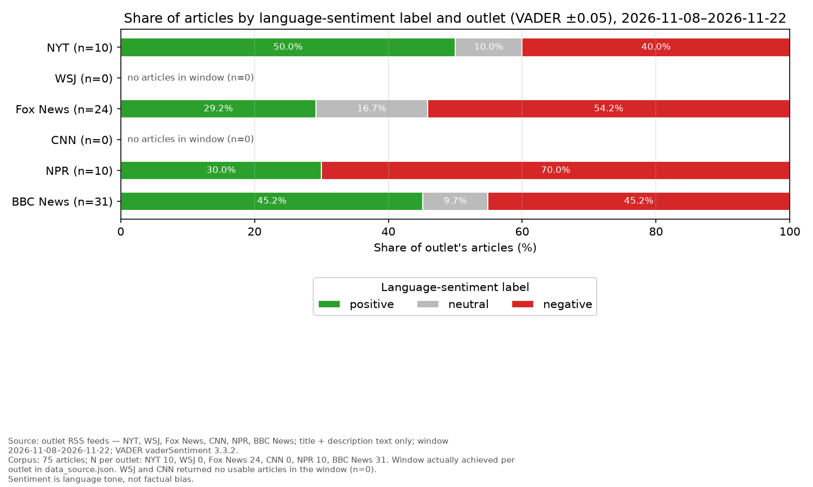

# Day 15 — Political News Coverage Analyzer

> **60-Day Data Analytics + AI Portfolio, Day 15.**

Compare topics, attention, and language sentiment across an explicitly
defined news corpus — six named outlets, one fixed window, title +
description text only — without ever equating sentiment with factual
bias.

## Nonpartisan guardrail

Sentiment measures the emotional tone of the words used; it is not a measure of factual accuracy, fairness, or political bias.

This build is descriptive only: no predictive model, no bias score, no
leaning score, no fact-checking, no causal claims. The same metrics,
charts and table columns are used for every outlet, and every chart
and table states its coverage (outlets, window actually achieved per
outlet, N per outlet, title + description text only) and its source.

## Problem

Readers are told that outlets "cover different things" or "sound
different", but those claims are rarely shown with a corpus anyone can
check: which outlets, which dates, which text, counted how. This
project does the comparison once, in the open: six named national
outlets, one fixed 14-day window (2026-11-08–2026-11-22), title +
description text only, one frozen keyword dictionary for ten topics,
one frozen lexicon (VADER) for language sentiment, and the same
attention, topic and sentiment tables for every outlet — with the
source feeds, the window actually achieved per outlet, the N per
outlet, and the limits stated on every surface.

**Audience.** A nonpartisan reader (citizen, student, journalist) who
wants to see, for the same two weeks, what six major outlets covered,
how much attention each topic got, and how the language sounded — and
a data reviewer checking the method, who wants the explicit corpus
(feed URLs, window, drop counts), the frozen topic dictionary printed
verbatim, a recomputation cross-check on VADER scores, a 30-article
sample review with an agreement rate, and every published number
matching the committed CSVs.

## Dataset

- **Source:** outlet RSS feeds, fetched 2026-11-22, no key, no login.
  One GET per feed, parsed with `feedparser`, raw XML stored verbatim
  in `data/raw/`.
- **Corpus:** 75 articles with `pubDate` in 2026-11-08–2026-11-22.

| Outlet | Feed URL | HTTP | Bytes | Fetched | Dropped (outside window) | Dropped (no link/date) | Final N | Window actually achieved |
|---|---|---|---|---|---|---|---|---|
| NYT | https://rss.nytimes.com/services/xml/rss/nyt/HomePage.xml | 200 | 21,419 | 10 | 0 | 0 | 10 | 2026-11-20–2026-11-22 |
| WSJ | https://feeds.a.dj.com/rss/RSSWorldNews.xml | 200 | 13,317 | 20 | 20 | 0 | 0 | — (feed served January 2025 items) |
| Fox News | https://moxie.foxnews.com/google-publisher/latest.xml | 200 | 258,357 | 25 | 1 | 0 | 24 | 2026-11-22 |
| CNN | http://rss.cnn.com/rss/edition.rss | 200 | 130,144 | 50 | 46 | 4 | 0 | — (feed served April 2023 items) |
| NPR | https://feeds.npr.org/1001/rss.xml | 200 | 14,301 | 10 | 0 | 0 | 10 | 2026-11-21–2026-11-22 |
| BBC News | https://feeds.bbci.co.uk/news/rss.xml | 200 | 26,437 | 33 | 2 | 0 | 31 | 2026-11-11–2026-11-22 |

Total raw XML: 463,975 bytes (each file < 1 MB, `data/` total < 5 MB).
No duplicates were found (0 removed). No outlet is claimed to cover
the full 14 days unless its earliest `pubDate` reaches back that far.

**Two outlets returned no usable articles in the window.** WSJ's feed
served 20 items dated January 2025 and CNN's feed served 46 items
dated April 2023 (plus 4 items with no parseable date). Both are kept
in every table and chart with n=0 — they are not silently dropped.
The Fox News feed also contained one item dated 2026-11-25 (after the
fetch date), which the window filter dropped.

- **GDELT:** not used. The GDELT DOC API v2 is an optional cross-check
  only; the researcher verified on 2026-11-22 that it rate-limits
  (HTTP 429) after one successful call, and the build is complete on
  RSS alone.
- **Licence / attribution:** RSS feeds are the outlets' own content,
  fetched for analysis. The repo stores headlines, descriptions and
  links only, plus derived counts and scores — no full article text
  is republished. Attribute each outlet by name with a link to its
  site (see `data/README.md`). `vaderSentiment` is MIT-licensed.
  No personal data is handled.

## Tools

Python 3.12.3; pandas 3.1.1, numpy 2.5.4, scipy 1.18.1, matplotlib
3.11.2, streamlit 1.66.1, feedparser 6.0.14, vaderSentiment 3.3.2
(full pins in `requirements.txt`). Dev tooling (ruff 0.17.4, black
26.10.1, mypy 2.4.1, pytest-cov 7.1.0) is pinned in the portfolio-root
`requirements-dev.txt`.

## Method

1. Fetch the 6 RSS feeds (`--live`), one GET per feed, raw XML stored
   verbatim; re-use with `--use-cache`; rebuild offline with
   `--offline` (never overwrites `data_source.json` when a live record
   exists).
2. Parse with `feedparser`; keep `outlet, title, description, link,
   pub_date, guid`. Drop items missing a link or a parseable date,
   then items outside 2026-11-08–2026-11-22, then deduplicate by URL.
3. Analysis text = `title + " " + description`. Topic: frozen keyword
   dictionary below — most hits wins, ties go to the topic whose
   keyword appears earliest in the text, zero hits means Other.
4. Sentiment: VADER compound on the original-cased text; standard
   thresholds ≥ +0.05 positive, ≤ −0.05 negative, otherwise neutral.
   Mean with 95% CI (t-interval; bootstrap with 1,000 resamples,
   seed 42, when |skew| > 1; intervals clipped to [−1, +1]).
   Every share carries a Wilson 95% CI.
5. Tests: chi-square on the topic × outlet table with the sparse-cell
   rule (collapse to the 4 largest topics + All other topics, then a
   permutation p-value with 10,000 shuffles, seed 42); Shapiro-Wilk
   normality gate picks ANOVA or Kruskal-Wallis for sentiment by
   outlet; pairwise tests only with a stated correction (Tukey HSD
   after ANOVA; pairwise Mann-Whitney U with Bonferroni correction
   after Kruskal-Wallis).

### Frozen topic dictionary (verbatim — identical to `src/topics.py`)

```python
{'Economy': ['economy',
             'economic',
             'inflation',
             'jobs',
             'unemployment',
             'wages',
             'market',
             'stock',
             'recession',
             'gdp',
             'interest rate',
             'federal reserve',
             'trade',
             'tariff',
             'deficit',
             'budget',
             'consumer price',
             'mortgage'],
 'Healthcare': ['health',
                'healthcare',
                'hospital',
                'doctor',
                'medicare',
                'medicaid',
                'vaccine',
                'disease',
                'drug',
                'pharmaceutical',
                'insurance',
                'clinic',
                'patient',
                'mental health'],
 'Immigration': ['immigration',
                 'immigrant',
                 'migrant',
                 'border',
                 'asylum',
                 'deportation',
                 'visa',
                 'citizenship',
                 'refugee',
                 'customs'],
 'Climate/Energy': ['climate',
                    'energy',
                    'carbon',
                    'emission',
                    'renewable',
                    'solar',
                    'wind power',
                    'oil',
                    'gas price',
                    'electric vehicle',
                    'wildfire',
                    'hurricane',
                    'drought',
                    'environment'],
 'Foreign policy': ['foreign policy',
                    'ukraine',
                    'russia',
                    'china',
                    'taiwan',
                    'middle east',
                    'israel',
                    'gaza',
                    'nato',
                    'diplomacy',
                    'sanction',
                    'war',
                    'military',
                    'defense',
                    'treaty',
                    'summit'],
 'Elections & campaigns': ['election',
                           'campaign',
                           'vote',
                           'voter',
                           'candidate',
                           'polling',
                           'poll',
                           'ballot',
                           'primary',
                           'democrat',
                           'republican',
                           'congress',
                           'senate',
                           'house of representatives',
                           'governor',
                           'president',
                           'white house'],
 'Crime & justice': ['crime',
                     'police',
                     'court',
                     'trial',
                     'justice',
                     'prison',
                     'shooting',
                     'murder',
                     'arrest',
                     'lawsuit',
                     'supreme court',
                     'judge',
                     'gun',
                     'fentanyl'],
 'Technology & AI': ['technology',
                     'artificial intelligence',
                     'ai',
                     'tech',
                     'cybersecurity',
                     'cyberattack',
                     'data breach',
                     'social media',
                     'smartphone',
                     'semiconductor',
                     'robot',
                     'algorithm'],
 'Education': ['education',
               'school',
               'teacher',
               'student',
               'college',
               'university',
               'tuition',
               'curriculum',
               'classroom',
               'graduation',
               'childcare'],
 'Other': []}
```

Matching is on lowercased `title + " " + description`; keywords match
as substrings; one hit is counted per keyword occurrence per topic.
`Other` has no keywords — it is the fallback only. The dictionary was
frozen before the pipeline ran and was not tuned after seeing results.

## Key insights

Corpus: **75 articles** — NYT 10, WSJ 0, Fox News 24, CNN 0, NPR 10,
BBC News 31. All headline findings below are language and attention
findings in this corpus and window only.

### Q1 — What topics did each outlet cover, and how much attention did each topic get?

Corpus-wide, the largest shares went to **Other (42.7%, 32 of 75)** —
articles matching no dictionary keyword — and **Technology & AI
(22.7%, 17 of 75)**, then Elections & campaigns (9.3%, 7 of 75).
The largest single attention-share cell is **BBC News × Other:
61.3% (19 of 31, Wilson 95% CI 43.8%–76.3%)**. Fox News gave its
largest share to Technology & AI (37.5%, 9 of 24, Wilson 95% CI
21.2%–57.3%). NYT's largest share was Other (50.0%, 5 of 10) and
NPR's was a tie between Other and Technology & AI (30.0% each,
3 of 10). Every share is reported with its N and Wilson CI in
`data/processed/topic_attention.csv`.

| Topic | Corpus share (n=75) |
|---|---|
| Other | 42.7% (32) |
| Technology & AI | 22.7% (17) |
| Elections & campaigns | 9.3% (7) |
| Crime & justice | 6.7% (5) |
| Education | 5.3% (4) |
| Healthcare | 4.0% (3) |
| Climate/Energy | 4.0% (3) |
| Foreign policy | 2.7% (2) |
| Economy | 1.3% (1) |
| Immigration | 1.3% (1) |

### Q2 — How does the language sentiment of coverage differ across outlets and topics?

Mean VADER compound (95% CI) by outlet, title + description text only:

| Outlet | n | Mean compound | 95% CI | Median | % positive | % neutral | % negative |
|---|---:|---:|---:|---:|---:|---:|---:|
| NYT | 10 | −0.046 | −0.483 to 0.391 | 0.077 | 50.0% | 10.0% | 40.0% |
| WSJ | 0 | — | — | — | — | — | — |
| Fox News | 24 | −0.127 | −0.388 to 0.135 | −0.084 | 29.2% | 16.7% | 54.2% |
| CNN | 0 | — | — | — | — | — | — |
| NPR | 10 | −0.240 | −0.682 to 0.202 | −0.350 | 30.0% | 0.0% | 70.0% |
| BBC News | 31 | 0.048 | −0.187 to 0.283 | 0.000 | 45.2% | 9.7% | 45.2% |

All four outlets with articles have 95% CIs that include 0, so no
outlet's average language tone is distinguishable from neutral in
this corpus. By topic, the only groups with n ≥ 5 are Other and
Technology & AI (Fox News: Other mean 0.501, Technology & AI mean
−0.004; BBC News: Other mean 0.185, Technology & AI mean 0.207).
These are differences in language tone only.

### Q3 — Are the topic and sentiment differences across outlets larger than chance?

- **Topic × outlet:** chi-square on the 4 outlets with articles × 10
  topics: χ² = 31.94, df = 27, asymptotic p = 0.234. Minimum expected
  cell count 0.13 — below 5, so the sparse-cell rule applied: the
  collapsed 4 × 5 table (4 largest topics + All other topics) gives
  χ² = 18.90, df = 12, p = 0.091, still sparse, so the conclusion
  rests on the **permutation p-value (10,000 shuffles, seed 42):
  p = 0.221**. No evidence that the distribution of topics differs
  across outlets in this corpus and window.
- **Sentiment by outlet:** BBC News failed Shapiro-Wilk normality
  (p = 0.022), so **Kruskal-Wallis: H = 2.09, p = 0.553**. No evidence
  that average language tone differs across outlets. Pairwise
  Mann-Whitney U tests with Bonferroni correction: all 6 corrected
  p-values are 1.000.
- **Sentiment by topic within an outlet:** Fox News one-way ANOVA
  (Other vs Technology & AI): F = 4.26, p = 0.061. BBC News one-way
  ANOVA: F = 0.01, p = 0.941. No other outlet had 2 topics with
  n ≥ 5.

### Sample review

A stratified sample of 5 articles per outlet with articles in the
window (seed 42) was drawn — **20 articles** (NYT, Fox News, NPR,
BBC News), because WSJ and CNN had no articles to sample. The
tester (2026-11-22) read each title + description and recorded the
topic a human reader would assign. **Agreement rate: 55.0% (11 of
20)** — BBC News 2 of 5 (40.0%), Fox News 2 of 5 (40.0%), NPR 4 of
5 (80.0%), NYT 3 of 5 (60.0%). The 9 disagreements: BBC "'Move on!'
Former PMs pile in with advice for Andy Burnham" (assigned
Technology & AI, reviewer Elections & campaigns), BBC "Mexican drug
lord on FBI's 10 most wanted list arrested in shoot-out" (assigned
Healthcare, reviewer Crime & justice), BBC "Theresa May 'aghast' at
Burnham's EU plans" (assigned Other, reviewer Foreign policy), Fox
News "$275M Obama-era solar fraud case" (assigned Climate/Energy,
reviewer Crime & justice), Fox News "American Culture Quiz"
(assigned Technology & AI, reviewer Other), Fox News "Indonesia
candy factory fire leaves multiple dead" (assigned Crime & justice,
reviewer Other), NPR "NPR's Senior Podcast Challenge" (assigned
Technology & AI, reviewer Other), NYT "Drones, Texts and Diversions:
How Mexico Captured a Most Wanted Man" (assigned Healthcare,
reviewer Crime & justice), NYT "What Machines Love" (assigned
Other, reviewer Technology & AI). The dictionary is not tuned after
seeing the agreement rate.
sample already shows why the review matters: the frozen keyword
`ai` matches as a substring inside words such as "said", and `drug`
matches crime reporting as Healthcare — the agreement rate is the
honest measure of how far the dictionary can be trusted.

## Visuals









The dashboard screenshot is `screenshots/dashboard.png`.

## How to run

```bash
python -m venv .venv
source .venv/bin/activate
pip install -r requirements.txt
python -m src.data_pipeline --live      # fetch feeds + build processed files
python -m src.make_charts              # rebuild the 4 charts
python -m src.data_pipeline --offline  # rebuild derived tables, no network
streamlit run src/app.py               # dashboard (default port 8501)
pytest tests/ -q --cov=src --cov-fail-under=30
```

## Validation

- **Hand-validation (plan §4.4):** the largest attention-share cell
  (BBC News × Other) was recomputed by hand from
  `data/processed/articles.csv`, independently of the pipeline code:
  19 ÷ 31 × 100 = **61.2903%** (committed 61.2903%, difference
  0.0000 pp); Wilson 95% CI recomputed by hand as
  **[43.8238%, 76.2671%]** (committed [43.8238, 76.2671], difference
  0.0000 pp). Tolerance was 0.01 pp.
- **VADER recompute:** 5 hand-picked titles recomputed with a direct
  `vaderSentiment` call match the pipeline's compound to 3 decimals
  (max difference 0.000); the pipeline's own cross-check of 5 further
  titles also matches exactly (max difference 0.000).
- **Corpus integrity:** every stored article's `pub_date` is inside
  2026-11-08–2026-11-22, URLs are unique, per-outlet counts sum to
  the corpus total (75), every article has exactly one topic and a
  VADER compound in [−1, +1] with a valid label.
- **Dictionary check:** the dictionary printed above is byte-identical
  to `TOPIC_KEYWORDS` in `src/topics.py` (asserted by a test).
- **Tests:** 38 tests in `tests/test_pipeline.py`, all passing; coverage
  56.35% measured over `src/` (threshold 30; the coder's 55.99% was
  measured before the sample review was filled — filling the review
  covers 3 more statements, see `test_report.md` §1).
  `black --check` + `ruff check` clean; `mypy src tests` clean.
- **Notebook:** `notebooks/analysis.ipynb` runs top-to-bottom via
  nbconvert with exit 0 and 0 error cells.
- **Streamlit smoke:** fresh port 8502+, HTTP 200 on `/` and
  `/_stcore/health`, real `screenshots/dashboard.png` (see
  `coder_handoff.md`).

## Limitations

- **Sentiment is language tone only** — never a measure of factual
  accuracy, fairness, or political bias. VADER is a general-purpose
  social-media lexicon, not built for news text.
- **Title + description text only** — no full article text; no
  scraping of linked article pages. Every sentiment and topic result
  is a headline + summary language result.
- **Descriptive only** — no predictive model, no bias score, no
  leaning score, no fact-checking, no causal claims.
- **Keyword matching is crude** — a headline can mention a word
  without being about that topic; the sample review (agreement rate
  55.0%, 11 of 20) is the honest measure of the dictionary's trustworthiness.
- **Small, uneven corpus** — 75 articles; WSJ and CNN contributed
  none in the window; NYT and NPR only 10 each. Shares from n=10
  carry wide Wilson intervals (e.g. ±27 pp), and most topic × outlet
  cells are sparse — hence the permutation p-value.
- **Rolling feeds** — RSS lists are the latest N items, not archives;
  the window actually achieved per outlet is shorter than 14 days
  for every outlet (best: BBC News, 12 days). A later
  fetch would return a different latest-N slice.
- **GDELT not used** — optional cross-check only; skipped because the
  researcher verified it rate-limits, and the build is complete on
  RSS alone.
- **Sample review complete** — agreement rate 55.0% (11 of 20;
  BBC News 2/5, Fox News 2/5, NPR 4/5, NYT 3/5); see the Sample
  review section for the disagreement list.

## License

MIT — see [LICENSE](LICENSE). Copyright (c) 2026 Victor.
