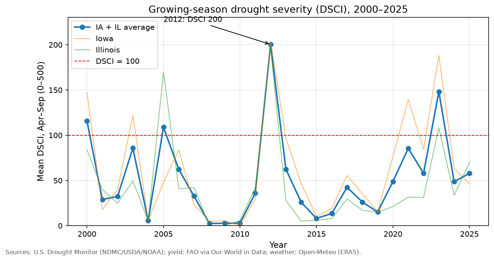
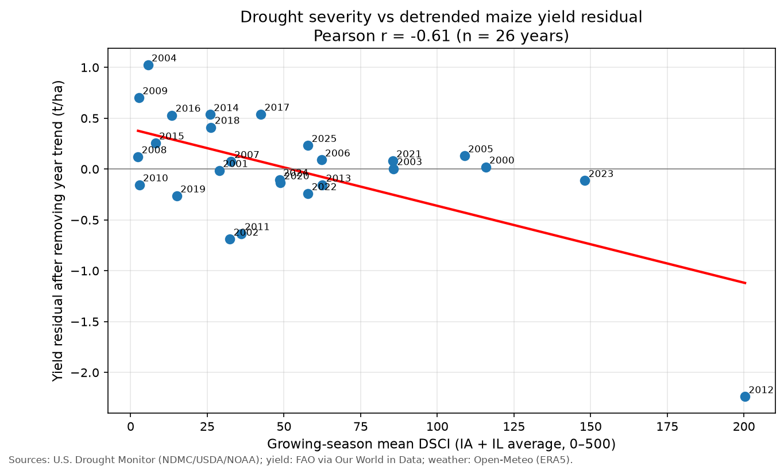
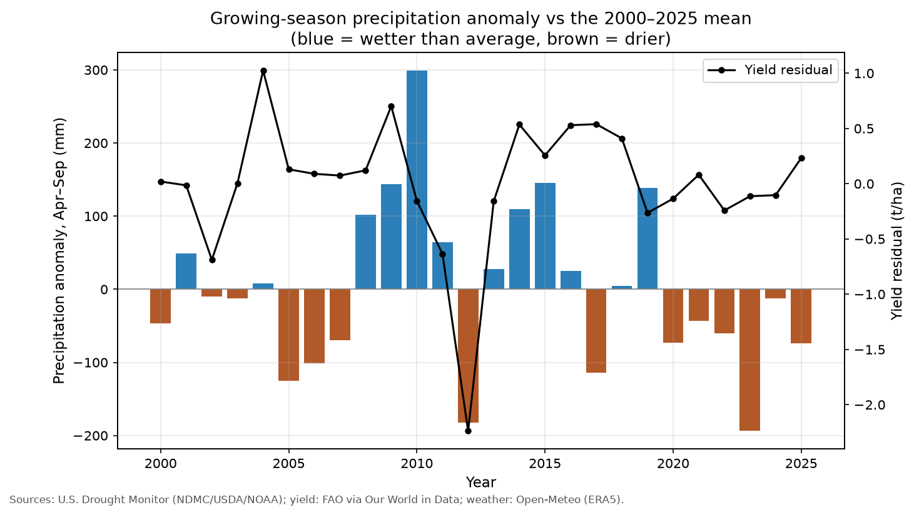
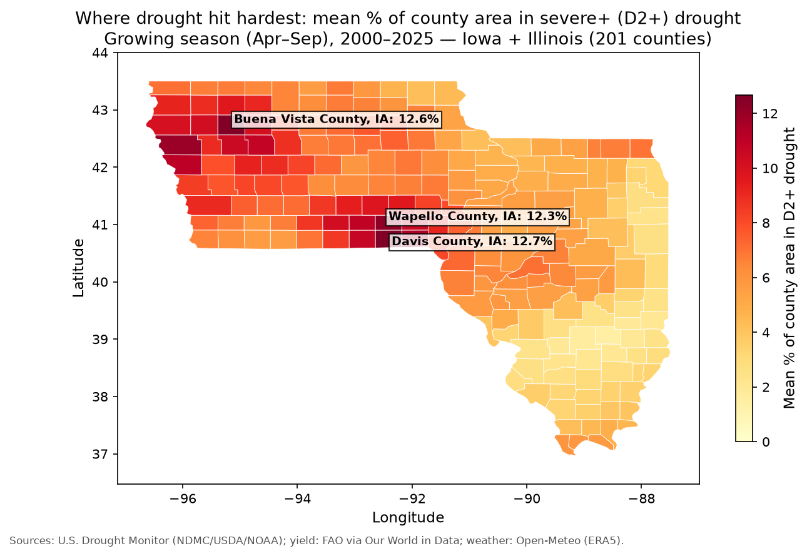
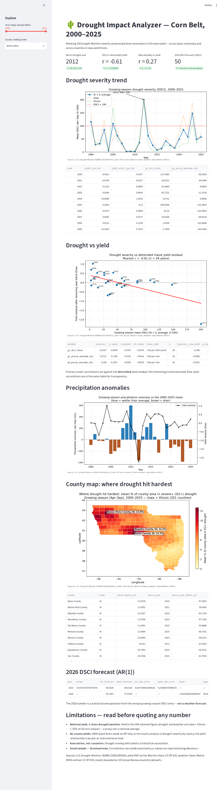

# Day 17 — Drought Impact Analyzer

> **60-Day Data Analytics + AI Portfolio, Day 17.**
> Relating drought severity and precipitation anomalies to US maize
> (corn) performance across counties and years, 2000–2025.

## Problem

A grower, buyer or planner who wants to know whether drought actually
moves the US corn harvest has three separate histories — the weekly US
Drought Monitor, daily Corn Belt weather, and annual national yield — in
three different shapes. This project joins them once, in the open: 26
years of weekly drought severity (DSCI and % area in each D0–D4 class)
for Iowa and Illinois, growing-season precipitation anomalies from the
same two states, and national maize yield. It asks how much of the
year-to-year yield variation drought explains once the long technology
trend is removed — and shows, on a county map, where drought hits hardest.

**Research questions**

1. How strongly is growing-season drought severity (DSCI) associated with
   US maize yield once the technology trend is removed — and how does that
   compare with the precipitation-anomaly association?
2. Which years and which counties were hit hardest by drought, and what
   happened to yield in the worst drought years (2012 first)?
3. Can a simple AR(1) on annual growing-season DSCI beat the naive
   last-year forecast — and what does it say for 2026?

## Dataset

| Source | What | Window | Rows | Access |
|---|---|---|---|---|
| U.S. Drought Monitor REST API (`usdmdataservices.unl.edu/api/`, no key) | Weekly state DSCI (IA FIPS 19, IL FIPS 17); weekly % area in D0–D4 for all 201 IA + IL counties | 2000–2025 | 1,357 weeks/state; ~270,000 county-weeks | 2026-11-24 |
| Our World in Data "Maize yields" (FAO data, CC BY 4.0) | USA annual maize yield, t/ha | 2000–2025 | 26 | 2026-11-23 (via Day 16) |
| Open-Meteo ERA5 archive (CC BY 4.0, no key) | Daily precipitation, Iowa + Illinois centroids | 2000–2025 | 9,497 days/state | 2026-11-23 (via Day 16) |
| US Census Bureau via plotly datasets (public domain) | County boundaries (GeoJSON, 3,221 counties) | — | 201 IA + IL counties used | 2026-11-24 |

DSCI (Drought Severity and Coverage Index) = 1×D0 + 2×D1 + 3×D2 + 4×D3 +
5×D4 on exclusive area shares (equivalently D0+D1+D2+D3+D4 on the API's
cumulative columns), range 0–500. D0 = abnormally dry, D1 = moderate,
D2 = severe, D3 = extreme, D4 = exceptional drought. Growing season =
April–September. Yield is shown in t/ha (1 t/ha = 15.93 bu/acre).

**County yields are not in this build:** USDA Quick Stats needs an API key
(HTTP 401 without one), so county-level crop performance is out of scope.
The county analysis is drought severity by county; the yield relationship
is by year at state/national level. See `research_brief.md` §1b and
Limitations below.

## Tools

Python 3.12.3 — pandas 3.1.1, numpy 2.5.4, matplotlib 3.11.2, streamlit
1.66.1, requests 2.34.2, scikit-learn 1.9.1, scipy 1.18.1 (all pinned in
`requirements.txt`). No plotly, no geopandas — the county choropleth is
drawn from the GeoJSON polygons with matplotlib.

## Method

1. **Fetch** — 2 state-DSCI calls + 6 county calls (3 year-blocks per
   state) from the USDM REST API; yield + weather copied from Day 16's
   committed raw files (verified 2026-11-23, not re-fetched).
2. **Aggregate** — per state-year: growing-season mean/max DSCI, weeks
   with DSCI ≥ 100; per county-year: growing-season mean % area in D1+/
   D2+/D3+ and the DSCI proxy; per state-year: growing-season and July
   precipitation totals and anomalies vs the 2000–2025 mean.
3. **Detrend** — yield residual = yield − OLS fit of yield on year
   (trend +0.116 t/ha/yr). All correlations use the residual as the
   primary result; raw-yield correlations are reported alongside.
4. **Relate** — Pearson r + p-value + OLS slope for exactly three pairs:
   (a) growing-season DSCI vs yield residual, (b) growing-season
   precipitation anomaly vs yield residual, (c) July precipitation
   anomaly vs yield residual.
5. **Forecast** — AR(1) on annual growing-season DSCI: backtested on 2025
   (fit 2000–2024), then refit on all 26 years for a 2026 forecast with a
   ±1 residual-std interval. Labelled a statistical extrapolation, not a
   weather forecast.

## Key insights

1. **Drought severity tracks detrended yield closely: r = −0.61,
   p = 0.0009, R² = 0.38 (n = 26).** Each extra 100 DSCI points in the
   growing season is associated with about 0.76 t/ha (12 bu/acre) less
   yield. The raw-yield correlation is far weaker (r = −0.30, p = 0.14)
   — the technology trend masks the drought signal until it is removed.
2. **Rain totals alone do not explain yield.** Growing-season
   precipitation anomaly vs detrended yield: r = +0.27, p = 0.18; July
   rain alone: r = +0.24, p = 0.23. The Drought Monitor's blend (rain,
   temperature, soil moisture, impacts) carries more yield signal than
   rain totals alone. The contrast year is 2023: a bigger rain deficit
   than 2012 (−194 mm vs −183 mm) but near-normal July rain (+3 mm vs
   −70 mm in 2012) — and yield only 0.11 t/ha below trend, vs 2.24 t/ha
   below trend in 2012.
3. **2012 is the case study.** Growing-season DSCI 200.4 (Iowa 204.2,
   Illinois 196.6), 30 weeks with DSCI ≥ 100, rain −183 mm (−31%),
   yield 7.73 t/ha — the lowest in 26 years, 2.24 t/ha below trend.
   Worst-hit county that year: Massac County, IL (73.9% of the county
   in D2+ drought).
4. **Geography: Iowa took the worst of it.** The 15 hardest-hit counties
   by 26-year mean D2+ share are all in Iowa — Davis County tops the
   ranking (12.7% of area in D2+ on average; worst year 2023, 67.3%).
   The single worst county-year is Woodbury County, IA in 2023 (97.7% of
   the county in D2+ drought). Southern Illinois is the least exposed
   (Hancock County, IL leads the state at 7.2%).
5. **The 2026 DSCI forecast is 50.2 (interval 1.8–98.5)** — a near-average
   year, but the AR(1) barely beats the naive last-year forecast on the
   2025 backtest (absolute error 8.8 vs 9.3 DSCI points), so the interval
   is wide and the forecast is barely more informative than the mean.

Full findings: [`outputs/insights_summary.md`](outputs/insights_summary.md).

## Visuals

### Drought severity trend



### Drought vs detrended yield



### Precipitation anomalies



### County map — where drought hit hardest



## Dashboard preview



Run it locally: `streamlit run src/app.py` (from this folder).

## How to run

```bash
python -m venv .venv
source .venv/bin/activate
pip install -r requirements.txt
python -m src.data_pipeline --live     # fetch + build processed files
python -m src.analysis                 # detrend, correlations, AR(1)
python -m src.make_charts              # the 4 charts
streamlit run src/app.py               # dashboard
pytest tests/ -q                       # 34 tests
```

Offline replay (no network — county aggregates rebuild from the committed
processed file): `python -m src.data_pipeline --offline`.

## Limitations

- **National yield, 2-state drought/weather.** Yield is the USA national
  figure; drought and weather are Iowa + Illinois (~35% of US corn
  output) — a proxy, not a national average.
- **No county yields.** USDA Quick Stats needs an API key, so the county
  analysis is drought severity by county; the yield relationship is by
  year at state/national level.
- **Association, not causation.** Drought moving with yield is a
  statistical association.
- **Small sample — 26 annual rows.** Correlations carry wide uncertainty;
  p-values are reported alongside every r. The AR(1) 2026 forecast is a
  statistical extrapolation, not a weather forecast.
- **County raw files not committed.** The weekly county CSVs (~24 MB
  total) exceed the data-size rule; the committed `county_year.csv`
  aggregates are the auditable record (see `data/README.md`).

## License

MIT — see [LICENSE](LICENSE). Copyright (c) 2026 Victor.
