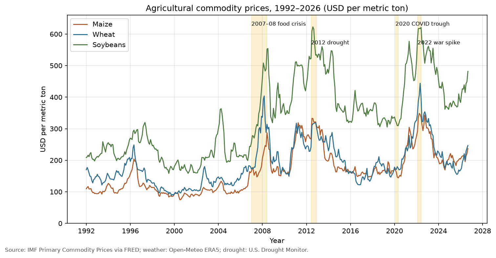
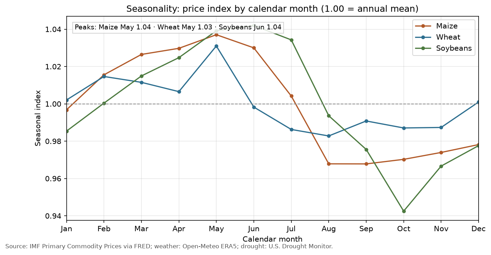
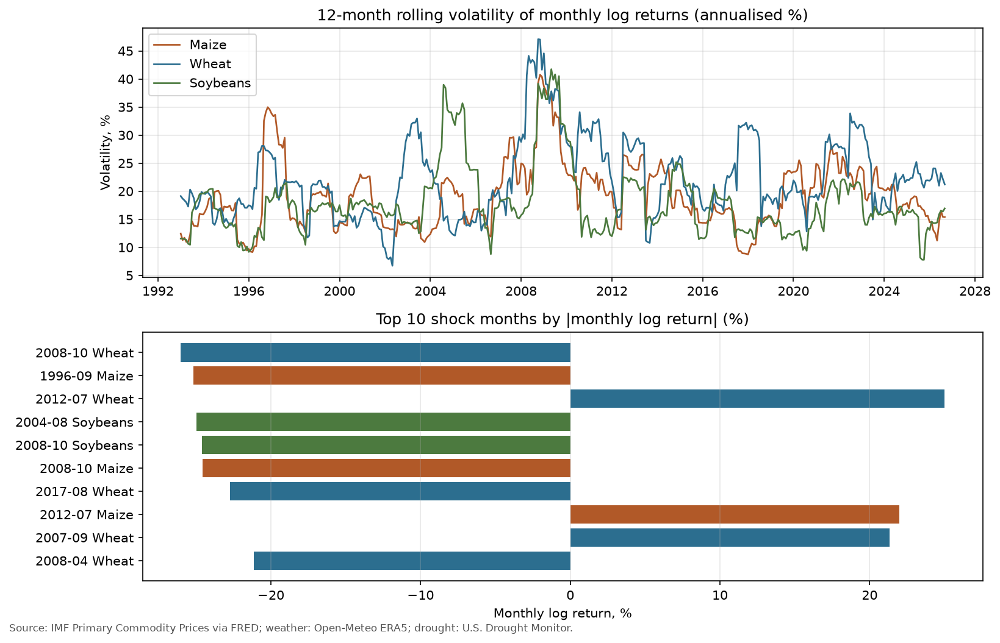
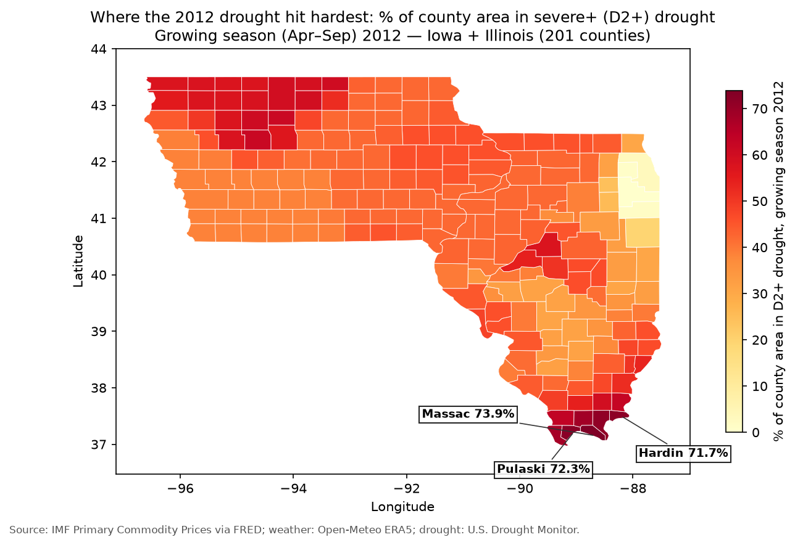
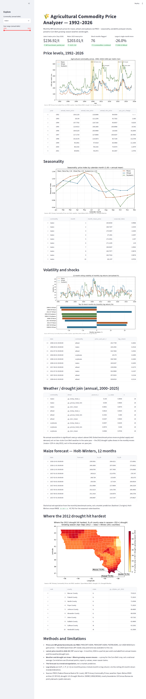

# Day 18 — Agricultural Commodity Price Analyzer

> **60-Day Data Analytics + AI Portfolio, Day 18.**
> Monthly IMF benchmark prices for maize, wheat and soybeans (1992–2026) —
> seasonality, variability and past shocks, joined to Corn Belt
> growing-season weather and drought.

## Problem

A grower, buyer or planner deciding when to sell, store or buy grain needs
to know three things: when prices usually rise and fall within the year,
how violently they can move, and what past shocks looked like. This project
answers all three from one open series — 34 years of monthly IMF benchmark
prices for maize, wheat and soybeans via FRED — then joins the annual price
moves to Corn Belt growing-season weather and drought, so the 2012 drought
spike and the 2022 war spike can be read against the conditions that
produced them.

## Dataset

- **Prices:** IMF Primary Commodity Prices via FRED (Federal Reserve Bank
  of St. Louis), `fredgraph.csv`, no key. Series `PMAIZMTUSDM` (maize),
  `PWHEAMTUSDM` (wheat), `PSOYBUSDM` (soybeans), USD per metric ton,
  monthly, 1992-01 → 2026-09, 417 months per commodity. Fetched
  2026-11-25. **Latest month is 2026-09** (IMF source lags ~2 months);
  2026 is a partial year (Jan–Sep) and is excluded from annual means and
  the weather/drought join.
- **Weather:** Open-Meteo ERA5 archive, Iowa + Illinois centroids, daily
  2000–2025 — copied from Day 16's committed raw files (verified
  2026-11-23). Growing-season (Apr–Sep) aggregates.
- **Drought:** US Drought Monitor state DSCI, Iowa + Illinois, weekly
  2000–2025 — copied from Day 17's committed raw files (verified
  2026-11-24). Growing-season mean DSCI.
- **County map:** Day 17's committed `county_year.csv` (county × year
  growing-season D2+ share), 2012 rows reused for the shock-year map.
- **USDA Quick Stats was NOT used:** its API returns HTTP 401 without a
  key and no key was available to this run. Prices here are IMF global
  benchmarks, not USDA NASS farm-gate prices — they move with the same
  shocks as US farm prices but are not state-level and are not farm-gate.

## Setup

```bash
python3 -m venv .venv
.venv/bin/pip install -r requirements.txt
```

## How to run

```bash
# Live fetch from FRED, then build all processed tables
.venv/bin/python -m src.data_pipeline --live
# Replay from the committed raw files (no network)
.venv/bin/python -m src.data_pipeline --offline
# Rebuild the four charts
.venv/bin/python -m src.make_charts
# Dashboard
.venv/bin/streamlit run src/app.py
# Tests (31 tests, coverage threshold 30)
.venv/bin/python -m pytest --cov=src --cov-fail-under=30
```

## Findings

**1. Seasonality is small and pre-harvest — prices peak in late spring,
trough at harvest.** Seasonal index (1.00 = annual mean, full window
1992–2026): maize peaks in **May (1.037)** and troughs in **September
(0.968)**, amplitude 0.069; wheat peaks in **May (1.031)**, troughs in
**August (0.983)**, amplitude 0.048; soybeans peak in **June (1.042)**,
trough in **October (0.942)**, amplitude 0.099. The pattern is stable:
on the last 10 full years (2016–2025) maize still peaks in May (1.053)
and wheat in May (1.086); soybeans peak in May (1.035) instead of June.
The seasonal swing is worth roughly 5–10% — real money on a harvest,
but small next to the shocks below.

**2. The shocks dwarf the seasons — wheat fell 69.7% peak-to-trough.**
Worst drawdowns: wheat **−69.65%** (Mar 2008 → Nov 2016), maize
**−63.21%** (May 1996 → Jul 2000), soybeans **−50.99%** (Aug 2012 →
May 2019). 76 shock months flagged (|monthly log return| ≥ 2× the
rolling 24-month return std): maize 21, wheat 30, soybeans 25. Largest
single-month moves: wheat **−26.0%** (Oct 2008), maize **−25.2%**
(Sep 1996), wheat **+25.0%** (Jul 2012). Named windows, maize:
2007–08 food-price crisis **+73.85%** (Jan 2007 → Jun 2008); 2012 US
drought **+15.49%** (Jun → Dec 2012); 2020 COVID trough **−14.67%**
(Feb → May 2020); 2022 Russia–Ukraine war spike **+14.71%** (Feb →
Jun 2022). Volatility clusters around shocks: maize 12-month rolling
volatility peaked at ~40% annualised in 2008–09.

**3. The annual weather/drought join finds no significant association —
the honest null result.** Across 26 annual points (2000–2025), YoY
price change vs growing-season temperature, precipitation and DSCI:
every |r| ≤ 0.15, every p-value above 0.46. The maize OLS regression
on DSCI + precipitation anomaly has R² = 0.016 (p = 0.552 / 0.647).
Global benchmark prices move on global supply and demand, not on
two-state Corn Belt weather in the same year. The 2012 drought *does*
show in the monthly data — maize jumped +22.0% in July 2012 alone,
the largest positive maize month in the series — but the 2012 annual
mean rose only +2.26% YoY because prices were already high in 2011.
In 2012 the Corn Belt averaged a growing-season DSCI of 200.4 with
precipitation 182.7 mm (−30.7%) below the 2000–2025 mean, and Massac
County, IL had 73.9% of its area in severe+ (D2+) drought. Cross-
commodity, the three crops move together: monthly log-return
correlations maize–soybeans 0.624, maize–wheat 0.546, wheat–soybeans
0.481 (full window; similar over the last 10 years).

**Forecast (labelled extrapolation, not a market prediction).**
Holt-Winters on monthly maize prices, 12 months ahead (Oct 2026 →
Sep 2027): **$239.56/t in Oct 2026** rising to **$252.31/t in May 2027**
and easing to **$240.81/t by Sep 2027** (80% interval ±$33.14/t).
Backtest on 3 origins: Holt-Winters mean RMSE **$23.38/t** vs **$41.74/t**
for the seasonal-naïve baseline (same month last year).

## Recommendation

**Sell into the late-spring peak and do not count on the weather to
tell you the annual price.** The seasonal edge is 5–10% (maize peaks
in May, troughs at harvest in September); the drawdown risk is 50–70%.
A planner should treat May as the selling window, keep storage for the
harvest trough, and hedge the shock risk — the 2008 and 2012 moves show
a single month can move prices 25%. The weather/drought join is not a
pricing signal at the annual level: use the monthly shock watch (this
dashboard's shock table) instead of an annual weather model.

## Visuals









## Dashboard preview



## Validation

- `pytest` — 31 tests passed (see `tests/`), coverage **33.33%**
  (threshold 30); black + ruff + mypy clean; `orchestrator validate` 11/11.
- Hand-validated metric: maize price for **2012-09 = $320.705906/t**,
  recomputed directly from `data/raw/fred_maize.csv` — exact match
  (diff 0.0) with `data/processed/monthly_prices.csv`.
- Streamlit smoke test: HTTP 200 on `/` and `/_stcore/health`, real
  screenshot captured (see `screenshots/dashboard.png`).
- Offline pipeline run reproduces the processed files; `data_source.json`
  records the live provenance and is not clobbered by offline runs.

## Limitations

- **Global benchmarks, not farm-gate prices.** USDA Quick Stats needs
  an API key (none available); a future run with a key could swap in
  NASS state prices without changing the pipeline shape.
- **Latest price month is 2026-09** (IMF lag ~2 months); 2026 is
  partial and excluded from annual statistics.
- **Weather/drought join is annual, 2-state, 26 years.** Iowa +
  Illinois are a proxy for the Corn Belt crop, not a national average;
  correlations carry wide uncertainty and are associations, never
  causal claims.
- **The forecast is a statistical extrapolation** from a monthly global
  benchmark series, not a market prediction.
- Log returns are ln(P_t / P_{t-1}) on monthly prices. A shock month is
  |log return| ≥ 2× the rolling 24-month return standard deviation.

## Attribution

- Prices: IMF Primary Commodity Prices via FRED (Federal Reserve Bank
  of St. Louis). Weather: Open-Meteo ERA5 archive (CC BY 4.0).
  Drought: U.S. Drought Monitor (NDMC/USDA/NOAA). County boundaries:
  US Census Bureau via plotly datasets (public domain).
- NOAA GHCN-daily is recorded as the roadmap's "NOAA weather"
  cross-check; it was not fetched (Open-Meteo already supplies the
  same daily fields).
