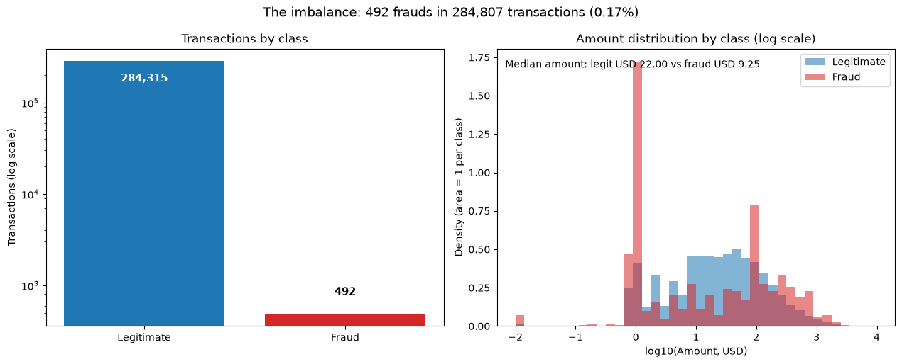
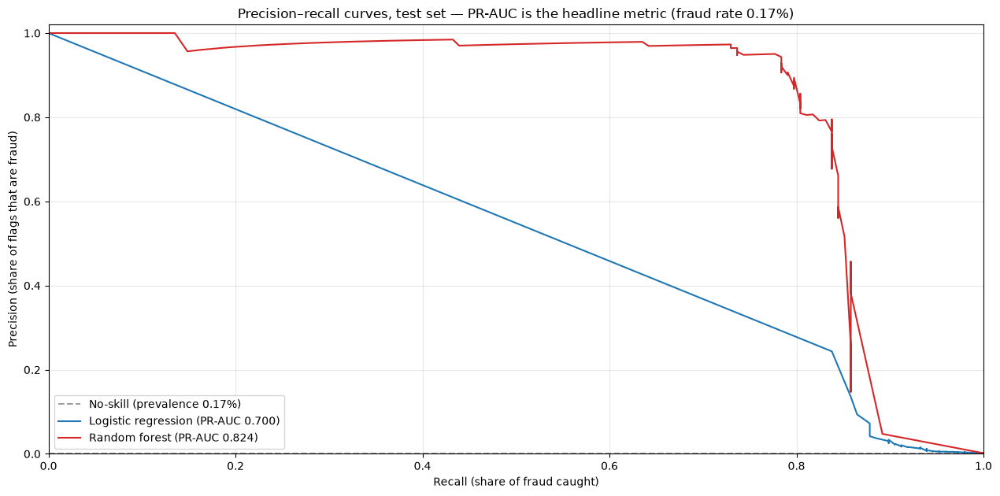
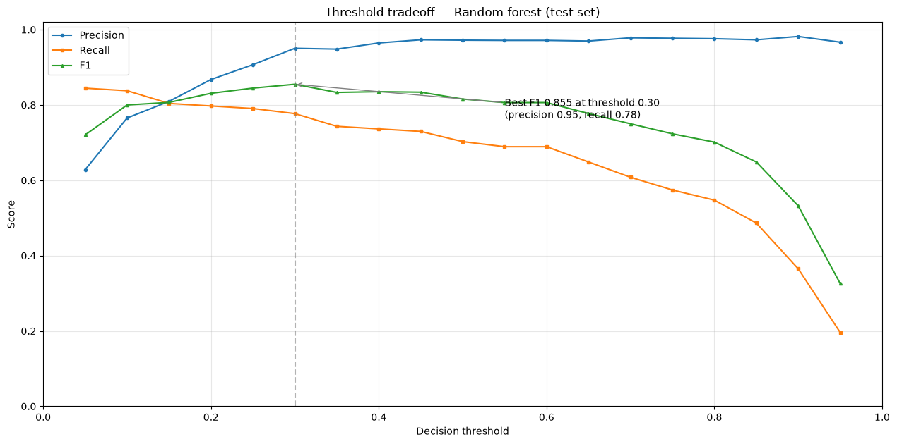
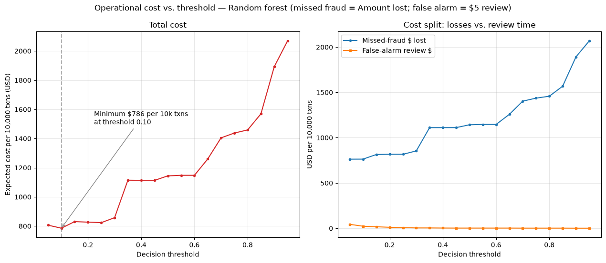
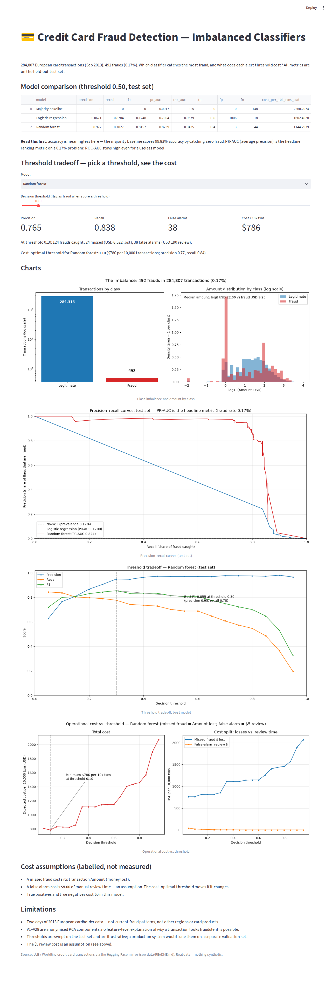

# Day 19 — Credit Card Fraud Detection

> **60-Day Data Analytics + AI Portfolio, Day 19.**
> Train imbalanced classifiers and compare recall, precision, and the
> operational cost of false alarms. Deliverable: fraud detection metrics
> panel with threshold tradeoffs.

## Problem

A card issuer sees 284,807 transactions in two days, of which 492
(0.17%) are fraud. A model that predicts "never fraud" is 99.83%
accurate — and catches nothing. The questions: which imbalanced
classifier catches the most fraud while keeping false alarms
manageable, how do precision and recall trade off as the decision
threshold moves, and what does each threshold cost in dollars?

## Dataset

- **Source:** the classic ULB / Worldline credit-card fraud dataset
  (European cardholders, two days in September 2013), fetched from the
  verified no-key Hugging Face mirror
  `RS2k03/creditcard-fraud-dataset`
  (`creditcard.csv`, accessed 2026-11-26). Kaggle hosts the same file
  but requires an account/API key, which was not available.
- **Fingerprint (verified after download):** 284,807 rows, 492 frauds
  (0.1727%), Time 0–172,792 s, Amount $0.00–$25,691.16, md5
  `e90efcb83d69faf99fcab8b0255024de` — an exact match to the published
  Kaggle fingerprint. Columns: Time, V1–V28 (PCA components), Amount,
  Class (1 = fraud).
- **Commit rule:** the raw file is 144 MB, so it is NOT committed — it
  is a git-ignored local cache in `data/raw/` and is re-downloaded by
  `src/data_pipeline.py --live`. Only the small processed tables are
  committed (see `data/README.md`). Real data only — nothing synthetic.
- **Attribution:** Dal Pozzolo et al., ULB Machine Learning Group /
  Worldline. See `data/README.md` for provenance and the licence note.

## Tools

Python 3.12.3; pandas 3.1.1, numpy 2.5.4, scikit-learn 1.9.1,
matplotlib 3.11.2, streamlit 1.66.1, requests 2.34.2 (see
`requirements.txt`, all pinned). Tests: pytest 9.2.0 + pytest-cov 7.1.0.

## Method

1. Stratified 70/30 train/test split (seed 42) — the 0.1727% fraud rate
   is preserved in both halves (test set: 85,443 rows, 148 frauds).
2. Features V1–V28 plus standardised Amount and Time.
3. Three models: a majority baseline (predict every transaction legit),
   logistic regression (`class_weight="balanced"`), and a random forest
   (200 trees, `class_weight="balanced_subsample"`, seed 42).
4. Metrics on the held-out test set at threshold 0.50, plus a threshold
   sweep (0.05–0.95) for the best model and logistic regression.
   **PR-AUC (average precision) is the headline ranking metric** —
   ROC-AUC stays high even for a useless model on a 0.17% problem.
5. Cost model (assumptions labelled): a missed fraud costs its
   transaction Amount; a false alarm costs **$5.00** of manual review
   time (assumption, not a measured figure). Cost is reported per 10,000
   transactions.

## Key insights

- **Random forest wins on PR-AUC (0.824 vs 0.700 for logistic
  regression)** — but logistic regression wins on ROC-AUC (0.968 vs
  0.944). The two rankings disagree, which is exactly why PR-AUC is the
  headline metric here.
- **At threshold 0.50 the forest is precise but leaky:** precision
  0.972, recall 0.703 (104 of 148 test frauds caught, 3 false alarms,
  $9,762.19 of fraud missed). Logistic regression catches more fraud
  (recall 0.878, 130 of 148) but flags 1,806 legitimate transactions
  to do it (precision 0.067).
- **The majority baseline is the accuracy trap:** 99.83% accurate,
  zero fraud caught, $19,311.89 of test-set fraud missed — the most
  expensive option at $2,260.21 per 10,000 transactions.
- **Dropping the forest's threshold to 0.10 is cheapest overall:**
  recall rises to 0.838 (124 of 148 caught), precision 0.765 (38 false
  alarms), and cost falls to **$785.58 per 10,000 transactions** —
  the sweep minimum (vs $1,144.29 at 0.50). Best F1 (0.855) sits at
  threshold 0.30 (precision 0.950, recall 0.777).
- **Recommendation:** run the random forest at threshold 0.10 for the
  alert queue — but re-tune the threshold on a separate validation set
  before production use (the sweep here is on the test set, so it is
  illustrative).

## Visuals









## Dashboard preview



Run the panel locally with `streamlit run src/app.py` — it reads the
processed tables and includes a live threshold slider.

## How to run

```bash
python -m venv .venv
source .venv/bin/activate
pip install -r requirements.txt
python src/data_pipeline.py --live     # download (one GET) + build
python src/data_pipeline.py --offline  # replay from the cached raw file
python src/make_charts.py
streamlit run src/app.py
pytest --cov=src --cov-fail-under=30
```

## Limitations

- Two days of 2013 European cardholder data — not current fraud
  patterns, not other regions or card products.
- V1–V28 are anonymised PCA components: no feature-level explanation
  of *why* a transaction looks fraudulent is possible.
- Thresholds are swept on the test set and are illustrative; a
  production system would tune them on a separate validation set.
- The $5 false-alarm review cost is an assumption; the cost-optimal
  threshold moves if it changes.
- Test results are recorded in `test_report.md` (pytest count, coverage,
  mypy/ruff/black, validate score, smoke test).

## License

MIT — see [LICENSE](LICENSE). Copyright (c) 2026 Victor.
