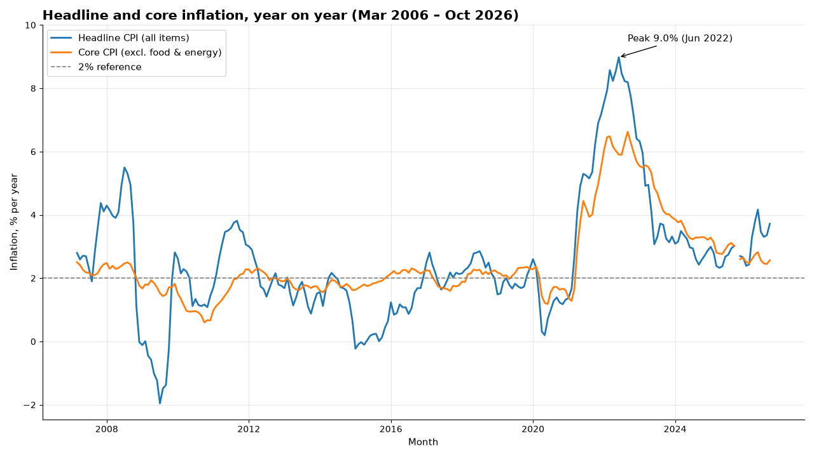
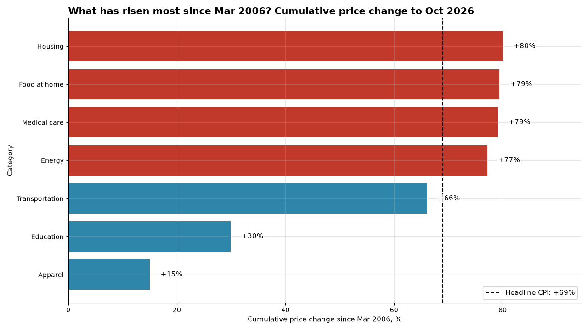
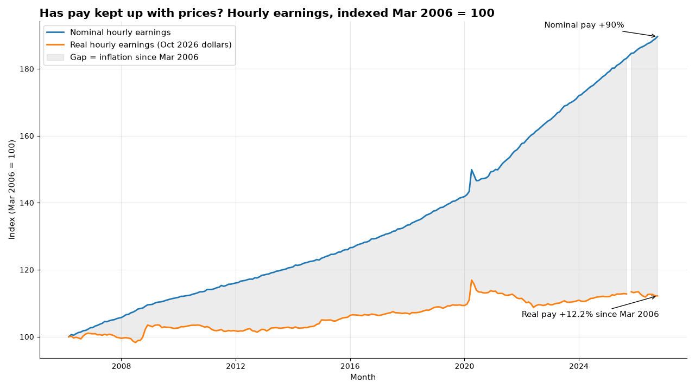
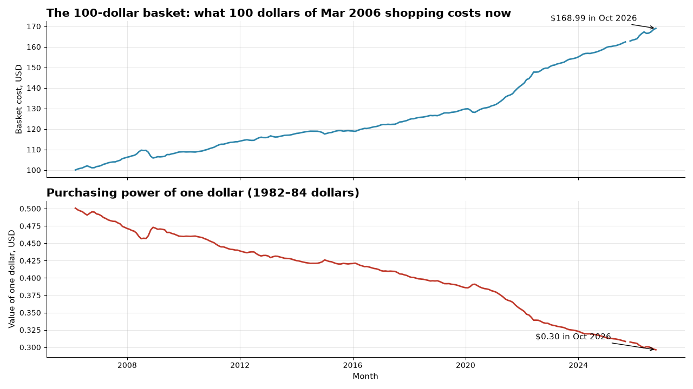
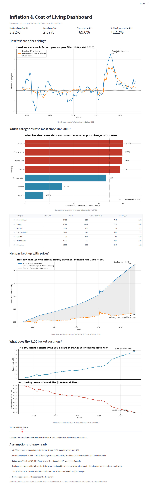

# Day 20 — Inflation & Cost of Living Dashboard

> **60-Day Data Analytics + AI Portfolio, Day 20.**
> Purchasing-power dashboard: consumer prices vs. earnings, Mar 2006 – Oct 2026.

## Problem

Prices have risen unevenly since 2006 while pay has not kept pace in every
period. A single headline CPI number hides the story: medical care, housing
and food have compounded far faster than apparel, energy whipsaws, and
nominal pay rises can be wiped out by inflation. This dashboard answers:

1. How fast have consumer prices risen overall — and in each spending
   category — since March 2006?
2. Has the average worker's pay actually kept up with prices, in real
   (inflation-adjusted) terms?
3. What does a fixed $100 basket from March 2006 cost today, and what is a
   dollar worth now?

**Audience:** a household budgeter / personal-finance reader deciding how
to think about pay rises, savings and spending — and any analyst who needs
a plain, sourced picture of what inflation has done to purchasing power.

## Dataset

- **Source:** U.S. Bureau of Labor Statistics via FRED (Federal Reserve
  Bank of St. Louis). Endpoint:
  `https://fred.stlouisfed.org/graph/fredgraph.csv?id=<SERIES_ID>` — no
  API key. Accessed 2026-11-27. Full provenance: [data/README.md](data/README.md).
- **Series (10):** headline CPI (CPIAUCSL), core CPI (CPILFESL), food at
  home, energy, housing, transportation, apparel, medical care, education
  (all CPI-U, seasonally adjusted, 1982–84 = 100) plus average hourly
  earnings, total private (CES0500000003).
- **Window:** Mar 2006 – Oct 2026, 248 months. **Latest data: October
  2026** (FRED lag ≈ 1 month; November 2026 CPI is released 2026-12-10).
- **Headline CPI history back to 1947** is kept separately
  (`data/processed/cpi_history.csv`) for context only.

## Tools

Python 3.12.3; pandas 3.1.1, numpy 2.5.4, matplotlib 3.11.2, streamlit
1.66.1, requests 2.34.2, pytest 9.2.0, pytest-cov 7.1.0, scipy 1.18.1.
See [requirements.txt](requirements.txt). No model is trained on this day
(descriptive analysis only).

## Method

1. Fetch the 10 FRED series (`src/data_pipeline.py --live`, or
   `--offline` from the committed raw cache) and build the joint monthly
   panel, 2006-03 → 2026-10.
2. Compute YoY/MoM inflation, cumulative change since Mar 2006, real
   hourly earnings (nominal ÷ headline CPI × 100), the fixed $100 basket
   cost and the purchasing power of $1 (`src/analysis.py` — pure functions,
   fully tested).
3. Draw 4 charts from the processed CSVs only (`src/make_charts.py`) and
   serve the dashboard (`src/app.py`, Streamlit, processed CSVs + charts
   only).

## Key insights

- **Prices +69.0% since Mar 2006** (CPI 199.70 → 337.48). The fixed $100
  basket costs **$168.99** in Oct 2026; $1 (1982–84) is worth **$0.30**.
  Inflation peaked at **8.98% YoY in Jun 2022**; latest readable YoY is
  **3.72% (Sep 2026)**.
- **Essentials outran the average:** housing **+80.0%**, food at home
  **+79.4%**, medical care **+79.1%** since Mar 2006, vs. apparel **+15.0%**
  and education **+29.9%**. Energy is the live driver: **+20.4% YoY
  (Sep 2026)**.
- **Real pay is up only +12.2% in twenty years** ($10.04 → $11.26 in
  1982–84 dollars) despite nominal pay rising +89.6% — and real pay
  **fell 0.54% YoY in Sep 2026** as energy-driven inflation outran pay.
- Full findings + recommendation: [outputs/insights_summary.md](outputs/insights_summary.md).

## Visuals









## Dashboard preview



Run it locally: `streamlit run src/app.py` (see below).

## How to run

```bash
python -m venv .venv
source .venv/bin/activate
pip install -r requirements.txt
python -m src.data_pipeline --live      # or --offline from the raw cache
python -m src.make_charts
streamlit run src/app.py
pytest tests/ -q
```

## Assumptions (clearly labeled, as the roadmap requires)

1. All CPI series are seasonally adjusted BLS series via FRED; index base
   1982–84 = 100.
2. Analysis window Mar 2006 – Oct 2026 (set by earnings availability);
   headline CPI back to 1947 is context only.
3. Latest data October 2026 (FRED lag ≈ 1 month); not yet November.
4. Real earnings use headline CPI as the deflator; no tax, benefits, or
   hours-worked adjustment — hourly wage only, all private employees.
5. The "$100 basket" is a fixed-basket illustration (no substitution, no
   BLS weight changes).
6. No forecast is made — this dashboard is descriptive.
7. **October 2025 CPI was never published** (2025 lapse in
   appropriations), so the October 2026 year-on-year change is undefined;
   the latest reported YoY is September 2026. See [data/README.md](data/README.md).

## Limitations

- October 2025 gap (above) also makes the November 2025 month-on-month
  change undefined.
- BLS weights change over time; the fixed basket ignores substitution.
- Real earnings are hourly only — they say nothing about hours worked or
  total take-home pay.

## License

MIT — see [LICENSE](LICENSE). Copyright (c) 2026 Victor.
